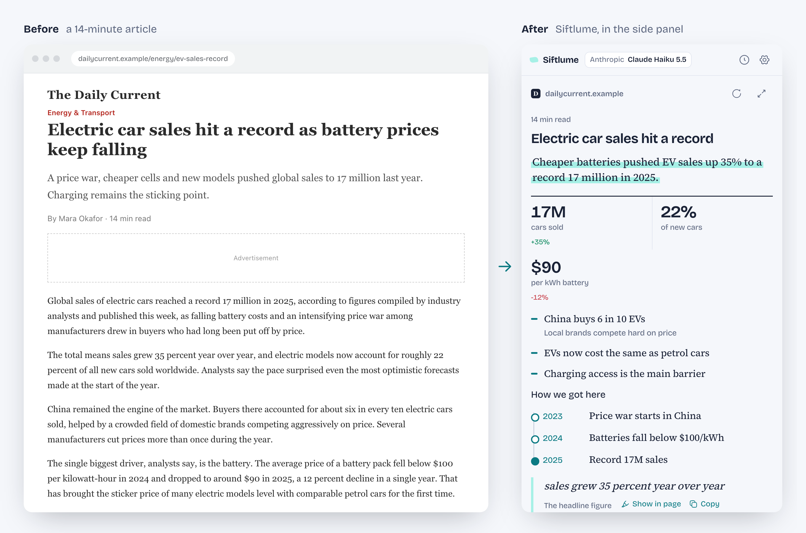
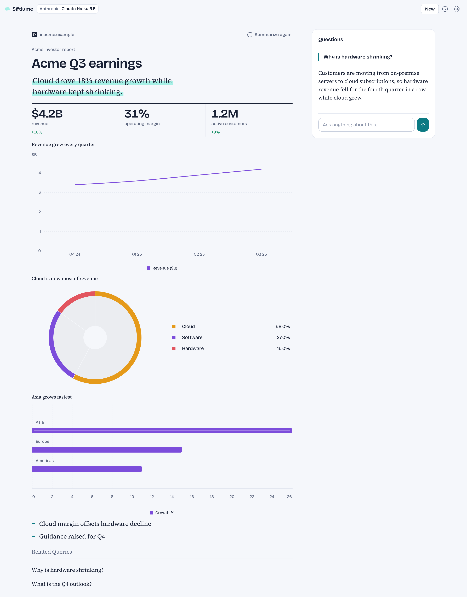
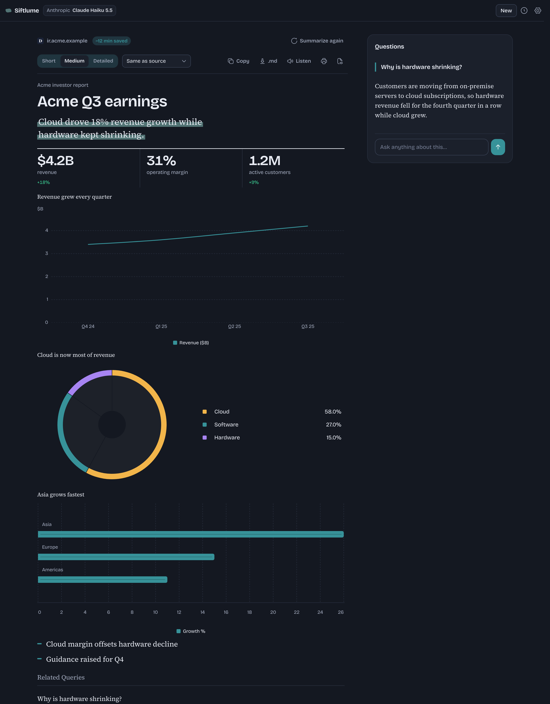
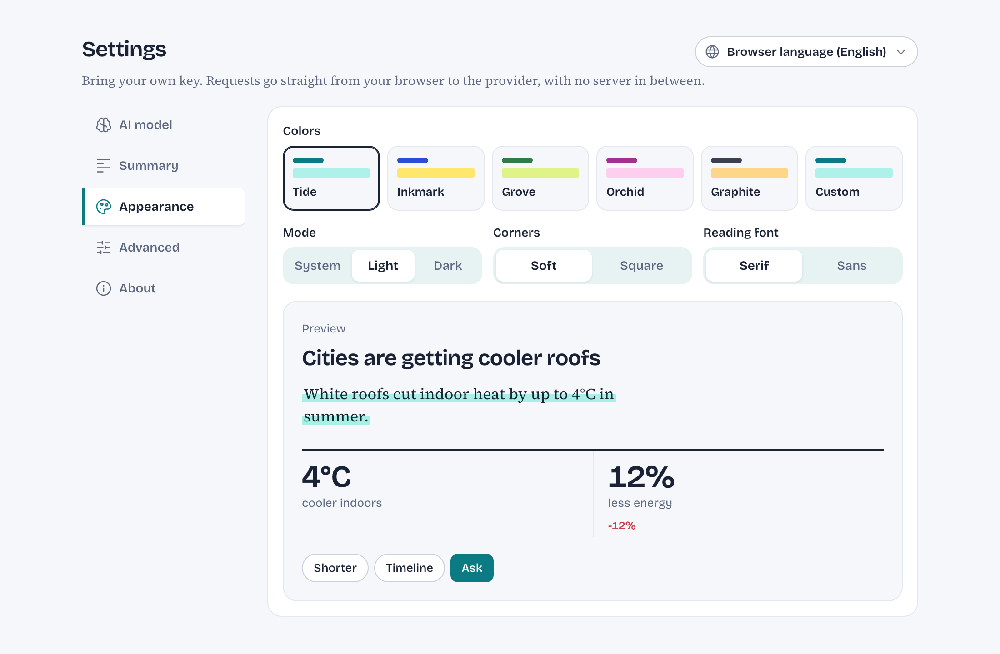

<p align="center">
  
</p>

<h1 align="center">Siftlume</h1>

<p align="center">
  Summarize any page, keep what matters.<br>
  A Chrome extension that turns web pages, text and files into visual, interactive summaries built with <a href="https://www.openui.com">OpenUI</a>.
</p>

<p align="center">
  <a href="https://chromewebstore.google.com/detail/siftlume/ohbbflajppmdigjgbdhgaphmjidmfafa"></a>
  <a href="LICENSE"></a>
  <a href="CONTRIBUTING.md"></a>
  <a href="https://ko-fi.com/tamnt"></a>
</p>

<p align="center">
  <a href="https://www.producthunt.com/products/siftlume?embed=true&amp;utm_source=badge-featured&amp;utm_medium=badge&amp;utm_campaign=badge-siftlume" target="_blank" rel="noopener noreferrer"></a>
</p>

<p align="center">
  
</p>

Siftlume reads the page you are on, a YouTube video, a GitHub pull request, a Google Doc, Sheet or Slides deck, a PDF, a CSV, or text you paste, and answers with a summary you can scan in seconds: a one-line TL;DR, headline numbers, short takeaways, charts, timelines and diagrams. You can refine it in one click and ask follow-up questions.

It uses your own LLM key, or a small model that runs in the browser with no key. Requests go straight from your browser to the provider you choose; there is no Siftlume server.

## Features

- **Summarize anything**: the open tab (cleaned with Readability), a selection, pasted text, or a file (PDF, CSV, Markdown, TXT, HTML, JSON). Several open tabs compared together, or a page with the links worth following (Deep read). Long reports and books are read part by part, and a **Full** length gives a report that walks through every topic.
- **Pages read their own way**:
  - **YouTube** from the captions; quotes play the video from that moment.
  - **GitHub pull requests** through GitHub's API: what changed and why, grouped by area, review state, CI checks and risks. **Critique** is a code review (findings by severity with `path:line` links into the diff and a suggested fix), **Action** is the merge checklist with owners. An optional read-only token (Settings → GitHub) opens private repositories.
  - **Google Docs, Sheets and Slides** and **PDFs in Google Drive**, from their export inside the tab with your own Google session: documents as Markdown, the open sheet as data with charts and filters, slides with the speaker notes.
  - **Recipes, products, job postings and events** from the page's schema.org data: ingredients with a servings stepper, price and a rating breakdown, salary and requirements, an event card with tickets and "Add to calendar".
- **Visual first**: a TL;DR with a highlighter mark, key figures, takeaways, tags and timelines. Pages with numbers get charts picked from the shape of the data, and processes get diagrams.
- **Two ways to read**: in the **side panel** of the tab you are reading, or in a **new full-page tab** with a Questions column.
- **Four ways to read**: **Summary** for the gist, **Explain** to understand it (how it works, an everyday analogy, misconceptions, terms), **Critique** to judge it (claims checked against the source's own evidence, weak spots, what to verify) and **Action** for what to do (checklist, deadlines, requirements, risks). Every analysis starts as a summary: pick another kind (and the length) before the run, or switch on the result screen. Each session keeps its own kind.
- **A layout that fits the page**: the structure comes from the kind of source (news, review, how-to, research, docs, data, release notes…) instead of one template.
- **Built for the content**: verdicts and pros/cons for reviews, bar lists for rankings, tickable checklists for action items (with owners, due dates and status when the source names them), code review findings by severity, who-is-who cards for news, and a glossary for jargon. Spec sheets, comparison tables and pricing plans for products; risk lists graded by severity; claim checks for news, health and science; status boards and changelogs for projects and release notes; and a question, method, findings and limitations brief for research papers.
- **Deeper analysis**: argument maps for op-eds and debates, cause → event → effect chains, who-thinks-what perspectives, before/after tables for new rules and prices, weighted decision matrices, best/base/worst scenarios, SWOT and 2×2 matrices, step-by-step calculations, code walkthroughs with line notes, hierarchy trees and QR codes for links you will open on your phone.
- **Result tools**: switch the length or language of a summary in place, copy or download it as Markdown (charts become tables, diagrams stay Mermaid), listen to it, print or save it as PDF, see how much reading time it saved, and check the extracted source text.
- **Refine in one click**: Shorter, More detail, Action items, Timeline, Simpler. Styles can also be turned on for every summary in Settings.
- **Ask follow-up questions**, answered only from the source.
- **History you can search and ask**: every summary is kept in the browser, searchable without accents and ranked by relevance, and you can ask a question across everything you have read.
- **Interactive CSV**: filter and group the data in the browser without calling the model again.
- **Source quotes** that scroll to and highlight the passage in the original page.
- **Any provider**: OpenAI, Anthropic, Google Gemini, OpenRouter, Groq, DeepSeek, Mistral, xAI, Together, Ollama, LM Studio, or any OpenAI-compatible endpoint. The model list loads from the provider. AI thinking is off by default (fastest; Settings → Advanced), and Anthropic prompts are cached.
- **No key needed**: download a small model (Gemma or LFM) once in Settings and it runs in the browser on your graphics chip, offline, with nothing leaving your computer.
- **Make it yours**: color presets or your own pen and highlighter colors, corners, reading font, and light, dark or system mode (one click in the header to switch).
- **12 interface languages**: English, Tiếng Việt, 日本語, 简体中文, 繁體中文, 한국어, Español, Français, Deutsch, Português (Brasil), Русский, ไทย. It follows the browser language and falls back to English.

## Screenshots

<table>
  <tr>
    <td width="50%"></td>
    <td width="50%"></td>
  </tr>
  <tr>
    <td>Full-page tab: numbers become charts, questions on the side</td>
    <td>Dark mode</td>
  </tr>
  <tr>
    <td colspan="2"></td>
  </tr>
  <tr>
    <td colspan="2">Settings: color presets, mode, corners and reading font, with a live preview</td>
  </tr>
</table>

The screenshots show the real interface rendering example content. Regenerate them with `pnpm screenshots`.

## Install

**[Add Siftlume to Chrome from the Chrome Web Store](https://chromewebstore.google.com/detail/siftlume/ohbbflajppmdigjgbdhgaphmjidmfafa)**. It also works in other Chromium browsers that install from the Chrome Web Store, such as Edge, Brave and Arc.

1. Click **Add to Chrome**.
2. Click the Siftlume icon in the toolbar (pin it from the puzzle-piece menu so it stays visible). On first run Settings opens with step-by-step instructions to get an API key from the provider you pick. Google Gemini, Groq, OpenRouter and Mistral have free tiers; Ollama and LM Studio run on your computer with no key.
3. Paste the key, click **Save**, then open any article and click the icon to summarize it.

### From source

1. Build it (see [Development](#development)): `pnpm install && pnpm build`.
2. Open `chrome://extensions` and turn on **Developer mode**.
3. Click **Load unpacked** and select `.output/chrome-mv3`.
4. Click the Siftlume icon, open **Settings**, pick a provider, paste your API key and choose a model.

### Local models

- **Ollama**: start it with `ollama serve`, select **Ollama** in Settings, click **Save**, then pick a model that supports chat. No `OLLAMA_ORIGINS` setup is needed.
- **LM Studio**: start the local server (Developer → Start server) and enable CORS.

### Safari (iPhone, iPad, Mac)

Safari extensions ship inside an app, so this needs a Mac with Xcode.

1. `pnpm build:safari` builds the extension into `.output/safari-mv3`.
2. Open `safari/Siftlume/Siftlume.xcodeproj` in Xcode. The project reads the files from `.output/safari-mv3`, so rebuild with step 1 after every change.
3. Pick the **Siftlume (iOS)** scheme and your iPhone (or a Simulator), set your team under Signing & Capabilities, and press Run. A free Apple ID works for your own devices; the App Store needs an Apple Developer account.
4. On the device: Settings → Apps → Safari → Extensions → Siftlume → turn it on and allow it on all websites. In Safari, tap the extensions button in the address bar to open Siftlume.

Safari has no side panel: results always open in a tab, and on a phone the result uses the narrow single-column layout. There is no right-click menu or keyboard shortcut on iOS. If new files appear at the top of `.output/safari-mv3`, regenerate the project with `xcrun safari-web-extension-converter .output/safari-mv3 --rebuild-project safari/Siftlume/Siftlume.xcodeproj`.

## Privacy

Full policy: [tamnt1707.github.io/siftlume/privacy.html](https://tamnt1707.github.io/siftlume/privacy.html).

- API keys are stored only in this browser (`chrome.storage.local`) and are never synced.
- Page content is sent only to the provider you configured, and only when you ask for a summary.
- Google Docs, Sheets, Slides and Drive PDFs are downloaded inside their own tab with your Google session, as File → Download does. GitHub pull requests are read from `api.github.com`; the optional GitHub token stays in this browser and is sent only there.
- Page access comes from `activeTab`, granted for the tab where you click the icon or use the context menu. Host permissions are requested only for the API domain of your provider, when you save Settings, and for the sites of the tabs you pick in "Combine open tabs" (which also asks for the optional `tabs` permission to list them).

## Development

Requirements: Node.js 20 or newer and [pnpm](https://pnpm.io).

```bash
git clone https://github.com/tamnt1707/siftlume.git
cd siftlume
pnpm install
pnpm dev          # opens Chrome with the extension loaded, with hot reload
```

| Command               | What it does                                                                          |
| --------------------- | ------------------------------------------------------------------------------------- |
| `pnpm dev`            | Development build with hot reload (`pnpm dev:firefox` for Firefox)                    |
| `pnpm build`          | Production build in `.output/chrome-mv3`                                              |
| `pnpm zip`            | Zip for the Chrome Web Store                                                          |
| `pnpm build:safari`   | Safari build in `.output/safari-mv3`, wrapped by the Xcode project in `safari/`       |
| `pnpm compile`        | Type-check                                                                            |
| `pnpm check:i18n`     | Every locale has the same keys, plural forms and placeholders as English              |
| `pnpm check:examples` | The OpenUI Lang examples in the prompts parse cleanly and their diagrams render       |
| `pnpm check`          | All of the checks above                                                               |
| `pnpm screenshots`    | Re-render the README screenshots (needs Chrome; set `CHROME_PATH` if it is elsewhere) |

### How it works

```
popup / context menu ──► side panel (per tab) or full-page tab
                              │
  extract ────────────────────┤  Readability + Turndown (HTML), pdf.js (PDF), Papa Parse (CSV),
                              │  schema.org JSON-LD, YouTube captions, GitHub API, Google exports
  prompt ─────────────────────┤  OpenUI library → system prompt + rules     (lib/openui.ts)
  stream ─────────────────────┤  AI SDK, straight to the provider           (lib/llm.ts)
  validate & repair ──────────┤  OpenUI parser + Pele; errors go back once  (lib/generate.ts)
  render ─────────────────────┘  <Renderer> with the Siftlume library       (lib/library.ts)
```

### Project layout

```
entrypoints/
  background.ts        context menus, per-tab side panel, toolbar icon behaviour
  popup/               launcher (new-tab mode)
  app/                 result view: full-page tab, also mounted in the side panel
  sidepanel/           side panel entry
  options/             settings page
components/            React UI: session view, settings (tabs), pickers, theme
lib/
  library.ts           OpenUI component library: registers the chat library + Siftlume components and actions
  genui/               the Siftlume components, one file per group (core, review, product, trust, reasoning, decision…)
  openui.ts            system prompts, inline-mode parsing, validation, edit-mode merge
  generate.ts          streaming and the repair loop
  refine.ts            refine buttons and default styles
  csv-tools.ts         in-browser Query tools for CSV data
  diagram.ts           Mermaid to SVG with Pele
  extractors.ts        HTML, PDF, CSV and Markdown to text (inline-handlers.ts cleans HTML first)
  structured.ts        schema.org recipes, products, job postings and events (JSON-LD)
  youtube.ts           YouTube captions
  github.ts            GitHub pull requests through the REST API
  gdocs.ts             Google Docs, Sheets, Slides and Drive PDFs from their export
  special-page.ts      which pages are read their own way, and their labels
  longread.ts          long sources read part by part
  local-model.ts       in-browser models (WebLLM, transformers.js) and their workers
  llm.ts, models.ts    providers (AI SDK) and live model lists
  settings.ts          settings and the provider list
  appearance.ts        design tokens for the chrome, OpenUI, charts and diagrams
  history.ts           saved sessions (OpenUI Message Protocol), searchable index
  library-search.ts    BM25 search, accents ignored; ask-history.ts asks across them
  i18n/                i18next setup
locales/<lang>/        UI translations, one folder per language
public/_locales/       extension name, description and menus (Chrome i18n)
scripts/               checks used by `pnpm check`, and the screenshot showcase
docs/screenshots/      README images (generated by `pnpm screenshots`)
```

More detailed, generated documentation lives in [`openwiki/`](openwiki/index.md).

## Contributing

Contributions are welcome: bug reports, translations, new providers, components and fixes. [CONTRIBUTING.md](CONTRIBUTING.md) covers the setup, conventions and step-by-step guides for common changes.

## Support

Siftlume is free and open source. If it saves you time, you can support it on [Ko-fi](https://ko-fi.com/tamnt). There is also a link in Settings → About.

## License

[MIT](LICENSE) © 2026 TamNT
