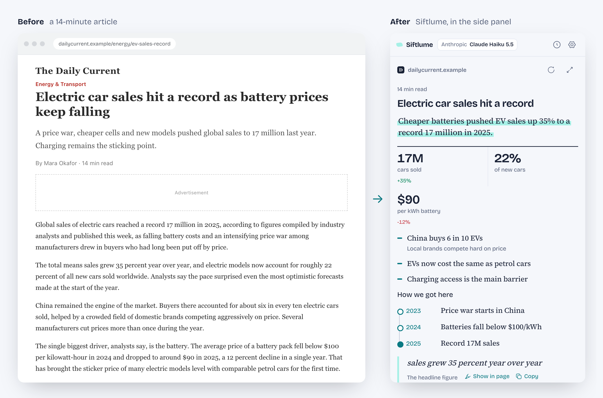

# Siftlume

Summarize any page, keep what matters. A Chrome extension that turns web pages, text and files into visual, interactive summaries, using your own AI provider.

- [Source code and documentation](https://github.com/tamnt1707/siftlume)
- [Privacy policy](privacy.html)
- [Report a problem](https://github.com/tamnt1707/siftlume/issues)
- [Support on Ko-fi](https://ko-fi.com/tamnt)
