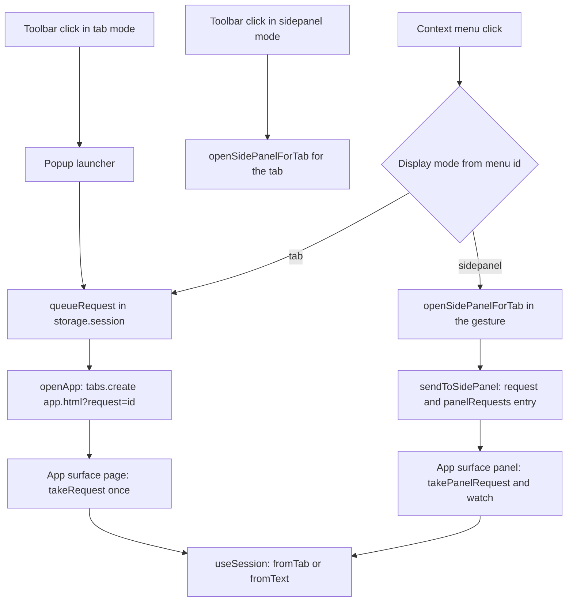

# Extension Surfaces and Routing

The extension has six browser-facing surfaces. A trigger never summarizes anything itself: it
records a *pending request* and picks the surface that will run it. The `display` setting
(`sidepanel` | `tab`) decides which surface that is, and the pending request itself is the only
thing that crosses the process boundary between the trigger and the surface.

## The surfaces

| Surface | Entry file | Role |
| --- | --- | --- |
| Background service worker | `entrypoints/background.ts` | Owns triggers, context-menu sync, side-panel lifecycle. Never renders or summarizes. |
| Context menus | `lib/context-menus.ts` | Two items whose ids encode the display mode. |
| Toolbar action / popup | `entrypoints/popup/Popup.tsx` | Launcher shown only in `tab` mode. |
| Full-page app tab | `entrypoints/app/App.tsx` (`surface="page"`) | The result view. |
| Per-tab side panel | `entrypoints/sidepanel/main.tsx` → `entrypoints/app/App.tsx` (`surface="panel"`) | The same result view, mounted in the panel. |
| Options page | `entrypoints/options/OptionsApp.tsx` | Settings; `browser.runtime.openOptionsPage()`. |

The app and the side panel share one React component. `App` takes a `surface` prop
(`'page' | 'panel'`) and branches on `isPanel`; `entrypoints/app/main.tsx` renders
`<App />` and `entrypoints/sidepanel/main.tsx` renders `<App surface="panel" />`.

## Entrypoint folders are what create the manifest entries

The build tool is **WXT**, and it derives the manifest from the *shape* of `entrypoints/`, not
from `wxt.config.ts` alone. Each top-level folder is matched against WXT's entrypoint globs:

| Folder | Entrypoint type | Manifest entry it produces |
| --- | --- | --- |
| `entrypoints/background.ts` | `background` | `background.service_worker` (`background.js`) |
| `entrypoints/popup/` | `popup` | `action.default_popup` → `popup.html` |
| `entrypoints/sidepanel/` | `sidepanel` | `side_panel.default_path` → `sidepanel.html`, plus the `sidePanel` permission |
| `entrypoints/options/` | `options` | `options_ui` → `options.html` (open in a tab) |
| `entrypoints/app/` | `unlisted-page` | **no manifest entry** — `app.html` is an unlisted page reachable only by URL |

This has a direct operational consequence: **removing or renaming an entrypoint folder changes
the built manifest**, and with it the set of surfaces the browser exposes. Deleting
`entrypoints/popup/` removes `action.default_popup` (the toolbar icon would then always fire
`action.onClicked`); deleting `entrypoints/sidepanel/` removes `side_panel.default_path` and the
`sidePanel` permission, so `browser.sidePanel.*` calls stop working; deleting
`entrypoints/options/` removes `options_ui`, so `browser.runtime.openOptionsPage()` has no page
to open. The app tab is the exception: `entrypoints/app/` is an *unlisted page*, so `app.html`
is built and served but never advertised in the manifest — it is opened programmatically by
`browser.tabs.create` with `browser.runtime.getURL('/app.html?…')`.

`wxt.config.ts` supplies the parts WXT cannot infer: the extension name and description
(localized via `__MSG_extName__` / `__MSG_extDescription__`), the permission list
(`storage`, `sidePanel`, `activeTab`, `scripting`, `contextMenus`, `unlimitedStorage`,
`declarativeNetRequest`, `favicon`, `clipboardWrite`), the optional host permission
`<all_urls>` used for the provider API domain, the action title, and the `_execute_action`
keyboard command bound to `Alt+Shift+S` by default.

## Flow: trigger → pending request → surface



Caption: how each trigger becomes a `PendingRequest` in `storage.session` and which surface
consumes it — the full-page tab or that tab's side panel.

## Pending requests

`lib/pending.ts` defines the handoff type:

```ts
export type PendingRequest =
  { type: 'tab'; tabId: number } |
  { type: 'text'; text: string; title?: string; url?: string; tabId?: number };
```

Requests live in `storage.session` under `session:requests` (memory only, cleared when the
browser closes) so that large pasted or selected text never has to travel in a URL.
`queueRequest()` returns a `crypto.randomUUID()` id and opportunistically drops entries older
than 10 minutes. `takeRequest(id)` returns the request **once** and removes it, so reloading the
result page does not re-run the summary (a missing id surfaces as the `requestExpired` error).

For side panels there is a second, tab-indexed map `session:panelRequests`
(`{ [tabId]: { id, at } }`) that points at a request id. `takePanelRequest(tabId)` consumes the
entry and only honours it for 60 seconds; `watchPanelRequests(tabId, cb)` notifies the panel when
a new request is addressed to its tab.

The 60-second window is the tighter of the two expiry rules, and it exists because a panel
request can be lost: `sendToSidePanel` writes the `session:panelRequests` entry *after* the
panel document has already been opened by `openSidePanelForTab`, so the panel may mount and
look for a request before the entry exists. The panel therefore polls once on mount and then
watches the storage item, and the short window stops a stale entry from being executed much
later. The 10-minute window applies to the request bodies themselves, which are only dropped
opportunistically — the next `queueRequest()` call garbage-collects entries older than
10 minutes.

## Trigger: the toolbar action versus the popup

The toolbar button is mode-dependent, and the mode is pushed to the browser at runtime:

- `tab` mode → `browser.action.setPopup({ popup: 'popup.html' })`; the icon opens the launcher.
- `sidepanel` mode → the popup is cleared (`popup: ''`), so clicking the icon fires
  `browser.action.onClicked` instead.

`syncAction()` is re-run whenever the display setting changes (`settingsItem.watch` compares
`next.display` to `prev.display`), so switching modes in Settings takes effect without a
browser restart. The popup is a pure launcher: it never streams a summary, because it closes on
blur. It offers "Summarize this page" (the active tab), a paste box, an upload button, and a
compact history list; each of those hands a request to a new tab and then closes itself.

### The manifest's `default_popup` versus the runtime behaviour

The **built** manifest (`.output/chrome-mv3/manifest.json`) ships `"action": { "default_popup":
"popup.html" }` — it is a static artefact, generated from the presence of the popup
entrypoint, and it cannot know the user's display mode. The mode-dependent behaviour is
therefore produced at **runtime**: `entrypoints/background.ts` calls
`browser.action.setPopup({ popup: '' })` in `sidepanel` mode, which clears the manifest default
and makes the toolbar click fall through to `browser.action.onClicked`. Anyone reading only the
manifest would wrongly conclude the icon always opens the popup; the manifest value is the
`tab`-mode fallback until the background worker has run its first sync.

The `_execute_action` keyboard command (`Alt+Shift+S` by default) invokes the same action as a
toolbar click, so it inherits the same mode-dependent behaviour: it opens the popup in `tab`
mode and the panel in `sidepanel` mode.

## Trigger: context menus

`lib/context-menus.ts` creates two items whose **ids encode the display mode**:

- `summarize-page:<display>` — context `page`
- `summarize-selection:<display>` — context `selection`

The id is the routing channel. The click handler must open the side panel *synchronously* inside
the user gesture, so it cannot first await the settings to learn the display mode; the mode is
read out of the id instead by `parseMenuId()`, which maps any unknown suffix to `tab` and any
unknown prefix to `page`.

Menu titles come from `browser.i18n.getMessage` (`public/_locales/<lang>/messages.json`) with an
English fallback. In the English locale these are "Summarize this page" and "Summarize
selection"; the extension itself is named **Siftlume** and the toolbar tooltip / keyboard
command description are both "Open Siftlume". `syncContextMenus(display)` removes all items and
recreates them, and the calls are serialized on a module-level promise chain: `onInstalled` and
startup can both trigger a sync, and two overlapping `removeAll()` → `create()` runs would
otherwise create duplicate ids. `browser.runtime.lastError` from a duplicate id is swallowed
rather than left unchecked.

Because a context-menu click grants `activeTab` on that tab, the panel or result page can read
the page afterwards without a separate permission prompt.

The click handler turns the menu click into a `PendingRequest`: a *selection* menu item with
non-empty `info.selectionText` becomes `{ type: 'text', text, title, url, tabId }`, everything
else becomes `{ type: 'tab', tabId }`. In `sidepanel` mode the request is handed to the tab's
panel via `sendToSidePanel(tabId, req, tab.url)`; in `tab` mode it is queued and a new app tab
is opened next to the source tab.

## Trigger: the background service worker

`entrypoints/background.ts` is the router. At startup it:

1. `browser.sidePanel.setPanelBehavior({ openPanelOnActionClick: false })` — the browser must not
   open the panel on its own, because the extension wants the toolbar click to grant `activeTab`.
2. `browser.sidePanel.setOptions({ enabled: false })` — the panel is off globally by default and
   enabled per tab.

It then syncs the menus and the action on `runtime.onInstalled`, `runtime.onStartup`, and on any
change of the `display` setting. On a fresh install it also opens the options page.

## Surface: the full-page app tab

`openApp(route, opener?)` creates a tab at `app.html?<query>` positioned next to the opener tab
(`index + 1`, with `openerTabId` and `windowId` carried over), so the summary opens beside the
page it came from.

The route is a query string, and the app surface understands three shapes:

| Route | Meaning |
| --- | --- |
| `?request=<id>` | Run a pending request (one-shot via `takeRequest`). |
| `?session=<id>` | Reopen a stored session from history. |
| `?view=new` | Empty start screen (source picker). |
| `?view=history` | History list. |

`App` replaces the query string in place (`history.replaceState`) as the user navigates, so a
refresh reopens the same view: while a session is open the URL becomes `?session=<id>`, and the
tab title becomes `<source title> | Siftlume`. The initial route is consumed exactly once
(`routed.current`), and only after settings have loaded — the request needs the provider
configuration before it can run.

## Surface: the per-tab side panel

The panel belongs to a single tab and is scoped to it:

- `openSidePanelForTab(tabId)` calls `browser.sidePanel.setOptions({ tabId, path:
  'sidepanel.html?tab=<id>', enabled: true })` and then `browser.sidePanel.open({ tabId })`.
- The tab id travels to the panel in the panel's own query string, so the panel knows which tab
  it belongs to and can offer "Summarize this page" for it (`browser.tabs.get(panelTabId)`).
- The panel is enabled only for that tab; other tabs do not show it.

### How the panel receives a request

The panel has no push channel from the service worker. Instead, `App` in panel mode reads its
own `?tab=<id>` parameter and, once settings have loaded, does two things:

1. pulls once — `takePanelRequest(panelTabId)` — to catch a request that was queued before the
   panel finished mounting;
2. subscribes — `watchPanelRequests(panelTabId, pull)` — to catch every later request addressed
   to that tab.

Both paths end in the same `run()` callback, which turns a `PendingRequest` into
`ctrl.fromTab(tabId)` or `ctrl.fromText(...)`. A `null` request means the id expired or was
already consumed, and the surface shows the `requestExpired` error instead of running anything.

### Invariant: `sidePanel.open()` must stay in the user gesture

`browser.sidePanel.open()` only works while a user gesture is active. Therefore
`openSidePanelForTab` must be called **synchronously inside the click or context-menu handler,
with no `await` before it**. The background code comments this at both call sites
(`browser.action.onClicked` and `browser.contextMenus.onClicked`):

```ts
// Must be called before any await to keep the user gesture.
void openSidePanelForTab(tab.id).catch(console.error);
```

This is why the display mode is baked into the context-menu id and the action popup instead of
being read from storage at click time — reading settings would require an `await` and would
break the gesture. `openSidePanelForTab` is deliberately not `async`: it fires `setOptions`
without awaiting and returns the `open()` promise directly.

The same gesture rule governs a second API: `browser.permissions.request()` for the provider's
API origin. `lib/settings.ts` documents that `requestOriginPermission(url)` must be called
directly inside a click handler, and `components/SettingsForm.tsx` does exactly that — "Load
models" and "Save" call it before awaiting anything, otherwise Chrome drops the gesture.

### Lifecycle: enabling, remembering, closing

The panel's URL is remembered per tab in `storage.session` under `session:panelUrls`
(`panelUrlsItem`), so the extension can tell whether the tab still shows the same document:

- `rememberPanelUrl(tabId, url)` records the URL the panel was opened for.
- `sameDocument(a, b)` compares URLs **without the fragment**, so clicking an in-page anchor
  keeps the panel open.
- `browser.tabs.onUpdated` → if the tab has a remembered URL and the new URL is a different
  document, `closeSidePanelForTab(tabId)` runs.
- `browser.tabs.onRemoved` → `closeSidePanelForTab(tabId)` runs.
- `closeSidePanelForTab` disables the panel for that tab (`setOptions({ tabId, enabled: false })`,
  which also closes it) and forgets the remembered URL.

The panel also refreshes its "Summarize this page" target on `tabs.onUpdated` for its own tab,
so a title change or navigation updates the button label.

## Panel versus page behaviour inside the shared App

Both surfaces run the same `useSession` controller, but differ in a few deliberate ways:

- Routing is page-only. `setRoute` is a no-op in the panel (`!isPanel && setRoute(params)`), so
  the panel's URL stays `sidepanel.html?tab=<id>`.
- The panel ignores `?request`, `?session` and `?view`; it only reads `?tab`.
- The panel has its own start screen: `SourcePicker` receives the panel's tab as `page`, so the
  panel can summarize its own tab directly, whereas the full-page tab relies on the popup or
  context menu to supply a source.
- A panel shows **only** that tab's summaries. Opening a history entry whose
  `source.tabId` differs from the panel's tab opens a full-page tab instead
  (`openApp({ session: s.id })`).
- The panel offers an "expand" affordance (`onExpand`) that reopens the current session in a
  full-page tab.
- Layout differs: `SessionView` renders `layout="panel"` (single narrow column) or
  `layout="page"`, and the prompt layout rule in `lib/openui.ts` is chosen by
  `settings.display` (`LAYOUT_RULES.tab` vs `LAYOUT_RULES.sidepanel`), so the generated UI is
  shaped for the surface it will be shown in.

## Settings that change routing

`Settings.display` (`DisplayMode = 'sidepanel' | 'tab'`) is persisted in `local:settings` and
edited in Settings → Summary → "Show results in" ("Inline (side panel)" vs "New tab (full
page)"). `normalizeSettings()` falls back to the default (`sidepanel`) for any unknown value.
The same value drives three things at once:

1. which context-menu ids are created,
2. whether the toolbar icon opens the popup or the panel,
3. the layout rule sent to the model.

Because the three are derived from a single persisted value, the routing is consistent across
surfaces: a menu item's id, the toolbar behaviour and the prompt's layout rule can never
disagree about which mode the user is in.

## Related pages

- [Architecture Overview](overview.md)
- [Permissions and Privacy](../operations/permissions-and-privacy.md)
- [Summary Generation](../workflows/summary-generation.md)
