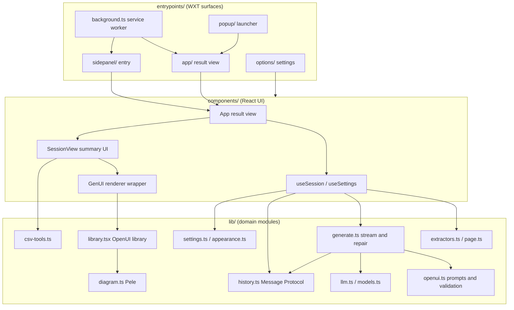
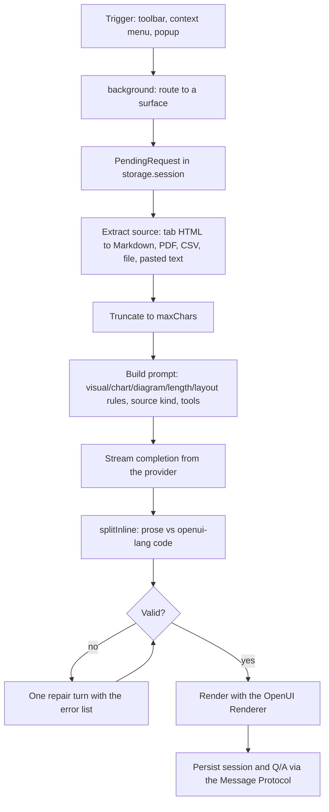

# Architecture Overview

The extension is a Manifest V3 Chrome extension built with **WXT** + **React 19** + **TypeScript**.
It turns a web page, a pasted text, or a file into an **interactive Generative UI** written in
OpenUI Lang and rendered by the OpenUI `Renderer`.

Two invariants shape every layer:

- **No backend, bring your own key.** The browser talks to the LLM provider directly. There is no
  server of ours in the path: `createModel()` builds an AI SDK provider from the user's own
  credentials and `streamCompletion()` streams the response in the extension page
  (`lib/llm.ts`).
- **Appearance tokens drive everything visual.** One `Appearance` object
  (pen + highlighter + corners + reading font) is resolved into CSS variables for the app chrome,
  OpenUI `ThemeProvider` tokens for the generated UI, chart palettes, and Pele diagram colors
  (`lib/appearance.ts`, `components/Themed.tsx`).

## Layer map

Caption: the entrypoints are thin surfaces; `components/` owns the React tree and session
lifecycle; `lib/` holds the domain modules that do extraction, prompting, streaming, validation,
rendering support and persistence.

## Entrypoints (`entrypoints/`)

| Entrypoint | Role |
| --- | --- |
| `background.ts` | MV3 service worker: owns context menus, the toolbar action (popup vs side panel), the per-tab side-panel lifecycle, and routing of a trigger to a `PendingRequest`. It never renders or summarizes. |
| `popup/` | Small launcher (only installed as the action popup in `tab` display mode). Hands a request to a new tab and closes itself. |
| `app/` | The result view (`App.tsx`). Rendered as a full-page tab; the same component is mounted in the side panel with `surface="panel"`. |
| `sidepanel/` | Entry HTML/JS that mounts `App` with `surface="panel"`. |
| `options/` | Settings page (`OptionsApp.tsx` → `SettingsForm`). |

`App` is the single result view used by both the tab and the panel; it branches on the `surface`
prop. See [Extension Surfaces and Routing](extension-surfaces.md) for the trigger-to-surface
mechanics.

## Components (`components/`)

- `App.tsx` (in `entrypoints/app/`) — routing, top bar, view switch (main / history / settings).
  The route lives in the query string (`?request=`, `?session=`, `?view=new|history`) and is
  rewritten with `history.replaceState`, so a refresh reopens the same view.
- `SessionView.tsx` — the summary UI: `GenUI` output, one-click refine chips, free-text refine,
  the follow-up question column, and the `onAction` handler that fulfils custom actions.
- `GenUI.tsx` — thin wrapper around the OpenUI `Renderer`: binds the app library, forwards
  `toolProvider`, `initialState` and `onStateUpdate`, and surfaces runtime/tool errors.
- `SourcePicker.tsx` — the start screen: summarize this page, paste text, drop a file.
- `HistoryList.tsx` — session list (compact variant in the popup).
- `SettingsForm.tsx` + `AppearancePanel.tsx` + `ModelSwitcher.tsx` + `LanguagePicker.tsx` —
  settings surface; `ModelSwitcher` is a cross-provider model picker that switches provider too.
- `useSession.ts` — the session controller: phases (`idle`, `extracting`, `summarizing`,
  `refining`, `answering`), abort handling, persistence, and the operations `fromTab`,
  `fromText`, `fromFile`, `refine`, `resummarize`, `ask`.
- `useSettings.ts` — reads `local:settings` and stays in sync when the Settings page saves.
- `Themed.tsx` — applies the Inkmark tokens (CSS variables + OpenUI theme) and the i18n provider.
- `portal.ts` — Radix portals are redirected into the themed root so menus keep the theme.

## Core `lib/`

| Module | Responsibility |
| --- | --- |
| `library.tsx` | The OpenUI library: `openuiChatLibrary` extended with the custom components `SummaryHero`, `KeyNumbers`/`KeyNumber`, `Takeaways`/`Takeaway`, `Timeline`/`TimelineEvent`, `SourceQuote`, `Diagram`, and the custom actions `HighlightInPage` and `CopyText`. `ROOT` is `Card`. The library is created at module scope, because the OpenUI parser memoizes by library identity. |
| `openui.ts` | System prompts (visual, chart, diagram, length, layout and per-source-kind rules), inline-mode splitting (`splitInline`), parser validation (`validateProgram`), Mermaid validation (`validateDiagrams`), repair messages, and edit-mode merging (`applyPatch` → `mergeStatements`). |
| `generate.ts` | The generation turn: streaming, one-shot repair loop, `generateSummary` (edit mode) and `generateAnswer` (Q&A). |
| `extractors.ts` | Source extraction: HTML → Markdown via Readability + Turndown (GFM keeps tables), PDF via pdf.js, CSV via Papa Parse, Markdown/text passthrough; `truncate()` caps the content at the configured `maxChars`. |
| `page.ts` | Tab reading (`extractTab`, HTML or PDF) and the `@HighlightInPage` implementation (`highlightInTab`). |
| `llm.ts` | AI SDK provider construction per API flavour and `streamCompletion`; `describeError` maps provider errors to user-facing messages. |
| `models.ts` | Live model lists per provider (`fetchModels`), Ollama capability filtering, and the cached model list (`local:modelCache`). |
| `csv-tools.ts` | `csv_rows` / `csv_group` tools plus the `toolProvider` that runs them **in the browser** over the parsed dataset. |
| `diagram.ts` | Mermaid → SVG with Pele (`pele/lazy`), and `diagramError()` producing a model-readable error. |
| `history.ts` | Sessions stored with the OpenUI Message Protocol (`buildMessage` / `parseMessage`), so form and `$state` values survive a reload. |
| `settings.ts` | Provider catalogue, the `Settings` shape, `local:settings` persistence, `configProblem()`, and runtime host-permission requests. |
| `appearance.ts` | The Inkmark design system: presets, palette resolution (including dark-mode derivation), CSS variables and the OpenUI theme. |
| `context-menus.ts` | Context-menu items whose ids encode the display mode. |
| `pending.ts` | The `PendingRequest` handoff and the per-tab side-panel bookkeeping. |
| `local-origin.ts` | A `declarativeNetRequest` session rule that rewrites `Origin` for local providers (Ollama), so no `OLLAMA_ORIGINS` is needed. |
| `refine.ts` | The refinement prompts and the standing style rules. |
| `i18n/` | The i18next instance, language matching and the type-checked key declarations. |

## Storage areas

WXT's `storage.defineItem` prefixes map to Chrome storage areas:

| Item | Area | Contents |
| --- | --- | --- |
| `local:settings` | `chrome.storage.local` | Settings, including per-provider API keys. The `local:` prefix (not `sync:`) keeps keys out of browser sync. |
| `local:history` | `chrome.storage.local` | Up to 20 sessions, each holding the source and the summary/Q&A as OpenUI Message Protocol payloads. |
| `local:modelCache` | `chrome.storage.local` | Last model list per provider, so the model picker works without a new request. |
| `session:requests` | `chrome.storage.session` | Pending summarize requests, keyed by UUID; memory-only, dropped after 10 minutes. |
| `session:panelRequests` | `chrome.storage.session` | Per-tab pointer to the request a side panel should run; the pointer is ignored after 60 seconds. |
| `session:panelUrls` | `chrome.storage.session` | The URL each tab's panel belongs to, used to close the panel on navigation. |

<!-- openwiki: broken internal link [storage-and-state.md] file "storage-and-state.md" does not exist. Fix the href or restore the target, then delete this comment. -->
See [Storage and State](storage-and-state.md) for the full state model.

## End-to-end data flow

Caption: one request travels trigger → pending request → extraction → prompt → streaming →
validation with at most one repair turn → rendering → persistence.

Details that matter:

1. **Trigger → surface.** The background worker never summarizes. It records a
   `PendingRequest` and opens either a full-page tab (`openApp`) or that tab's side panel.
   The request is handed over through `chrome.storage.session`, not the URL, so large pasted
   text does not have to travel in a query string; the URL only carries the request id.
2. **Extraction.** `useSession.fromTab` → `extractTab` reads the tab (Readability + Turndown for
   HTML, pdf.js for PDFs). `fromFile` → `extractFile` handles PDF, CSV, Markdown and text.
   `fromText` uses the text as-is. The content is then truncated to `settings.maxChars`, and the
   truncation flag is sent to the model.
3. **Prompting.** `buildSummaryPrompt` composes the OpenUI library prompt (with a visual-first
   example, a chart example and a diagram example) with the rule sets. The rule set is chosen by
   the source kind and by `settings.display` (`LAYOUT_RULES.tab` vs `LAYOUT_RULES.sidepanel`), so
   the generated UI is shaped for the surface it will be shown in. CSV sources additionally enable
   the `Query` tools and `$state` bindings.
4. **Streaming.** `streamCompletion` streams text from the provider and calls back with the
   accumulated text, so the UI renders the program while it arrives.
5. **Validation and repair.** `validateProgram` parses the program against the app library and
   reports parser errors, a missing root, and unresolved references; `validateDiagrams` renders
   every `Diagram` node with Pele so a Mermaid error is caught too. On failure the errors are sent
   back to the model **once**; the repair output is only accepted if it does not leave more errors
   than before.
6. **Rendering.** `GenUI` renders the program with the app library. Prose outside the fence is
   rendered as Markdown. Custom actions (`@HighlightInPage`, `@CopyText`) are not executed by the
   Renderer: it emits an event that `SessionView.onAction` fulfils (highlight the quote in the
   original tab, copy to the clipboard, open a URL, or turn a follow-up item into a question).
7. **Persistence.** The summary program and each answer are stored with `buildMessage`, so the
   renderer can restore form and `$state` values on reopen; only the plain `content` is ever sent
   back to the model.

### Session lifecycle

`useSession` is the single owner of session state. Every turn goes through `begin()`, which aborts
the previous `AbortController` and enters a phase (`extracting` → `summarizing` → `refining` →
`answering`), and every turn ends in `finish()`, which returns to `idle`. A new request aborts
whatever was running, `stop()` aborts explicitly, and unmounting the hook aborts as well. The
session is committed (and persisted) after each turn, so a summary that was interrupted still
appears in history; reopening a session that has a source but no summary triggers a new run.

### Refinement and follow-ups

Refinement uses OpenUI **edit mode**: the current program is shown to the model, which returns
only the changed statements, and `applyPatch` merges them with `mergeStatements`. Follow-up
questions use OpenUI **inline mode**, where the answer may be plain prose or a compact UI.

## Invariants and failure modes

- **The user gesture must be preserved.** `browser.sidePanel.open()` only works during a user
  gesture, so the display mode is baked into the context-menu id instead of being read from
  storage at click time, and `openSidePanelForTab` is deliberately not `async`.
- **A pending request is consumed once.** `takeRequest` removes the request from
  `storage.session` when the result view picks it up, so reloading the page does not re-run the
  summary; if the request is missing, the UI shows the "request expired" error instead.
- **CSV queries never call the model.** The `toolProvider` runs `csv_rows` / `csv_group` in the
  browser, so changing a filter or grouping re-renders without a new generation.
- **Model output is untrusted.** Pele rendering disables links and images; the diagram error path
  renders the message as text, not as markup.
- **Configuration is checked before every call.** `configProblem()` rejects a missing base URL,
  a missing API key for key-requiring providers, or an empty model; `useSession` surfaces it as
  an error and the UI offers a link to Settings.
- **Local providers.** `allowLocalOrigin` rewrites the `Origin` header for requests to
  `localhost` so Ollama accepts them without `OLLAMA_ORIGINS`.
- **The repair loop is bounded.** Exactly one repair turn; if it does not help, the remaining
  errors are shown as a warning and the last valid program is kept.

## Configuration and operations

- `wxt.config.ts` declares only part of the manifest: the localized `default_locale`, `name` and
  `description`, the runtime permissions (`storage`, `sidePanel`, `activeTab`, `scripting`,
  `contextMenus`, `unlimitedStorage`, `declarativeNetRequest`, `favicon`, `clipboardWrite`),
  `optional_host_permissions: ['<all_urls>']` for the provider API domain (requested at runtime
  on Save, so provider calls bypass CORS), the `action.default_title`, and the `Alt+Shift+S`
  `_execute_action` command.
- **The manifest is not only what `wxt.config.ts` says.** WXT derives the rest from the
  entrypoint folders and `public/`, and the built `.output/chrome-mv3/manifest.json` additionally
  contains `background.service_worker`, `action.default_popup: "popup.html"`,
  `side_panel.default_path: "sidepanel.html"`, `options_ui` (`open_in_tab: true`,
  `page: "options.html"`) and the icon set. The side-panel and options entries exist because
  `entrypoints/sidepanel/` and `entrypoints/options/` exist, not because the config mentions them.
- `pnpm dev` runs the extension with hot reload, `pnpm compile` type-checks, `pnpm build`
  produces `.output/chrome-mv3`, and `pnpm check:i18n` validates the locale folders against
  English.
- **Localization.** `locales/<lang>/<namespace>.json` (namespaces: `common`, `picker`, `popup`,
  `session`, `settings`, `errors`) are bundled at build time via `import.meta.glob`. English is the
  source of truth and its keys are type-checked through the `i18next` module augmentation in
  `lib/i18n/types.d.ts`, so a missing English key is a compile error. `public/_locales/<lang>/`
  holds the Chrome-level strings (extension name, description, context-menu titles).

## Related pages

- [Extension Surfaces and Routing](extension-surfaces.md)
<!-- openwiki: broken internal link [storage-and-state.md] file "storage-and-state.md" does not exist. Fix the href or restore the target, then delete this comment. -->
- [Storage and State](storage-and-state.md)
<!-- openwiki: broken internal link [ui-components.md] file "ui-components.md" does not exist. Fix the href or restore the target, then delete this comment. -->
- [UI Components](ui-components.md)
- [OpenUI Lang](../concepts/openui-lang.md)
- [Summary Generation](../workflows/summary-generation.md)
<!-- openwiki: broken internal link [../quickstart.md] file "../quickstart.md" does not exist. Fix the href or restore the target, then delete this comment. -->
- [Quickstart](../quickstart.md)
