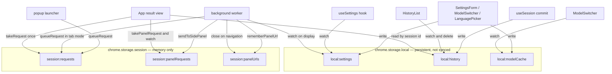
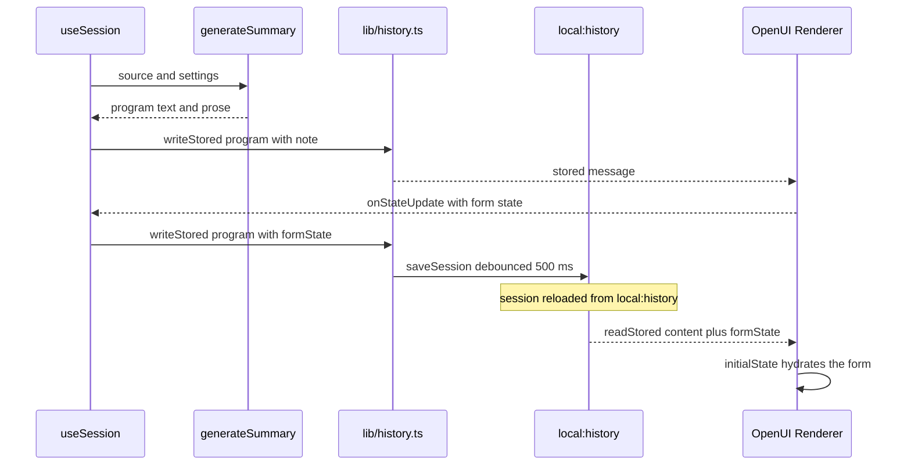

# Storage and Session State

This page is the state model of the extension. It answers three questions: which browser storage
areas exist and who owns them, what survives a browser restart and what does not, and how a
session — its source, its summary program, its form values and its Q&A turns — is written and read
back.

Related reading: [Architecture Overview](overview.md) for the layer map, [Extension Surfaces and
Routing](extension-surfaces.md) for how a trigger becomes a pending request,
[Permissions, Privacy and Runtime Operations](../operations/permissions-and-privacy.md) for the
privacy model, and [LLM Providers](../integrations/llm-providers.md) for how the stored settings
are turned into provider calls.

## The storage areas

All persistence goes through WXT's `storage.defineItem`, whose `area:key` prefix selects the
Chrome storage area. The codebase uses exactly six items, in two areas.

| Area | Key | What it holds | Writer | Reader | Lifetime |
| --- | --- | --- | --- | --- | --- |
| `chrome.storage.local` | `local:settings` | The whole `Settings` object, including the per-provider `apiKey`, base URL and model | `SettingsForm.onSave`, `ModelSwitcher.pick`, `LanguagePicker.change` | `useSettings` (watch), `entrypoints/background.ts` (watch on `display`), `lib/settings.ts` `getSettings()` | Persistent, **never synced** (the `local:` prefix, not `sync:`) |
| `chrome.storage.local` | `local:history` | Up to 20 `Session` objects, newest first | `lib/history.ts` `saveSession()` (via `useSession.commit`), `deleteSession()` | `HistoryList` (watch), `entrypoints/app/App.tsx` (session-id lookup), `useSession.open()` | Persistent; oldest entries are dropped past 20 |
| `chrome.storage.local` | `local:modelCache` | The last model list per provider (`ModelOption[]`) | `SettingsForm.loadModels()` | `ModelSwitcher` (getValue + watch), `SettingsForm` | Persistent; replaced wholesale per provider on every successful load |
| `chrome.storage.session` | `session:requests` | Queued `PendingRequest` bodies keyed by UUID | `queueRequest()` from the popup and the background worker | `takeRequest()` in the result page | Memory only — cleared when the browser closes; entries older than 10 minutes are garbage-collected on the next `queueRequest()` |
| `chrome.storage.session` | `session:panelRequests` | Per-tab pointer `{ [tabId]: { id, at } }` to a request id | `sendToSidePanel()` (background worker) | `takePanelRequest()` / `watchPanelRequests()` in the panel surface | Memory only; the pointer is honoured for 60 seconds, then ignored |
| `chrome.storage.session` | `session:panelUrls` | The URL each tab's panel belongs to, `{ [tabId]: url }` | `rememberPanelUrl()` (background worker) | `entrypoints/background.ts` on `tabs.onUpdated`, `closeSidePanelForTab()` | Memory only; the entry is removed when the panel is closed or the tab goes away |



Caption: the six storage items, their owners and their flows — three persistent `local:` items
(config, history, model cache) and three ephemeral `session:` items (the request handoff and the
per-tab panel bookkeeping).

### Why the split exists

The two areas encode two different lifetimes, and the split is deliberate rather than incidental:

- **`local:` is durable and private.** `chrome.storage.local` survives a browser restart and is
  not replicated through the user's browser account. This is where configuration and history
  live, and it is the reason API keys never sync. `lib/settings.ts` says so at the definition
  site:

  ```ts
  // "local:" (not "sync:") so API keys are never synced through the user's browser account.
  export const settingsItem = storage.defineItem<Settings>('local:settings', {
    fallback: DEFAULT_SETTINGS,
  });
  ```

  No `sync:` item exists anywhere in the codebase, so there is no path by which a key could
  reach `chrome.storage.sync`.

- **`session:` is memory only.** `chrome.storage.session` is cleared when the browser closes. It
  is used for the request handoff precisely because that payload is transient: a pasted or
  selected text can be large, and it must not travel in a URL query string and must not outlive
  the browser session. The URL carries only the request id.

### API keys live only in `local:settings`

`Settings.providers` is a `Partial<Record<ProviderId, ProviderConfig>>` where `ProviderConfig`
holds `apiKey`, `baseUrl` and `model`, so **every** provider's key is kept in the single
`local:settings` object — and switching providers in Settings keeps each key, rather than
overwriting one slot.

The invariants around keys:

- The key is never written to any other storage item. `local:history` holds sources and
  OpenUI programs; `local:modelCache` holds model ids and labels; the `session:` items hold
  request payloads and URLs. None of them ever receive a key.
- The key never reaches the model in a message, and never leaves the browser except as the
  `Authorization` / `x-api-key` header of the provider request.
- `normalizeSettings()` is the only gate between a raw stored blob and the typed `Settings`
  object. It fills in defaults and drops values from older versions (an unknown `provider`, an
  unknown `theme`, a `display` that is neither `sidepanel` nor `tab`, unknown summary styles),
  so a settings blob written by an older version can never crash a newer one.

### Settings are read reactively

`components/useSettings.ts` is the single read path for the whole UI:

```ts
export function useSettings() {
  const [settings, setSettings] = useState<Settings>(DEFAULT_SETTINGS);
  const [loaded, setLoaded] = useState(false);

  useEffect(() => {
    void getSettings().then((s) => {
      setSettings(s);
      setLoaded(true);
    });
    return settingsItem.watch((next) => setSettings(normalizeSettings(next)));
  }, []);

  return { settings, loaded };
}
```

Two properties matter:

- The watcher is what keeps the open surfaces consistent. Saving in the Settings tab, or
  picking a model from the `ModelSwitcher` in the popup, updates every mounted surface without a
  reload, because the change is broadcast through `chrome.storage`.
- `loaded` is the readiness flag. The result view waits for it before it handles a routed
  request, because the request needs the provider configuration; `entrypoints/app/App.tsx`
  skips the whole routing effect until `loaded` is true, and `routed.current` makes the route
  handling happen exactly once.

`entrypoints/background.ts` uses the same watcher for a different purpose — it compares
`next.display` with `prev.display` and re-syncs the action button and the context menus, so
switching between "tab" and "sidepanel" mode takes effect without restarting the browser.

## History: sessions as Message Protocol payloads

`local:history` is a `Session[]`. The shape is defined in `lib/history.ts`:

```ts
export interface Session {
  id: string;
  createdAt: number;
  updatedAt: number;
  source: SessionSource;   // ExtractedSource + truncated flag + optional tabId
  summary: string | null;   // stored message (buildMessage)
  qa: QaTurn[];             // question + stored answer
}
```

`saveSession()` implements the write policy:

```ts
const MAX_SESSIONS = 20;

export async function saveSession(session: Session) {
  const list = await historyItem.getValue();
  const next = [session, ...list.filter((s) => s.id !== session.id)].slice(0, MAX_SESSIONS);
  await historyItem.setValue(next);
}
```

Three properties follow: the list is **newest first**, re-saving a session **replaces** it in
place rather than duplicating it, and the list is **capped at 20** — the `unlimitedStorage`
permission exists because these payloads are large (a full OpenUI program plus the source text
plus every Q&A turn).

`deleteSession()` removes one entry; `HistoryList` calls it from its per-item delete button and
refreshes itself through `historyItem.watch`.

### The OpenUI Message Protocol

The summary and every answer are **not** stored as raw text. They are stored with
`buildMessage` from `@openuidev/react-lang` and read back with `parseMessage`, which is what
lets the renderer restore form values and `$state` after a reload:

```ts
export interface StoredContext {
  /** Renderer form + $state (from onStateUpdate), restored through initialState. */
  formState?: Record<string, unknown>;
  /** The sentence outside the fence from the latest turn. */
  note?: string;
}

export function writeStored(content: string, context?: StoredContext) {
  const ctx =
    context && (context.note || (context.formState && Object.keys(context.formState).length)) ? context : undefined;
  return buildMessage({ content, context: ctx, attributes: { app: 'ai-summarizer@1' }, end: true });
}

export function readStored(stored: string | null) {
  if (!stored) return { content: '', context: {} as StoredContext };
  const { content, context } = parseMessage(stored);
  return { content, context: (context && typeof context === 'object' ? context : {}) as StoredContext };
}
```

The rules this establishes:

- **One payload, two audiences.** The stored string carries the program (`content`), the
  renderer's form state (`context.formState`) and the model's prose note (`context.note`).
- **The context is optional.** `writeStored` drops the context block entirely when there is
  neither a note nor a non-empty form state, so a plain summary does not pay for a context
  section.
- **The app is identified.** The stored message carries `attributes: { app: 'ai-summarizer@1' }`
  and an `end` marker, so a stored payload is self-describing.
- **Only `content` goes to the model.** `lib/generate.ts` sends `readStored(turn.answer).content`
  back to the provider — never the protocol markers and never the form state:

  ```ts
  // Message Protocol: the model sees only the content, never the ]]>openui: markers.
  messages.push({ role: 'assistant', content: readStored(turn.answer).content });
  ```

- **The stored message renders directly.** `GenUI` passes the stored string to the OpenUI
  `Renderer` as `response`; the renderer accepts a stored message with protocol markers without
  any conversion step.

### How a session round-trips



Caption: the write-then-restore loop — a summary is stored with the Message Protocol, the
renderer reports form and `$state` changes back, and the updated payload is persisted so the
same filters are in place after a reload.

### Debounced form and `$state` persistence

The renderer reports every form change through `onStateUpdate`. `components/useSession.ts`
captures that and re-writes the stored message with the new state, debounced by 500 ms:

```ts
// Persist the summary's form/$state (Message Protocol context), debounced.
const saveTimer = useRef<ReturnType<typeof setTimeout>>(undefined);
const updateSummaryState = useCallback((formState: Record<string, unknown>) => {
  const current = sessionRef.current;
  if (!current?.summary) return;
  const { content, context } = readStored(current.summary);
  const next = { ...current, summary: writeStored(content, { ...context, formState }) };
  sessionRef.current = next;
  clearTimeout(saveTimer.current);
  saveTimer.current = setTimeout(() => void saveSession(next), 500);
}, []);
```

`updateAnswerState(turnId, formState)` does the same for one Q&A turn: it maps over `current.qa`,
rewrites only the matching turn's answer payload and leaves the other turns untouched.

What this buys, concretely:

- **The filters stay applied.** A generated UI that contains a `Select` for a CSV column writes
  the chosen filter into `formState`. The `csv_rows` / `csv_group` tools run entirely in the
  browser through the `toolProvider` (`lib/csv-tools.ts`), so changing a filter re-renders
  without a new model call — and because the value is persisted in the session's payload, the
  filter is still applied when the session is reopened from history.
- **`$state` bindings survive too.** Reactive variables are part of the same state map that the
  renderer reports, so a `$state` value that drives a chart is restored on reopen.
- **The in-memory state is updated immediately.** `sessionRef.current` is mutated synchronously
  before the debounce fires, so the UI never shows a stale value while the write is pending.
  Only the *disk* write is debounced; a single 500 ms window collapses a burst of slider or
  select changes into one `saveSession` call.

On reopen, `SessionView` hands the stored state back to the renderer as `initialState`:

```tsx
<GenUI
  key={session.id}
  response={summaryResponse || null}
  initialState={summary.context.formState}
  onStateUpdate={ctrl.updateSummaryState}
/>
```

The `key={session.id}` matters: switching sessions remounts the renderer, so a previous
session's form state cannot leak into the next one.

### Session lifecycle and the commit rule

`useSession` is the single owner of the in-memory session. Each turn runs through `begin()`
(which aborts the previous `AbortController` and enters a phase) and `finish()` (which returns
to `idle`). The phases are `idle`, `extracting`, `summarizing`, `refining` and `answering`.

The persistence rule is **commit after every turn**:

```ts
const commit = useCallback((next: Session) => {
  sessionRef.current = next;
  setSession(next);
  void saveSession(next);
}, []);
```

`commit` is called when the session is created (before the first summary runs), when a summary
arrives, when a refinement is merged, and when an answer is appended. The consequences:

- **An interrupted summary still appears in history.** The session was committed with its
  source and `summary: null` before the model was called.
- **A session saved without a summary is completed when reopened.** `useSession.open()` checks
  `if (!s.summary && !configProblem(settingsRef.current)) void runSummary(s.source, s)`, so a
  session whose tab was closed mid-generation is finished the next time it is opened.
- **`open()` does not write.** Opening a session only updates `sessionRef`/`setSession`; the
  history array is untouched until the next `commit`.
- **A failed turn leaves the previous state in place.** Errors are caught, described with
  `describeError` and surfaced as `error`, and the previously committed summary stays visible.

`useSession` also keeps a `settingsRef` mirror of the current settings, because the callbacks
must not re-create on every settings change; the configuration check
(`configProblem(settingsRef.current)`) therefore runs against the latest settings at the moment
of the call.

### Refinement preserves the stored state

`refine()` reads the current program out of the stored message, sends it to the model in
edit mode, and writes the merged program back **with the existing context**:

```ts
const { content: program, context } = readStored(current.summary);
…
commit({
  ...current,
  summary: writeStored(res.program, { formState: context.formState, note: res.prose }),
  updatedAt: Date.now(),
});
```

So a refinement replaces the program and the note, but keeps the form state of the previous
program. (In practice the refined program has a new shape, and the renderer is remounted, so
the restored values only apply where the fields still exist.)

## The pending-request handoff

The `session:` items are the transient side of the state model. `lib/pending.ts` owns them.

`PendingRequest` is either a tab reference or a text payload:

```ts
export type PendingRequest =
  { type: 'tab'; tabId: number } |
  { type: 'text'; text: string; title?: string; url?: string; tabId?: number };
```

### `session:requests` — the body

`queueRequest()` assigns a UUID, opportunistically drops entries older than 10 minutes, and
returns the id. `takeRequest(id)` is **consume-once**: it returns the request and removes it
from the map, so reloading the result page does not re-run the summary. A missing id is not an
error path in the storage layer — the result view turns it into the "request expired" message.

### `session:panelRequests` — the per-tab pointer

For the side panel, the request body still lives in `session:requests`; `session:panelRequests`
only holds `{ [tabId]: { id, at } }`, a pointer to it. `takePanelRequest(tabId)` consumes the
pointer and only honours it for 60 seconds:

```ts
export async function takePanelRequest(tabId: number) {
  const all = await panelRequestsItem.getValue();
  const r = all[tabId];
  if (!r) return null;
  const { [tabId]: _taken, ...rest } = all;
  await panelRequestsItem.setValue(rest);
  return Date.now() - r.at < 60_000 ? takeRequest(r.id) : null;
}
```

The 60-second window is the tighter of the two expiry rules and it exists because the pointer
can be *lost*: `sendToSidePanel` writes the `session:panelRequests` entry **after**
`openSidePanelForTab` has already opened the panel document, so the panel may mount and look
for a request before the entry exists. The panel therefore polls once on mount and then
watches the storage item (`watchPanelRequests`), and the short window prevents a stale pointer
from executing much later.

### `session:panelUrls` — panel ownership

Each tab's panel belongs to the URL that was analysed. `rememberPanelUrl(tabId, url)` records
it, and the background worker closes the panel when the tab navigates to a different document:

```ts
export const sameDocument = (a?: string, b?: string) => Boolean(a && b) && a!.split('#')[0] === b!.split('#')[0];
```

Comparing without the fragment means in-page anchors keep the panel open. `closeSidePanelForTab`
disables the panel and removes the URL entry, and it is also called when the tab itself is
removed.

## Model cache

`local:modelCache` maps a provider id to the last model list that was loaded from its API:

```ts
export const modelCacheItem = storage.defineItem<Partial<Record<ProviderId, ModelOption[]>>>('local:modelCache', {
  fallback: {},
});
```

It exists so the model picker works without a new request. `SettingsForm.loadModels()` writes
it after a successful `fetchModels()`, replacing that provider's entry; `ModelSwitcher` reads it
with `getValue()` plus a `watch()` and lists the models of every *connected* provider.

The cache also feeds the connection logic. `isProviderConnected()` treats a provider as
connected when it has a saved API key, or — for keyless providers such as Ollama, LM Studio and
a custom endpoint — when a model was chosen **or** a model list was cached. A keyless provider
with only a cached list therefore shows as connected without any further setup.

## Invariants

- **API keys live in `local:settings` and nowhere else**, and no `sync:` item exists, so keys
  never reach browser sync.
- **The pending handoff is single-use and memory-only.** `takeRequest` removes the entry; the
  `session:` area is cleared when the browser closes.
- **History is bounded at 20 sessions**, newest first, and re-saving replaces in place.
- **Only `content` is sent to the model.** Form state and protocol markers never leave the
  browser in a prompt.
- **A session is committed after every turn**, so an interrupted generation is still recoverable
  from history, and a session without a summary is completed when it is reopened.
- **Form and `$state` writes are debounced (500 ms) but the in-memory value is updated
  immediately**, so the UI is never stale and the disk write is not chatty.
- **Settings are normalized on every read**, so a blob written by an older version cannot break
  a newer one.
- **The panel pointer is honoured for 60 seconds and the request body for 10 minutes**, because
  the pointer can be written after the panel has already mounted.

## Related pages

- [Architecture Overview](overview.md)
- [Extension Surfaces and Routing](extension-surfaces.md)
- [Permissions, Privacy and Runtime Operations](../operations/permissions-and-privacy.md)
- [LLM Providers](../integrations/llm-providers.md)
- [Summary Generation](../workflows/summary-generation.md)
