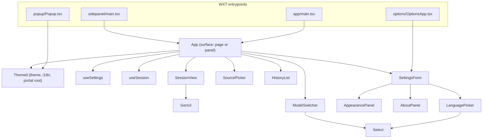
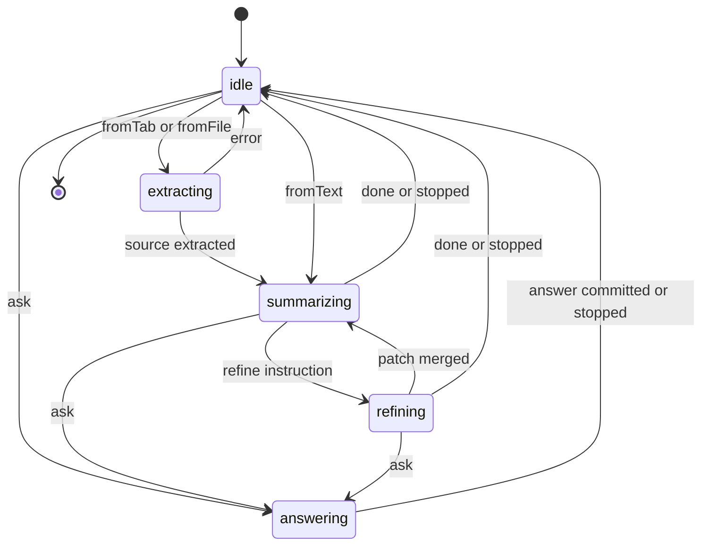
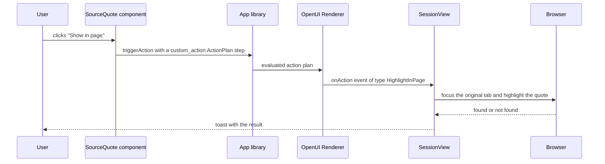

# React UI Components

The React layer turns a stored OpenUI program into a screen. It is split into three groups:

- **The result view** — `entrypoints/app/App.tsx` and the components it composes (`SessionView`,
  `SourcePicker`, `HistoryList`, `ModelSwitcher`). One component serves both the full-page tab
  and the per-tab side panel.
- **The renderer boundary** — `components/GenUI.tsx` wraps the OpenUI `Renderer`, and
  `components/SessionView.tsx` owns the switch that turns renderer events into browser actions.
- **The settings surface** — `components/SettingsForm.tsx` and the panels it hosts
  (`AppearancePanel`, `AboutPanel`, `LanguagePicker`).

State ownership is deliberately narrow: `useSession` owns the *session* (source, summary program,
Q&A turns) and `useSettings` owns the *settings*; nothing else writes to storage except the
explicit writers listed in [Storage and Session State](storage-and-state.md).

Related reading: [Architecture Overview](overview.md) for the layer map,
[Extension Surfaces and Routing](extension-surfaces.md) for how a trigger reaches this layer,
[OpenUI Lang](../concepts/openui-lang.md) for the program format that is rendered here.

## Component tree



Caption: the UI tree — one `App` serves the page and the panel, `SettingsForm` is reused by the
options page and embedded in `App`, and `Themed` wraps every surface so the Inkmark tokens apply.

## App: one component, two surfaces

`App` takes a `surface` prop (`'page' | 'panel'`). `entrypoints/app/main.tsx` renders `<App />`
and `entrypoints/sidepanel/main.tsx` renders `<App surface="panel" />`; both are the same
component, so the two surfaces can never drift apart.

The prop only changes three things:

- **Class names and layout.** The root gets `app--panel` or `app--page`, and `SessionView`
  receives `layout="panel"` or `layout="page"`. The CSS turns the page layout into two columns
  and the panel layout into one.
- **Routing.** Only the page surface writes to the URL.
- **Which requests are consumed.** Only the panel surface reads `?tab=` and pulls panel requests.

### What the page surface routes

The page surface reads the query string once, after settings have loaded (the request needs a
usable provider configuration):

| Query | Effect |
| --- | --- |
| `?request=<id>` | `takeRequest(id)` consumes the queued request once (it is removed from storage), then `run()` starts the summary. A reload does not re-run it. |
| `?session=<id>` | The session is looked up in `local:history` and opened with `ctrl.open()`. A missing id sets the "not in history" error. |
| `?view=history` | The history view is shown instead of the main view. |

While a session is open, the URL is rewritten with `history.replaceState` to `?session=<id>` and
the document title is set to `<source title> | <app name>`. `replaceState` is used rather than
`pushState` so the browser's back button is not flooded with every state change.

### What the panel surface does

The panel belongs to one tab: it reads `?tab=<id>` from its own URL, takes pending requests
addressed to that tab from `session:panelRequests`, and watches that storage item for new ones.
It also tracks the tab's title and URL through `browser.tabs.onUpdated` to offer "Summarize this
page" for that tab only.

A panel may only show summaries of its own tab. Opening a session that belongs to another tab
therefore does not render it in the panel — it opens a full-page tab with `openApp({ session })`.

### View state and banners

`App` keeps a single `view` state (`'main' | 'history' | 'settings'`) and renders one of:

- `SettingsForm` embedded, with an `onClose` that returns to the main view;
- `HistoryList` in a narrow column;
- `SessionView` when a session is open;
- `SourcePicker` (the start screen) otherwise.

Three banners sit above the content: a **configuration problem** banner (from
`configProblem(settings)`) that is hidden while the settings view is open and links to it, a
**dismissable error** banner, and a **warning** banner. The toast region at the bottom carries
short confirmations (copied, highlighted, quote not found) and clears itself after 2.5 seconds.

## useSession: the session controller

`useSession(settings)` is the only owner of session state. It returns a `SessionController`
(`{ session, phase, streamRaw, pendingQuestion, error, warning, ... }` plus the command
functions) that the UI calls and renders.

The phase is the state machine of a turn:



Caption: the phases of `useSession` — one abort controller is created per phase change, so a new
turn cancels the previous one.

The important invariants:

- **One request at a time.** `begin(phase)` aborts the previous `AbortController` and creates a new
  one. Every generator call receives its `signal`, and aborted calls do not set an error.
- **Configuration is checked before every model call.** `start`, `refine`, `resummarize` and `ask`
  all call `configProblem(settings)` first and surface the message as an error instead of
  starting a request that would fail.
- **Every committed change is persisted.** `commit()` writes the session to `local:history`
  (via `saveSession`, which keeps the newest 20). A turn therefore survives a closed tab.
- **Form state is persisted separately and lazily.** `updateSummaryState` and
  `updateAnswerState` write the Renderer's `$state` back into the stored Message Protocol
  message and debounce the `saveSession` call by 500 ms, so typing in a form does not hammer
  storage.
- **An unfinished session finishes on open.** `open(session)` re-runs the summary when the
  stored session has no summary yet (for example the tab was closed mid-stream) and the
  configuration is usable.
- **The source is truncated on the way in.** `start()` applies `settings.maxChars` and records
  `truncated`, which the UI shows as a hint under the source header.

`stop()` aborts the in-flight request and returns the phase to `idle`; `reset()` clears the
session entirely; `open()` and `reset()` also abort whatever was running.

## useSettings: read-only view of the configuration

`useSettings()` loads `local:settings` once and then watches it. The watcher normalizes the
value (`normalizeSettings`), so a settings object written by an older version — or by another
surface — still produces a valid `Settings` in the UI. It exposes `{ settings, loaded }`;
`loaded` gates the routing effect, because a queued request must not be consumed before the
provider configuration is known.

## SessionView: the summary screen

`SessionView` renders one session. It assumes `ctrl.session` is non-null.

**The summary area.** While the first summary streams in, the raw streamed text is split with
`splitInline()` and the code part is rendered as it arrives. During a *refinement* the previous
program stays on screen until the patch has been merged — the user never sees the summary
disappear. The `GenUI` instance is keyed by `session.id`, so switching sessions resets the
Renderer's internal state.

**The refine area.** One-click chips (`shorter`, `moreDetail`, `actionItems`, `timeline`,
`simpler`) call `ctrl.refine(REFINE_PROMPTS[id])` — the model runs in edit mode and returns only
the changed statements, which are merged into the current program. A free-text field sends an
arbitrary instruction the same way. The chips are disabled while a turn is running.

**The question area.** The side column holds the Q&A turns and an "ask" box. A submitted
question becomes `pendingQuestion` and is rendered as a bubble with a streaming answer
underneath; the answer is committed to the session when the turn ends.

**Answers are split, summaries are not.** A Q&A answer may be plain prose (a short factual
answer) or a UI program. `Answer` splits the raw text with `splitInline`: prose outside the
fence is rendered as Markdown, the fenced program is handed to `GenUI`.

**CSV sources get in-browser tools.** When the source is a CSV, a `toolProvider` built by
`createCsvToolProvider(source.csv)` is passed to the Renderer, so `Query("csv_group", …)` calls
run locally in the browser instead of calling the model.

## The action boundary: renderer event → browser action

The OpenUI `Renderer` does not perform custom actions itself. It emits an event to `onAction`,
and the app decides what happens. `SessionView` handles four event types:

| Event type | Effect |
| --- | --- |
| `continue_conversation` | Sent to the model as a follow-up question via `ctrl.ask()`. Any `params.context` is appended to the message as `Context: …`. |
| `open_url` | Opens `params.url` in a new browser tab. |
| `HighlightInPage` | Brings the original tab to the front, focuses its window, then highlights the quote in the page. Only available for a `webpage` source with a `tabId`; otherwise a toast says highlighting only works on web pages. |
| `CopyText` | Writes `params.text` to the clipboard and confirms with a toast. |

Failures inside `HighlightInPage` (the tab was closed or navigated away) are caught and reported
as a toast rather than thrown.

### Custom actions must be fired as an `ActionPlan` step

This is the one hard constraint on the action path. A custom action has to be triggered as a
`custom_action` step inside an `ActionPlan` (`{ steps: [...] }`):

```ts
const customAction = (name: string, params: Record<string, unknown>): ActionPlan => ({
  steps: [{ type: 'custom_action', name, params }],
});
```

The legacy `{ type, params }` form is silently dropped by the Renderer when `type` names a
registered custom action, so the click would never reach `onAction` and the button would do
nothing. `lib/library.tsx` uses the `customAction` helper for exactly this reason: the
`SourceQuote` component's "Show in page" and "Copy" buttons trigger
`customAction(highlightInPage.name, { text: props.quote })` and
`customAction(copyText.name, { text: props.quote })`.

The two custom actions are declared with `defineAction` and registered on the shared library
(`library.actions.add`), together with the custom components. The library is created at module
scope on purpose — the parser memoizes by library identity.

### The action dispatch path



Caption: how a click inside the generated UI becomes a browser action — the library builds the
`ActionPlan`, the Renderer emits the event, and `SessionView` performs the effect.

## GenUI: the renderer wrapper

`GenUI` is a thin wrapper around the OpenUI `Renderer` bound to the app library. It exists for
two reasons:

- **Error surfacing.** The Renderer reports runtime and tool errors through `onError`. `GenUI`
  collects them and renders a collapsible list, but it filters two kinds out: warnings (the view
  still renders) and parser errors (already handled by the repair loop in the generation layer).
  While the response is still streaming, no errors are shown at all.
- **Uniform props.** Every `GenUI` instance in the app passes the same library, the same
  `toolProvider`, and the same `initialState` / `onStateUpdate` pair, so the summary and every
  Q&A answer share the same behaviour.

## SettingsForm and its panels

`SettingsForm` is used twice: as the whole content of the options page, and embedded inside the
result view (`embedded` prop) so the gear button opens the settings without leaving the page.
The `initialTab` prop selects the first visible tab.

The five tabs are fixed ids defined in `components/SettingsForm.tsx`:

| Tab id | Label | Content |
| --- | --- | --- |
| `ai` | AI model | Provider choice, API key, base URL, model id and the loaded model list. |
| `summary` | Summary | Where results open (side panel or new tab), output language, length, "always include" styles, custom instructions. |
| `appearance` | Appearance | The `AppearancePanel`. |
| `advanced` | Advanced | Maximum characters sent to the model, and the privacy note about `chrome.storage.local`. |
| `about` | About | The `AboutPanel`. |

**Edits are a draft until Save.** The form keeps its own copy of `Settings` and writes it to
`local:settings` only when Save is pressed. The one exception is the interface language:
`LanguagePicker` applies and stores the choice immediately, because nobody wants to read the
rest of the form in the old language before pressing Save.

**The AI tab loads models live.** The "Load models" button requests the host permission for the
provider's origin *synchronously inside the click* (the permission prompt needs the user
gesture) and then fetches the model list with the user's key. The list is cached in
`local:modelCache` per provider; when the cached list is shown first, a background refresh
follows 600 ms after the key or base URL changes. If the current model is not in the loaded list,
a sensible default is selected automatically.

### AppearancePanel

`AppearancePanel` edits the Inkmark `Appearance`: a color preset (or custom pen and
highlighter colors), the color mode (`system` | `light` | `dark`), corner style and reading
font. The changes are passed up as patches and previewed live with the real summary classes, so
what the user sees in the preview is what a result looks like.

### AboutPanel

The About tab is the project's identity surface: the app name and tagline, the extension version
read from the browser manifest (`browser.runtime.getManifest().version`), a Ko-fi support button
linking to `https://ko-fi.com/tamnt`, and a link to the MIT license at
`https://opensource.org/license/mit`.

### The embedded form and the theme

When embedded, `SettingsForm` renders a nested `Themed` with `root={false}`. The nested theme
does not switch the interface language of the whole page and does not touch the page background —
the outer `Themed` keeps those, so the surrounding result view does not change while the user is
still editing the draft.

## ModelSwitcher

`ModelSwitcher` is the model picker in the top bar (also used by the popup). It is a Radix
Popover with a `cmdk` command palette: models of every *connected* provider are listed in
groups, searchable, and keyboard navigable. The active provider is always included, even if it
is not fully configured yet.

Choosing a model writes the settings directly to `local:settings` — including switching the
active provider when a model of another provider is picked. This is a deliberate exception to the
"settings are a draft until Save" rule of the settings form: switching the model is meant to
take effect at once, and `useSettings` picks the change up through its storage watcher.

## SourcePicker, HistoryList and the small shared pieces

- **`SourcePicker`** is the start screen. In a panel it offers "Summarize this page" for that
  tab (disabled for pages the browser does not let extensions read, such as `chrome://`); on the
  full page it is the title plus a paste box and a drop zone. Files are accepted by extension
  (`.pdf`, `.csv`, `.tsv`, `.md`, `.txt`, `.json`, `.html`, `.log`, `.yaml`, …). Paste can be
  submitted with `Ctrl`/`Cmd` + `Enter`.
- **`HistoryList`** watches `local:history` and lists the stored sessions. It supports a
  `compact` mode with a `limit` (the popup shows the four most recent) and a delete button that
  removes a session from storage.
- **`Select`** is the Inkmark select built on Radix Select, and **`Icon`** is the Hugeicons
  wrapper that fixes size and stroke width across the app.

## Themed: where the design system is applied

`Themed` is the root wrapper of every surface. It resolves the color mode (`system` follows the
OS and reacts to changes), builds the CSS variables for the app chrome and the matching OpenUI
`ThemeProvider` tokens for the generated UI, sets the page background outside the app, and
provides the i18n instance.

It also provides a **portal container**: Radix menus and selects portal into `document.body` by
default, which is outside the element that carries the Inkmark CSS variables. `Themed` publishes
its own root element through a React context, and `Select` / `ModelSwitcher` portal into that
element instead, so open menus keep the theme.

The interface language is applied by the root `Themed` only, which is what makes the embedded
settings draft safe.

## Extension points

| To change | Edit | Effect |
| --- | --- | --- |
| The summary layout | `components/SessionView.tsx` | Two-column page vs single-column panel, refine chips, question box. |
| A new browser action | `components/SessionView.tsx` (the `onAction` switch) plus an action declared in `lib/library.tsx` | The action must be triggered as a `custom_action` `ActionPlan` step. |
| A new summary component | `lib/library.tsx` | `defineComponent` + registration in `library.components.add`, with the allowed slots. |
| A new settings tab | `components/SettingsForm.tsx` | Add the id to `TABS` and a `Tabs.Content` panel. |
| The renderer error policy | `components/GenUI.tsx` | Which severities and sources are shown. |
| The visual identity | `lib/appearance.ts` and `components/Themed.tsx` | Presets, tokens, dark-mode derivation. |
