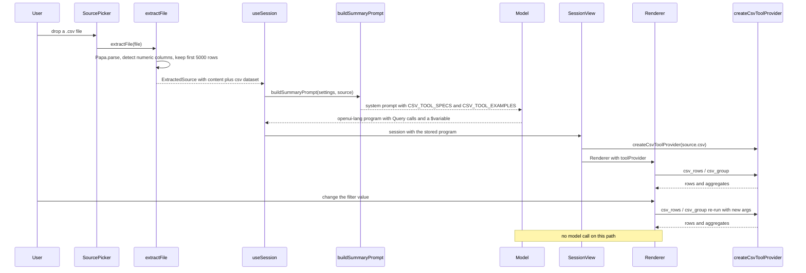

# In-browser CSV Query Tools

CSV is the one source kind with **two** representations at the same time:

1. A **prompt-side summary** — schema, column statistics and a small sample of rows — that the
   model reads as ordinary source text.
2. A **dataset** (`CsvDataset`) kept in the extension, which backs two in-browser tools the model
   can call from its OpenUI Lang program: `csv_rows` and `csv_group`.

The point of the split is interactivity. The model writes a program that *references* the data
through `Query(...)` and binds a filter control to a `$variable`. When the user changes the
filter, the Renderer re-runs the tool **locally in the browser** and re-renders the chart or
table. No second model call is made, so re-filtering costs nothing and stays instant.

> **Invariant:** changing a filter or grouping re-renders the UI without a new model call.
> Everything needed for that lives in the dataset and in the Renderer's store.

## The data path



*Caption: the CSV data path — from a dropped file to a browser-side tool call, and the
re-filter loop that never reaches the model.*

## Parsing a CSV into a dataset

`extractFile()` (`lib/extractors.ts`) routes `.csv`, `.tsv` and `text/csv` files to
`extractCsv()`, which parses with PapaParse (`header: true`, `skipEmptyLines: true`, delimiter
auto-detected) and returns two things:

```ts
const { content, dataset } = extractCsv(await file.text());
return { kind: 'csv', title: name, origin: name, content, csv: dataset };
```

`dataset` is a `CsvDataset`: `{ columns, numericColumns, rows }`, where a row is a
`Record<string, string | number | null>`.

### Row budget

`MAX_CSV_ROWS = 5000` is the hard cap. Only the first 5000 parsed rows are kept for the tools
(and therefore also for what gets stored in history). The full row count is still reported to the
model, with a note when it was truncated:

```ts
`Total rows: ${raw.length}${raw.length > MAX_CSV_ROWS ? ` (tools only see the first ${MAX_CSV_ROWS})` : ''}. Columns (${columns.length}): ${columns.join(', ')}`,
```

### Numeric column detection

A column is numeric when **more than 90%** of its non-empty values parse as a finite number:

```ts
const nums = values.filter((v) => Number.isFinite(Number(v)));
return values.length > 0 && nums.length / values.length > 0.9;
```

Detection runs over all parsed rows; the ratio is the criterion, not "all values are numbers".
Numeric columns are converted to real `number` values in the dataset (so charts and
`sum`/`avg` work), non-numeric columns stay strings, and empty cells become `null`. A cell that
lives in a numeric column but does not parse stays a string.

### The prompt-side view

The model never receives the raw file. It receives a compact description built by `extractCsv()`:

- the total row count (and the 5000-row caveat),
- the column list and the list of numeric columns,
- per-column statistics — for numeric columns `min`, `max`, `mean`, `non-empty`; for text columns
  `distinct`, `non-empty` and the eight most common values,
- the first 30 rows as a Markdown table.

This is also the text that `truncate()` may cut to the context budget (`settings.maxChars`)
before it reaches the model.

## The tool contract

`lib/csv-tools.ts` owns both halves of the contract:

- `CSV_TOOL_SPECS` — the `ToolSpec[]` (name, description, `inputSchema`, `outputSchema`,
  `readOnlyHint`) that is injected into the system prompt.
- `CSV_TOOL_EXAMPLES` — a worked OpenUI Lang example that shows the intended shape: a
  `Query("csv_group", …)` chart, a `Query("csv_rows", …)` table, and a `Select` bound to a
  `$region` variable that feeds both queries' `filter_value`.

The specs and examples are **only** added when the source is a CSV that carries a dataset.
`toolOptions()` in `lib/openui.ts` is the gate:

```ts
function toolOptions(source: ExtractedSource): Partial<PromptOptions> {
  // Enable Query/$bindings only when there is data to query; keeps the prompt lean otherwise.
  if (source.kind !== 'csv' || !source.csv) return {};
  return { tools: CSV_TOOL_SPECS, toolExamples: CSV_TOOL_EXAMPLES, toolCalls: true, bindings: true };
}
```

`toolCalls: true` teaches the model the `Query()` syntax and `bindings: true` the `$variable`
syntax; both are only enabled for CSV, so other source kinds keep a lean prompt. The same gate
applies to the Q&A prompt (`buildQaPrompt`), and both prompts are cached by source kind and by
"has a dataset", so the CSV prompt is assembled once per kind.

A separate rule in `KIND_RULES.csv` tells the model to describe the dataset, to use
`Query("csv_group", …)` and `Query("csv_rows", …)` for charts and tables *instead of hard-coding
numbers*, and to add a filter `Form` with a `Select` bound to a `$variable` when a text column has
few distinct values.

Because a wrong example teaches the model wrong syntax, `CSV_TOOL_EXAMPLES` is parsed and
validated by `scripts/check-examples.ts` (`pnpm check:examples`): the example program must have a
root, no parser errors, no unresolved or orphaned statements, and every Mermaid diagram in it must
render with Pele.

### Wiring the provider into the Renderer

`SessionView` creates the provider once per dataset and hands it to every renderer it owns:

```ts
const toolProvider = useMemo(() => (source.csv ? createCsvToolProvider(source.csv) : null), [source.csv]);
```

The provider is passed to `GenUI` for the summary and for every Q&A answer (`QaItem` →
`Answer` → `GenUI`), and `GenUI` forwards it to the OpenUI `Renderer` as its `toolProvider`
prop. The Renderer's provider is a plain function map — `{ tool_name: async (args) => result }`,
the shape declared by `GenUI`'s `ToolProvider` type — so `Query("csv_rows", …)` resolves to
`csv_rows(args)` with no network and no MCP client.

## Tool semantics and limits

### `csv_rows`

| Argument | Meaning |
| --- | --- |
| `filter_column` | Column to filter on (exact match). |
| `filter_value` | Value for `filter_column`; `""` or `"__all__"` disables the filter. |
| `sort_by` | Column to sort by. |
| `order` | `"asc"` or `"desc"`. |
| `limit` | Max rows, default 20, clamped to 1…200. |

- **Exact-match filter.** `applyFilter` keeps a row only when `String(row[column]) === value`.
  An empty column name, an empty value, or the sentinel `"__all__"` disables filtering
  altogether — that is what makes a "All regions" entry in a `Select` work.
- **Sorting** is numeric when both compared cells are numbers, otherwise a `localeCompare` on
  their string form. Only an explicit `"asc"` sorts ascending; anything else sorts descending.
- **Limit clamp:** `Math.min(Math.max(Number(args.limit) || 20, 1), 200)`.
- **Result:** `{ rows, total }` where `total` is the row count *after* filtering and *before*
  the limit, so a table can say "N of M".

### `csv_group`

| Argument | Meaning |
| --- | --- |
| `group_by` | Column to group by (required). |
| `op` | `count`, `sum`, `avg`, `min`, `max` (default `count`). |
| `value_column` | Numeric column to aggregate; required unless `op` is `count`. |
| `filter_column` / `filter_value` | Same exact-match filter as `csv_rows`. |
| `order` | `"asc"` or `"desc"`. |
| `limit` | Max groups, default 12, clamped to 1…50. |

- Rows are bucketed by the group key; an empty key becomes the literal group `"(empty)"`.
- Aggregation ignores non-numeric cells (`NaN` values are filtered out) and returns `0` for a
  bucket with no usable value. Values are rounded to two decimals.
- Grouping is sorted by the aggregate value, descending unless `"asc"` is given.
- **Limit clamp:** `Math.min(Math.max(Number(args.limit) || 12, 1), 50)`.
- **Result:** `{ rows, groups }` with `rows` as `{ key, value }` pairs and `groups` as the total
  number of groups before the limit.

### Failure semantics

Both tools validate their arguments against the dataset and throw a plain `Error`, which the
Renderer's query manager turns into a query error surfaced through `onError` and shown by
`GenUI` in its error list:

| Condition | Message |
| --- | --- |
| Unknown `filter_column`, `sort_by`, `group_by` or `value_column` | `Unknown column "x" in <field>. Available: a, b, c` |
| `value_column` not numeric (and `op !== 'count'`) | `value_column "x" is not numeric. Numeric columns: a, b` |
| Missing `group_by` | `group_by is required.` |

The "Available:" / "Numeric columns:" suffix matters: it is the model's only way to recover
from a wrong column name, and the CSV kind rule plus the prompt statistics are what make the
right names guessable in the first place.

## State and reactivity

The filter control in the generated program is a normal OpenUI `Form`/`Select` bound to a
`$variable`:

```
$region = "__all__"
byProduct = Query("csv_group", {group_by: "product", op: "sum", value_column: "revenue", filter_column: "region", filter_value: $region}, {rows: [], groups: 0})
regionField = FormControl("Region", Select("region", [SelectItem("__all__", "All regions"), …], null, null, $region))
```

The Renderer collects the `$variable` references inside a query's arguments as that query's
dependencies. When the user picks another region, the store changes, the query is re-evaluated
with the new argument set, the tool runs again **in the browser**, and the chart and table
re-render from the new result. The model is not involved — no request, no tokens, no latency.

The filter selection is not throwaway state, though: the Renderer's `onStateUpdate` fires with
the raw form/`$state` map, and `useSession` persists it into the stored message via
`writeStored(..., { formState })` (debounced by 500 ms). On reload the same map is handed back
through `initialState`, so the summary opens with the user's last filter still applied. The
persistence path is described in
[Storage and Session State](../architecture/storage-and-state.md); the rendering side in
[UI Components](../architecture/ui-components.md).

Two consequences follow from this design:

- The **dataset** and the **program** are separated on purpose. The program stores only *how* to
  query (column names, operation, filter binding); the data stays in the extension. That is why
  the CSV dataset itself is part of the stored session source, and why the 5000-row cap also
  bounds what is written to history.
- Because the tool functions are pure functions of the dataset, adding a new tool means adding
  a function to the provider returned by `createCsvToolProvider` plus a matching `ToolSpec` — the
  Renderer, the prompt and the state plumbing need no changes.

## Where to look when changing this

| Concern | File |
| --- | --- |
| Parsing, row cap, numeric detection, prompt-side statistics | `lib/extractors.ts` |
| Tool implementations, argument validation, limits, tool specs and examples | `lib/csv-tools.ts` |
| When the tools enter the prompt (`toolOptions`), CSV kind rules, prompt caching | `lib/openui.ts` |
| Provider creation and wiring into the Renderer, state persistence | `components/SessionView.tsx`, `components/useSession.ts` |
| Renderer wrapper and error display | `components/GenUI.tsx` |
| Validation of the prompt examples | `scripts/check-examples.ts` |
