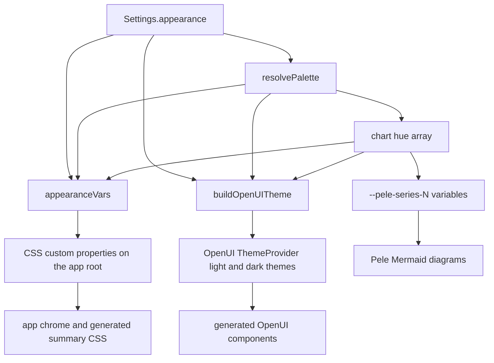

# Inkmark Design System and Appearance Tokens

Inkmark is the extension's visual identity: a reader's notebook. The paper and the ink stay
fixed per light or dark mode, and the user picks only two things — the **pen** (accent) and the
**highlighter** (marker). Everything else in the app is derived from those two colors.

Three files own the system:

| File | Responsibility |
| :--- | :--- |
| `lib/appearance.ts` | The `Appearance` model, the preset catalogue, palette resolution (including dark-mode derivation and WCAG luminance handling), the CSS variable map, and the OpenUI theme builder. |
| `components/Themed.tsx` | Applies the tokens: resolves the color mode, publishes the CSS variables on the app root, and mounts the OpenUI `ThemeProvider` with the derived light/dark themes. |
| `components/AppearancePanel.tsx` | The Settings → Appearance editor: preset swatches, custom pen and highlighter, color mode, corner style, reading font, and a live preview. |

## The Appearance object

`Appearance` is a plain, serializable record:

```ts
interface Appearance {
  preset: string;   // a preset id, or "custom"
  accent: string;   // pen color (hex)
  marker: string;   // highlighter color (hex)
  corners: 'soft' | 'square';
  readingFont: 'serif' | 'sans';
}
```

It is a field of `Settings` (`settings.appearance`) and is persisted with the rest of the
settings in `local:settings`. `normalizeSettings()` merges it onto `DEFAULT_APPEARANCE`, so a
settings blob written by an older version still yields a complete appearance object.

`DEFAULT_APPEARANCE` is the **Tide** preset: a teal pen `#0B7A83` with an aqua highlighter
`#A6F0E6`, soft corners and the serif reading font. The same values are hard-coded as the
`:root` defaults in `assets/app.css`, so the app looks like Tide even before any token is
applied.

### Preset catalogue

`PRESETS` holds five entries. Each preset stores the **light-mode** pen and highlighter; the
dark variant is derived, never stored:

| id | Name | accent (pen) | marker (highlighter) |
| :--- | :--- | :--- | :--- |
| `tide` | Tide | `#0B7A83` | `#A6F0E6` |
| `inkmark` | Inkmark | `#2E4BD6` | `#FFE45C` |
| `grove` | Grove | `#2E7D46` | `#DDF27C` |
| `orchid` | Orchid | `#A3328F` | `#FFC9EC` |
| `graphite` | Graphite | `#39404F` | `#FFD27A` |

## Palette resolution

`resolvePalette(appearance, dark)` is the single place where an `Appearance` becomes concrete
colors. It returns the accent family (`accent`, `accentHover`, `accentSoft`, `onAccent`), the
marker, and the chart hue array.

**Which colors win.** The preset is looked up by id first. If the preset id is unknown (or the
appearance is `custom`), the stored `accent` / `marker` are used, but only when they pass the
`isHex` check (a six-digit hex, with or without the leading `#`). Anything else falls back to
the default Tide colors. A malformed custom color therefore degrades to the default instead of
producing an unreadable accent.

**Dark-mode derivation.** A dark pen on dark paper does not read, so in dark mode the accent is
lifted toward white: while its WCAG relative luminance is below `0.22`, the color is mixed 18%
toward `#ffffff`, at most six times. The remaining colors are then derived from the (possibly
lifted) accent:

- `accentHover` — 12% toward white in dark mode, 12% toward black in light mode.
- `accentSoft` — mixed toward the paper (`#1B202B` in dark, `#FFFFFF` in light) by 82% / 90%.
- `onAccent` — the text color on top of the accent: dark ink `#141821` when the accent
  luminance exceeds `0.45`, otherwise white.
- `marker` — in dark mode the highlighter becomes a translucent band (`#RRGGBB6B`, i.e. alpha
  `0x6B`) instead of a solid block, because a solid highlighter on dark paper is a wall of
  color.

The luminance helper implements the WCAG relative-luminance formula (sRGB linearization with
the `0.03928` threshold, weighted `0.2126 / 0.7152 / 0.0722`), and `mix()` blends two colors
in RGB space.

**Chart hues.** The palette also produces the chart hue array: the accent first, followed by
five fixed supporting hues chosen to stay distinct next to any accent. There are two sets —
a light one (`#0F9D8A`, `#E59A1A`, `#7C4DDB`, `#E2555F`, `#5E6880`) and a dark one
(`#3CC8B4`, `#F2B54A`, `#A784F2`, `#F27C84`, `#9AA3B8`).

## The derivation chain



*How one Appearance object becomes the chrome variables, the OpenUI theme tokens and the shared
chart and diagram palette.*

### CSS variables for the app chrome

`appearanceVars(appearance, dark)` returns the inline style object that `Themed` puts on the app
root element:

- `--accent`, `--accent-hover`, `--accent-soft`, `--on-accent`, `--marker` — the resolved
  palette.
- `--font-reading` — the reading font stack: the serif stack
  (`"Source Serif 4 Variable", Georgia, "Times New Roman", serif`) or the sans stack
  (`"Bricolage Grotesque Variable", ui-sans-serif, system-ui, sans-serif`).
- `--r-sm`, `--r-md`, `--r-lg`, `--r-pill` — the corner radii. Soft corners are `8 / 12 / 16 /
  999px`; square corners are `2 / 3 / 4 / 4px`.
- `--pele-series-1` … `--pele-series-N` — one variable per chart hue.

The stylesheets consume these: `assets/app.css` for the app chrome and `assets/genui.css` for
the generated summary blocks. The marker color, for instance, paints the TL;DR highlighter
stroke behind the summary title and the brand swatch in the top bar.

The root element also carries `app--light` / `app--dark` and `corners--soft` /
`corners--square` class names, so a stylesheet can react to the mode and the corner style
besides consuming the variables.

### OpenUI theme tokens for the generated UI

The generated UI (the OpenUI components the model emits) is themed through the OpenUI
`ThemeProvider`, not through the CSS variables. `buildOpenUITheme(appearance)` returns the
`lightTheme` and `darkTheme` props, both created with `createTheme()`:

- Accent-driven tokens: `textNeutralLink`, `textBrand`, `interactiveAccentDefault`,
  `interactiveAccentHover`, `interactiveAccentPressed`, `borderAccent`, `highlightSubtle`.
- Fixed paper-and-ink tokens per mode: `background`, `foreground`, `textNeutralPrimary`,
  `textNeutralSecondary`, `textNeutralTertiary`, `borderDefault`, `shadowS`, `shadowM`.
- `fontBody` — the reading font; `fontHeading`, `fontLabel`, `fontNumbers` — always the sans
  stack.
- `radiusS` … `radiusXl` — square (`2 / 3 / 4 / 4px`) or soft (`6 / 10 / 14 / 18px`).
- All eight OpenUI chart palette keys (`defaultChartPalette`, `barChartPalette`,
  `lineChartPalette`, `areaChartPalette`, `pieChartPalette`, `radarChartPalette`,
  `radialChartPalette`, `horizontalBarChartPalette`) get the same resolved chart hue array, so
  every chart type draws from one palette.

#### The typography workaround

OpenUI composes its shorthand text tokens from its own default font: a token such as
`textBodyDefault` is the literal string `400 16px/1.5 "Inter", sans-serif`. Overriding
`fontBody` therefore does **not** change the rendered text — the shorthand still names Inter.
Setting `fontBody` alone would leave every OpenUI component in Inter while the app chrome uses
the chosen reading font.

`typographyTokens()` works around this by rebuilding the shorthands: it walks
`defaultLightTheme`, picks every string token whose key starts with `text` and whose value
contains `"Inter"`, and rewrites the font part of the shorthand. Body tokens (`textBody*`) get
the reading font stack, all other text tokens get the sans stack. The rebuilt tokens are merged
into both the light and the dark theme.

### One hue set for charts and diagrams

The chart hue array is published twice, and both copies come from the same `resolvePalette`
result:

- As OpenUI theme tokens (`*ChartPalette`), used by the OpenUI chart components.
- As CSS custom properties `--pele-series-1` … `--pele-series-N` on the app root.

Pele (the Mermaid renderer) paints from CSS custom properties at render time, so
`--pele-series-N` is what colors a diagram's series. Because both come from the same array, a
chart and a diagram inside one summary share one palette. The rest of the Pele variables
(`--pele-fg`, `--pele-muted`, `--pele-surface`, `--pele-border`, `--pele-accent`,
`--pele-radius`, …) are mapped from the app tokens in the `.g-diagram` rule of
`assets/genui.css`; see [Mermaid Diagrams](../integrations/mermaid-diagrams.md) for the
rendering pipeline.

## Where the tokens are applied

`Themed` is the root wrapper of every surface — the side panel, the full-page app, the popup
and the options page. It:

1. Resolves the color mode with `useIsDark(mode)`: `system` follows
   `prefers-color-scheme` and reacts to OS changes through a `matchMedia` listener; `light` and
   `dark` force the mode.
2. Builds the OpenUI theme and the CSS variables with `useMemo`, keyed on the appearance and
   the resolved mode, so switching mode does not rebuild the theme unnecessarily.
3. Renders `<ThemeProvider mode={dark ? 'dark' : 'light'}>` with the two derived themes.
4. Puts the CSS variables on the root `div`, whose class names carry `app--light`/`app--dark`
   and `corners--soft`/`corners--square`.
5. Sets `document.documentElement.style.colorScheme` and the page background outside the app
   (overscroll, side-panel edges) so the surface around the app follows the mode too.

`Themed` has a `root` flag. A nested `Themed` (the embedded settings draft) passes
`root={false}`: it still applies the appearance tokens, but it does not switch the interface
language of the whole page and does not touch the page background, so the surrounding result
view does not change while the user is still editing the draft.

`Themed` also publishes its root element through a React context
(`PortalContainerContext`), because Radix menus and selects portal into `document.body` by
default — outside the element that carries the Inkmark variables. Portaled UI portals into the
Inkmark root instead, so open menus keep the theme.

## Editing the appearance

`AppearancePanel` renders the settings UI:

- A radiogroup of preset swatches, each drawn as a pen stroke over a highlighter band. Picking
  a preset writes `preset`, `accent` and `marker` together.
- A "Custom" swatch switches `preset` to `custom`; only then are the two color fields
  (pen and highlighter) shown. The hex input is flagged `aria-invalid` when the value is not a
  valid hex, and the color picker falls back to `#000000` for invalid values.
- Segmented controls for the color mode (`system` / `light` / `dark`), the corner style
  (`soft` / `square`) and the reading font (`serif` / `sans`).
- A live preview drawn with the real summary classes (`g-hero`, `g-nums`, chips and a primary
  button), so what the user sees is what a result looks like.

The panel is stateless: it emits patches (`onChange`) and mode changes (`onModeChange`) that
the settings form merges into its draft copy of `Settings`. Like the rest of the settings form,
the edits are a draft until Save is pressed.

## Fonts

The two typefaces are bundled as variable fonts through `@fontsource-variable` packages
(`assets/fonts.ts` imports Bricolage Grotesque and Source Serif 4, Latin and Vietnamese
subsets). Nothing is fetched from a font CDN, so pages render offline.

## Extending the system

| To change | Edit | Effect |
| :--- | :--- | :--- |
| The colors of a preset | `PRESETS` in `lib/appearance.ts` | The new preset appears in the settings swatches; existing users keep the preset id and get the new colors. |
| A new preset | `PRESETS` and the `DEFAULT_APPEARANCE` | The swatch list is rendered from `PRESETS`, so no UI change is needed. |
| The default look | `DEFAULT_APPEARANCE` and the `:root` block in `assets/app.css` | The default appearance for new users; the CSS defaults must match the Tide values. |
| The dark-mode rules | `resolvePalette` | Accent lifting, hover/soft mixes, `onAccent` contrast and the translucent dark marker. |
| The chart hues | `CHART_SUPPORT_LIGHT` / `CHART_SUPPORT_DARK` | Both the OpenUI chart palettes and `--pele-series-N`. |
| Corner radii | `appearanceVars` and `buildOpenUITheme` | The CSS radius scale and the OpenUI radius tokens are set in two places and must stay consistent. |
| The OpenUI typography rebuild | `typographyTokens` | The set of shorthand text tokens that must be rebuilt when the default font changes. |
| How the chrome paints the tokens | `assets/app.css`, `assets/genui.css` | The visual result; the variables themselves are produced by `lib/appearance.ts`. |
