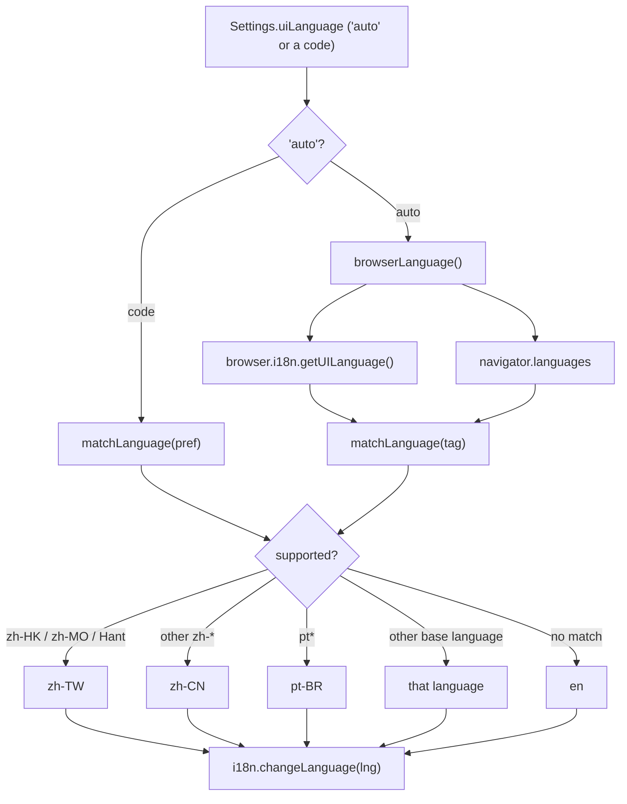

# Localization and Translation Workflow

The extension has **two independent localization systems**, and mixing them up is the most
common mistake when adding a language:

| System | Location | Read by | Language follows |
| :--- | :--- | :--- | :--- |
| **App UI** | `locales/<lang>/<namespace>.json` | `i18next` (`lib/i18n`) | The *Interface language* setting (Settings → Appearance), defaulting to the browser language |
| **Chrome chrome** | `public/_locales/<lang>/messages.json` | Chrome itself, via `browser.i18n.getMessage` and `__MSG_*__` manifest placeholders | The **browser** locale only; the user's Interface-language choice does not apply |

The UI language is a user preference the extension controls. The Chrome-level strings are owned
by the browser and cannot be switched by the extension at runtime.

## The app UI system (i18next)

### Layout and namespaces

One folder per language under `locales/`, one JSON file per feature namespace. The six
namespaces are declared in `lib/i18n/index.ts` as `NAMESPACES = ['common', 'picker', 'popup',
'session', 'settings', 'errors']`, with `common` as the default namespace.

| Namespace | Covers |
| :--- | :--- |
| `common` | Shared actions, source kinds, history list, model switcher |
| `picker` | The start screen ("What should I summarize?") |
| `popup` | The toolbar popup launcher |
| `session` | Summary, refinement chips, Q&A, generated-UI labels and toasts |
| `settings` | The whole Settings page |
| `errors` | User-facing error messages thrown from `lib/` |

Twelve languages ship today: `en`, `vi`, `ja`, `zh-CN`, `zh-TW`, `ko`, `es`, `fr`, `de`,
`pt-BR`, `ru`, `th`. The list is a single source of truth in `UI_LANGUAGES` in
`lib/i18n/index.ts`, which pairs each code with its native name (used by the language picker).

### Bundled at build time, not fetched at runtime

`lib/i18n/index.ts` collects every locale with Vite's `import.meta.glob`:

```ts
const files = import.meta.glob<Record<string, unknown>>('../../locales/*/*.json', { eager: true, import: 'default' });
```

The glob is resolved by the bundler, so all twelve languages are inlined into the extension
package. There is no runtime fetch of a locale file and no network dependency for translation.

`i18n.init()` is called with `fallbackLng: 'en'`, `supportedLngs` limited to the twelve codes,
`defaultNS: 'common'`, `interpolation.escapeValue: false` (React already escapes) and
`initAsync: false` so `t` is usable synchronously.

### One React-free core, one React binding

`lib/i18n/index.ts` deliberately has **no React dependency**, so plain `lib/` code and the
background can call `t` directly:

```ts
export const t = i18n.t.bind(i18n);
```

`lib/i18n/react.ts` registers the *same* instance with `initReactI18next`, and each UI entry
point (`entrypoints/app/main.tsx`, `entrypoints/options/main.tsx`, `entrypoints/popup/main.tsx`,
`entrypoints/sidepanel/main.tsx`) imports it before rendering. React components then use
`useTranslation('settings')` etc. and re-render when the language changes.

`components/Themed.tsx` mounts `<I18nextProvider i18n={i18n}>` and applies the language from
settings:

```tsx
useEffect(() => {
  if (root) setUiLanguage(settings.uiLanguage);
}, [root, settings.uiLanguage]);
```

The `root` guard matters: an **embedded** Settings draft (`root={false}`, used by the side
panel and the result tab) must not switch the whole page's language while the user is still
editing. Only the root `Themed` applies it.

### Language resolution



`matchLanguage()` normalizes a BCP 47 tag (underscores become hyphens) and maps it to one of
the twelve supported codes: `zh-HK`, `zh-MO` and anything containing `Hant` become `zh-TW`, any
other `zh-*` becomes `zh-CN`, any `pt-*` becomes `pt-BR`, and any other tag falls back to its
base language if that base is supported. `browserLanguage()` prefers
`browser.i18n.getUILanguage()` and then `navigator.languages`, and returns `en` when nothing
matches. `resolveUiLanguage()` turns the `"auto"` setting into a concrete language.

`setUiLanguage()` performs the runtime switch: it calls `i18n.changeLanguage()` only when the
language actually differs, and it also sets `document.documentElement.lang` so the document
declares the active language.

The language picker (`components/LanguagePicker.tsx`) is the one setting that applies and saves
**immediately** instead of waiting for the Save button, because nobody wants to read the rest of
the form in the old language. It writes the choice straight to `local:settings` via
`settingsItem.setValue`, and `useSettings()` propagates the change so the root `Themed`
re-applies it.

### Two different "language" settings

`Settings` carries two independent language fields:

- `uiLanguage` — the **interface** language, one of the twelve codes or `"auto"`.
- `language` — the **summary output** language, `"auto"` (same language as the source) or an
  explicit language name.

The output language is *not* an i18next concern: it is sent to the model as part of the prompt
rule in `lib/openui.ts`, which either says "Write ALL user-facing text in the same language as
the source" or names the chosen language. `components/SettingsForm.tsx` keeps a separate
`OUTPUT_LANGUAGES` list of sixteen languages (value = English name sent to the model, label =
native name), which is independent of `UI_LANGUAGES`.

### What stays in English

Only **user-visible labels** are translated. Strings that are addressed to the model stay in
English by design:

- `lib/refine.ts` — `REFINE_PROMPTS` (the text sent when a refinement chip is clicked) and
  `STYLE_RULES` (standing prompt rules). The chip *labels* and *tooltips* come from
  `session:refine.*` and `session:refineHint.*` in the locale files.
- `lib/openui.ts` — the summary/Q&A prompt rules, preamble and repair messages.

The file comment in `lib/refine.ts` states this explicitly: "Instructions are for the model, so
they stay in English; labels and descriptions are translated."

Error messages are the exception that proves the rule: `lib/llm.ts`, `lib/models.ts`,
`lib/page.ts`, `lib/extractors.ts` and `lib/settings.ts` build user-facing error text with
`t('errors:…')`, so errors are translated into the *current* interface language at the moment
they are produced.

### English is the source of truth, and its keys are type-checked

`lib/i18n/types.d.ts` augments the `i18next` module with the types of the **English** JSON
files:

```ts
declare module 'i18next' {
  interface CustomTypeOptions {
    defaultNS: 'common';
    resources: {
      common: typeof common;
      errors: typeof errors;
      picker: typeof picker;
      popup: typeof popup;
      session: typeof session;
      settings: typeof settings;
    };
  }
}
```

Because `typeof common` is the type of `locales/en/common.json`, a call such as
`t('settings:model.load')` fails to compile when the key is missing from English. A missing
English key is therefore a **compile error** caught by `pnpm compile`, not a runtime surprise.
Only English is type-checked; other locales are validated by the script below.

## The Chrome-level system (`public/_locales`)

`public/_locales/<lang>/messages.json` holds the strings Chrome itself reads:

| Key | Used for |
| :--- | :--- |
| `extName` | Manifest `name` (`__MSG_extName__`) — the brand, not translated |
| `extDescription` | Manifest `description` (`__MSG_extDescription__`) |
| `actionTitle` | Toolbar icon tooltip (`__MSG_actionTitle__`) |
| `commandOpen` | Keyboard shortcut description (`__MSG_commandOpen__`) |
| `menuSummarizePage` | Context-menu title "Summarize this page" |
| `menuSummarizeSelection` | Context-menu title "Summarize selection" |

The manifest placeholders are declared in `wxt.config.ts`, together with
`default_locale: 'en'`.

The two context-menu titles are read at runtime in `lib/context-menus.ts`:

```ts
const msg = (key: 'menuSummarizePage' | 'menuSummarizeSelection', fallback: string) =>
  browser.i18n.getMessage(key) || fallback;
```

The English fallback keeps the menu usable if a locale file is missing the key.

The directory names use Chrome's **underscore** convention (`pt_BR`, `zh_CN`, `zh_TW`), unlike
`locales/`, which uses BCP 47 hyphens (`pt-BR`, `zh-CN`, `zh-TW`). There is no script that
keeps the two trees in sync; they are maintained by hand and share the same twelve languages.

## The locale check script

`scripts/check-locales.mjs` (`pnpm check:i18n`) compares every non-English locale against
English and exits with code 1 on any drift. It reads the namespace list from `locales/en` and
the language list from the directories next to it.

For each namespace and language it:

- **Flattens** both files (nested objects become dotted keys).
- **Derives plural bases** from the English keys: a key ending in `_zero|_one|_two|_few|_many|_other`
  is a pluralised key.
- **Computes the required plural categories** with `new Intl.PluralRules(lng).resolvedOptions().pluralCategories`
  — CLDR data for the target language. Russian therefore needs `questions_one`, `questions_few`,
  `questions_many` and `questions_other`; English needs only `_one` and `_other`; French needs
  `_one`, `_many` and `_other`. The translation must supply exactly those keys.
- **Checks placeholders**: the sorted set of `{{…}}` tokens in a translation must equal the
  English set, so `{{count}}` or `{{provider}}` cannot be dropped or renamed.
- **Rejects empty strings** (a whitespace-only value is an error).
- **Rejects unexpected keys** present in the translation but absent from English.
- **Reports missing or invalid JSON** per language file.

On success it prints `✓ 11 locales × 6 namespaces match English.`; on failure it prints the
number of problems and exits non-zero.

The script only covers the `locales/` tree. The `public/_locales/` messages are not checked by
it.

`pnpm check` runs the three gates together: `pnpm compile` (TypeScript, including the
English-key type check), `pnpm check:i18n` and `pnpm check:examples`.

## Adding a language, end to end

1. **Create the UI locale folder** `locales/<code>/` with all six namespace files
   (`common`, `picker`, `popup`, `session`, `settings`, `errors`). Copy `locales/en/*` and
   translate. Keep the `{{placeholders}}` exactly as they are, and provide the plural forms your
   language needs (`Intl.PluralRules` tells you which).
2. **Register the code** in `UI_LANGUAGES` in `lib/i18n/index.ts` with its native name. The code
   must be one i18next can resolve; use the BCP 47 hyphenated form (`pt-BR`, `zh-CN`).
3. **Create the Chrome-level file** `public/_locales/<code_with_underscores>/messages.json`
   with the six keys, using Chrome's underscore naming (`pt_BR`, `zh_CN`).
4. **Run `pnpm check:i18n`** (and `pnpm compile`) and fix every reported problem: missing keys,
   wrong plural categories, mismatched placeholders, empty or extra strings.
5. Optionally extend `matchLanguage()` if the new language needs special regional mapping
   (as `zh-*` and `pt-*` do today).

Nothing else needs to change: the glob picks the new folder up at build time, the `UI_LANGUAGES`
entry makes the language selectable in Settings, and `browserLanguage()` will pick it up
automatically when the browser locale matches.

## Focused checks when you touch translations

- `pnpm check:i18n` — locale parity, plurals, placeholders.
- `pnpm compile` — catches a missing **English** key at the call site.
- `pnpm check:examples` — not a locale check, but it guards the model-facing prompt examples
  that the translation work usually touches alongside.

There are no unit tests for the i18n helpers themselves; `matchLanguage()`, `browserLanguage()`
and `resolveUiLanguage()` are covered indirectly by `pnpm check:i18n` for the file shape and by
manual inspection for the mapping table.
