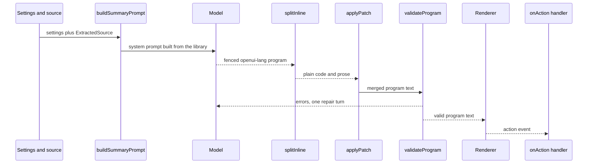

# OpenUI Lang Program Model and Library

The extension does not let the model write free-form UI code. The model writes **OpenUI Lang**, a
small statement language (`root = Card([...])`, `hero = SummaryHero("...", "...")`) that the
OpenUI parser turns into a component tree, and the OpenUI `Renderer` paints that tree with
React components.

Three files own this domain model:

| File | Responsibility |
| :--- | :--- |
| `lib/library.tsx` | The component library: the extended OpenUI chat library, the custom components, the custom actions, and the root component name. |
| `lib/openui.ts` | The prompt, the parser instance, the rule sets, `splitInline`, `validateProgram`, `validateDiagrams`, `applyPatch`. |
| `lib/generate.ts` | The turn loop that streams, splits, merges, validates and repairs a program. |

Everything else (`components/GenUI.tsx`, `components/SessionView.tsx`, `components/useSession.ts`)
<!-- openwiki: broken internal link [../architecture/ui-components.md] file "../architecture/ui-components.md" does not exist. Fix the href or restore the target, then delete this comment. -->
consumes these APIs; see [React UI Components](../architecture/ui-components.md) for the React
side and [In-browser CSV Query Tools](csv-data-tools.md) for the tool-gated part of the prompt.

## The program/prompt/parse/render chain



Caption: the library defines the prompt, the model answers with a program, the program is
split, merged, validated (with one repair turn) and finally handed to the Renderer, which
reports actions back to the app.

## The library

`lib/library.tsx` starts from the OpenUI chat library (`openuiChatLibrary` from
`@openuidev/react-ui`, whose root component is `Card`) and extends it:

```ts
export const library = openuiChatLibrary.extend({
  components: {
    add: [
      { component: SummaryHero, slots: ['Card.children'] },
      { component: KeyNumbers, slots: CONTENT_SLOTS },
      { component: Takeaways, slots: CONTENT_SLOTS },
      { component: Timeline, slots: CONTENT_SLOTS },
      { component: SourceQuote, slots: CONTENT_SLOTS },
      { component: Diagram, slots: CONTENT_SLOTS },
      KeyNumber,
      Takeaway,
      TimelineEvent,
    ],
  },
  actions: { add: [highlightInPage, copyText] },
});

export const ROOT = 'Card';
```

`CONTENT_SLOTS` is `['Card.children', 'SectionItem.content', 'TabItem.content',
'AccordionItem.content']` — the places where a block may be dropped. `SummaryHero` is narrower: it
is only allowed directly inside `Card.children`, because it is the opening block of a summary.
`KeyNumber`, `Takeaway` and `TimelineEvent` are the *children* of the strip components; the
comment in the source says they are not placed directly in the `Card`.

The six custom components are:

- **`SummaryHero(title, tldr, source?, readMinutes?)`** — the opening block: source title, a
  one-sentence TL;DR rendered with a highlighter mark, optional origin and reading time. The
  marker is only drawn once streaming has finished (`useIsStreaming()`).
- **`KeyNumbers([KeyNumber(value, label, change?)])`** — a strip of 2–4 headline figures; the
  optional signed change drives an up/down modifier class.
- **`Takeaways([Takeaway(text, detail?)])`** — 3–6 short key points, most important first.
- **`Timeline([TimelineEvent(when, what)])`** — dated events or ordered stages.
- **`SourceQuote(quote, note?)`** — a verbatim quote with a "show in page" and a "copy" button.
- **`Diagram(mermaid, caption?)`** — a Mermaid diagram rendered as SVG.

They carry the visual identity of the app through the `g-*` classes in `assets/genui.css`; the
built-in OpenUI components stay available for everything else.

`ROOT` is `'Card'`, and it is used twice: as the root name passed to the parser
(`createParser(library.toJSONSchema(), ROOT)`) and in the error message that asks for a root
component when a program has none.

### Why the library lives at module scope

The library object is created once, when `lib/library.tsx` is evaluated, and the parser in
`lib/openui.ts` is created once from it:

```ts
const parser = createParser(library.toJSONSchema(), ROOT);
```

The source comment states the reason: *"Created at module scope because parsers memoize by
library identity."* If the library were rebuilt on every render or on every call, the schema and
the parser would be rebuilt with it, and the identity that the memoization keys on would change
every time. A stable module-scope library keeps the parse result, the schema and the streaming
parser stable for the lifetime of the extension page.

### Custom actions and their contract

Two custom actions are registered on the library:

- `HighlightInPage(text)` — scrolls the original web page to an exact quote and highlights it.
- `CopyText(text)` — copies text to the user clipboard.

The contract is deliberately narrow:

1. **The Renderer never runs a custom action.** It emits an event to `onAction`; the app decides
   what happens. `components/SessionView.tsx` switches on `event.type` and handles
   `'HighlightInPage'` (only for `webpage` sources with a `tabId`; it focuses the tab and calls
   `highlightInTab`) and `'CopyText'` (writes to the clipboard).
2. **A custom action fired from a component must be an `ActionPlan` step.** The helper in
   `lib/library.tsx` wraps the call:

   ```ts
   const customAction = (name: string, params: Record<string, unknown>): ActionPlan => ({
     steps: [{ type: 'custom_action', name, params }],
   });
   ```

   `SourceQuote` uses `triggerAction('', undefined, customAction(highlightInPage.name, { text:
   props.quote }))`. The legacy `{ type, params }` form is **silently dropped** by the Renderer
   when `type` names a registered custom action, so a click would never reach `onAction` — the
   source comment says exactly that, and the Renderer's action dispatch only forwards a
   non-`ActionPlan` action when its type is *not* a registered action.

The buttons are disabled while streaming, so a half-streamed quote cannot be copied or
highlighted.

## Building the prompt from the library

`lib/openui.ts` builds the system prompt in two halves.

**The library half.** `library.prompt(...)` renders the language itself: the component
signatures and descriptions, the component groups, the built-in actions, the streaming and
hoisting rules, and — because the summary prompt sets `editMode: true` and `inlineMode: true` —
the edit-mode and inline-mode sections. The base options come from
`openuiChatPromptOptions` (the OpenUI chat examples and rules) plus `SHARED_RULES`, and the
summary prompt adds three more worked examples on top:

| Example | File | Shows |
| :--- | :--- | :--- |
| `VISUAL_SUMMARY_EXAMPLE` | `lib/summary-example.ts` | Hero, key numbers, takeaways, tags, timeline, quote, folded sections, follow-ups. |
| `CHART_SUMMARY_EXAMPLE` | `lib/chart-example.ts` | One chart per insight, each preceded by a `TextContent(..., "small-heavy")` caption, values taken only from the source. |
| `DIAGRAM_SUMMARY_EXAMPLE` | `lib/diagram-example.ts` | A small Mermaid flowchart inside a `Diagram`, with no styling. |

All three are complete programs that were validated against the library with the parser (and the
diagram one with Pele), so the model sees examples that actually parse.

**The task half.** A `## Summarization task` (or `## Q&A task`) section is appended as a bullet
list of rules. The rule sets are:

| Rule set | Where | What it constrains |
| :--- | :--- | :--- |
| `VISUAL_RULES` | `lib/openui.ts` | Visual-first summary: always start with `SummaryHero`, numbers into `KeyNumbers`, points into `Takeaways`, dates into `Timeline`, topics into `TagBlock`, no paragraphs longer than two short sentences, no top-level `MarkDownRenderer`. |
| `CHART_RULES` | `lib/openui.ts` | When to chart (3+ comparable numbers), which chart per data shape (time series → `LineChart`/`AreaChart`, categories → `BarChart`/`HorizontalBarChart`, parts of a whole → `PieChart` "donut" or `SingleStackedBarChart`, several series → grouped `BarChart` or multi-series `LineChart`, single score → `RadialChart`, few attributes → `RadarChart`, two numeric variables → `ScatterChart`), max 12 data points, data only from the source. |
| `DIAGRAM_RULES` | `lib/openui.ts` | When a diagram beats a list (4+ step process, decision logic, actors over time, lifecycle, concept map, data model), at most one diagram per summary, and the Mermaid syntax constraints (4–12 nodes, short labels, no `style`/`classDef`/`click`/`linkStyle`, `flowchart TD` by default, `\n` for line breaks and `\"` for inner quotes inside the openui-lang string). |
| `LENGTH_RULES` | `lib/openui.ts` | One rule per `SummaryLength` (`short`, `medium`, `detailed`), selected from `settings.length`. |
| `STYLE_RULES` | `lib/refine.ts` | The standing styles from Settings → Summary → "Always include" (`actionItems`, `timeline`, `simpler`). |
| `LAYOUT_RULES` | `lib/openui.ts` | Layout per surface: `tab` (~800px) allows up to 4 `KeyNumbers` and 5-column tables; `sidepanel` (~400px) allows max 3 `KeyNumbers` and 3-column tables. Selected from `settings.display`. |
| `KIND_RULES` | `lib/openui.ts` | One rule per `SourceKind` (`webpage`, `text`, `pdf`, `markdown`, `csv`): what to ignore, whether `Card` sources and `[1]` citations apply, and whether `@HighlightInPage` may be used. |
| `SHARED_RULES` | `lib/openui.ts` | Grounding: only use facts present in the source, quotes copied verbatim, `@CopyText` for copyable text, `@OpenUrl` only for links that appear in the source. |
| User rules | `lib/openui.ts` | Output language (`auto` follows the source, otherwise the configured language) and the user's own `customInstructions`. |

Both prompts are cached: `cachedPrompt` keys on `summary:<kind>:<hasCsv>` and
`qa:<kind>:<hasCsv>`, so the library half is assembled once per source kind, while the
settings-dependent half (length, styles, layout, language, custom instructions) is rebuilt on
every call.

The Q&A prompt (`buildQaPrompt`) uses the same library half but a different task half: it allows
a plain-text answer for short factual questions and asks for a compact `Card` only when the
answer has structure.

### The CSV gate

`toolOptions(source)` adds the CSV tool specs, the CSV tool example, `toolCalls: true` and
`bindings: true` **only** when the source is a CSV that carries a dataset. Other source kinds
keep the lean prompt. See [In-browser CSV Query Tools](csv-data-tools.md) for the tool contract
itself.

## The three output modes

The model can answer in three shapes, and the app handles each differently:

1. **Full program.** The first summary turn: one ```` ```openui-lang ```` fence containing the
   complete program. This is the default mode of the summary prompt.
2. **Edit-mode patch.** A refinement turn: the model sees the current program in the
   conversation (fenced by `lib/generate.ts`) and returns **only the changed statements**. The
   runtime merges by statement name, so unchanged statements survive. The edit-mode section of
   the generated prompt explains the merge semantics and the patch-size guide (1–10 statements).
3. **Inline prose plus code.** The Q&A mode (`inlineMode: true`): the model may write a short
   sentence outside the fence and a program inside it, or — for a plain question — no code at
   all. `splitInline` is what separates the two halves.

Mode 2 and mode 3 are not mutually exclusive: the summary prompt sets both `editMode: true` and
`inlineMode: true`, so a refinement turn may add one short sentence outside the fence.

## `splitInline` — prose vs. code

`splitInline(text)` returns `{ prose, code }`. It is written to work **while streaming**, so an
unclosed fence is handled like an open one. The rules:

- A fence line matches `/^[ \t]*```[ \t]*([\w.+-]*)[ \t]*$/`. The optional tag decides what
  happens to the lines inside it.
- A fence is treated as a **code fence** when the tag is empty or starts with `openui`
  (`fenceIsCode = tag === '' || tag.startsWith('openui')`). Its content goes to `code`.
- **Other code fences stay prose.** A ```` ```ts ```` block is not openui-lang, so its lines are
  pushed into `prose` — the host renders the prose as Markdown and the fenced TypeScript is
  shown to the user instead of being swallowed.
- **A missing fence is treated as code when the first line looks like a statement.** If no fence
  was seen at all and the first non-empty line matches
  `/^\s*\$?[A-Za-z_]\w*\s*=(?!=)/` (an assignment that is not `==`), the whole text is returned
  as `code` with empty prose. This rescues a model that forgot the fence.
- **A fence with no statement in it is returned as prose.** If the code block contains no line
  that looks like a statement, the entire text goes back to `prose` and `code` is empty — a
  fenced code sample is not a program.

The comment above the function states the reason for the split: *"The Renderer strips fences
itself, but the host must render the prose, and `mergeStatements` needs plain code."* The host
does exactly that in `components/SessionView.tsx`: the `Answer` component splits the raw answer,
renders `prose` with `MarkDownRenderer` and hands `code` to `GenUI`.

## Validation and repair

### `validateProgram`

`validateProgram(program)` parses the program and returns `{ ok, errors }`:

- **Parser errors** (`result.meta.errors`) are mapped to LLM-readable strings, prefixed with the
  offending statement id when there is one: `"n1": missing required property "value"`.
- **Missing root**: when `result.root` is absent, an extra error is pushed first:
  `No root component. The program must define \`root = Card([...])\`.`
- **Unresolved references**: `result.meta.unresolved` lists names that are used but never
  defined, and they are appended as one error line.

The errors are written to be sent straight back to the model.

### `validateDiagrams`

`validateDiagrams(program)` walks the parsed tree, collects every `Diagram` element with its
`mermaid` prop and renders it with Pele. A Mermaid failure becomes an error string with the
diagram's statement id, so a broken diagram is repaired in the same turn as a broken program.
`lib/diagram.ts` turns a Pele error into a readable message with line, column and a short snippet.

### The repair turn

`lib/generate.ts` runs one turn and, if the program is invalid, sends the errors back to the
model **once**:

- `fullCheck` combines the parser check and the diagram check.
- `buildRepairMessage(errors, editMode)` asks for "only the corrected statements" in edit mode
  and for the complete corrected program otherwise — always in one ```` ```openui-lang ```` fence
  and with no explanation.
- The repair is not streamed: the UI keeps showing the first attempt while it runs.
- The fix is kept only if it is **not worse** (`recheck.errors.length <= check.errors.length`).
- If the program was still invalid after the repair, the remaining errors are surfaced to the
  user as a warning (see `reportRemaining` in `components/useSession.ts`).

`components/GenUI.tsx` then filters the Renderer's own error callback: while streaming nothing
is shown, warnings are dropped (the program still renders), and **parser** errors are dropped
because the repair loop already handled them. Everything else (runtime, render and tool errors)
is listed in a `<details>` block with its `code`, `statementId` and message.

## Edit-mode merging

`applyPatch(previous, patch)` is the app-side wrapper around the runtime's `mergeStatements`:

```ts
export function applyPatch(previous: string, patch: string) {
  if (!previous.trim()) return patch;
  if (!patch.trim()) return previous;
  return mergeStatements(previous, patch);
}
```

The two guards make the same function serve both roles: on the first turn there is no program
yet, so the patch *is* the program; an empty patch leaves the program untouched. `mergeStatements`
merges by statement name — the same name replaces, a new name appends — and garbage-collects
statements that are no longer reachable from the root, which is how removing a component from a
parent's children array deletes it.

`lib/generate.ts` uses it on both paths: `generateSummary` always runs in edit mode (with an
empty previous program for the first turn), while `generateAnswer` runs in full-program mode and
takes the model's code as-is.

## The `Diagram` component

`Diagram` is the one custom component with runtime behaviour of its own:

- It waits for the stream to end before rendering. Partial Mermaid is almost always invalid, so
  the component shows a "drawing" placeholder while `useIsStreaming()` is true.
- It measures itself with a `ResizeObserver` and rounds the width down to 40px steps, so small
  resizes do not re-layout the diagram.
- It renders through Pele with `maxWidth: width` and `directionBreakpoint: 760`: wide
  left-to-right flows flip to top-down when the container is too narrow, which is the difference
  between the side panel and the full tab.
- On failure it shows the error message as text inside a `<details>` block, because the message
  can contain Mermaid source.

Pele itself is configured with `links: false`, `images: false` and a `limit` of 20 000 in
`lib/diagram.ts` — the model's output is untrusted, so a diagram cannot contain a clickable link
or a remote image.

## Where to change what

| Change | File |
| :--- | :--- |
| A new custom block, its props, or its allowed slots | `lib/library.tsx` |
| A new custom action and its app-side handler | `lib/library.tsx` (definition) and `components/SessionView.tsx` (handler) |
| A new rule for the model, or a change to the visual/chart/diagram policy | `lib/openui.ts` |
| A new standing summary style | `lib/refine.ts` (the style) and the `STYLE_RULES` table it feeds |
| A new worked example | `lib/summary-example.ts`, `lib/chart-example.ts` or `lib/diagram-example.ts` |
| The repair loop, the merge, or what is streamed | `lib/generate.ts` |
