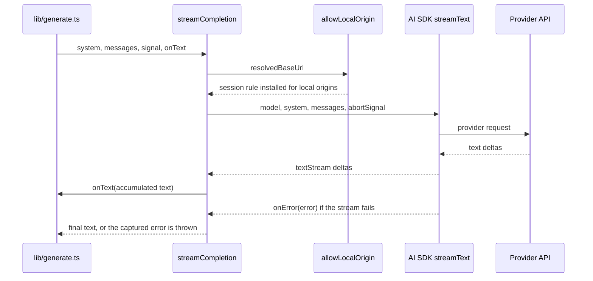
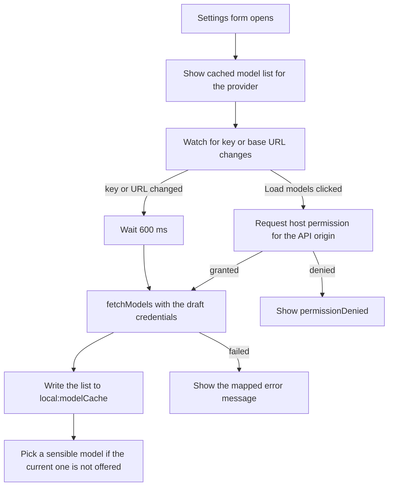

# LLM Providers and Model Configuration

The extension is bring-your-own-key: there is no backend, and the browser calls the LLM provider
directly. Everything that concerns "which provider, with which key, on which base URL, with which
model" lives in a small, well-bounded corner of the codebase:

| Module | Responsibility |
| --- | --- |
| `lib/settings.ts` | The provider catalogue (`PROVIDERS`), the `Settings` shape, per-provider credentials, `getActiveProvider()`, `configProblem()`, and the runtime host-permission request. |
| `lib/llm.ts` | Building the AI SDK model for the active provider (`createModel`), streaming a completion (`streamCompletion`), and mapping provider errors to user-facing text (`describeError`). |
| `lib/models.ts` | Fetching the live model list per provider (`fetchModels`), the non-chat filter, the Ollama capability filter, the `local:modelCache` item, and `isProviderConnected()`. |
| `lib/local-origin.ts` | The `declarativeNetRequest` session rule that rewrites the `Origin` header for local servers, so Ollama accepts requests without `OLLAMA_ORIGINS`. |
| `components/SettingsForm.tsx` | The settings surface: provider picker, key, base URL, model, plus the model-loading lifecycle and the permission requests. |
| `components/ModelSwitcher.tsx` | A cross-provider model picker that reads `local:modelCache` and switches provider and model together. |

## The provider catalogue

`PROVIDERS` (`lib/settings.ts`) maps a `ProviderId` to a `ProviderPreset`. A preset carries the
display label, the API flavour, the default base URL, a suggested default model, whether a key is
required, an optional "get a key" URL, and a `local` flag for providers that run on the user's
machine.

Twelve provider ids exist: `openai`, `anthropic`, `google`, `openrouter`, `groq`, `deepseek`,
`mistral`, `xai`, `together`, `ollama`, `lmstudio`, `custom`. Only three of them are first-party
API flavours; the rest are OpenAI-compatible gateways, and three are local servers.

### Four API flavours

The `ProviderApi` type is the single switch that decides how a provider is called and how its
model list is fetched:

| `api` | Meaning | AI SDK provider | Model-list request |
| --- | --- | --- | --- |
| `openai` | OpenAI **Responses** API | `createOpenAI(...)` (default model = Responses API) | `GET {base}/models` with `Authorization: Bearer …` |
| `anthropic` | Anthropic **Messages** API | `createAnthropic(...)` | `GET {base}/models?limit=1000` with `x-api-key` |
| `google` | **Gemini** API | `createGoogleGenerativeAI(...)` | `GET {base}/models?pageSize=1000` with `x-goog-api-key` |
| `compatible` | Any OpenAI-compatible **Chat Completions** endpoint | `createOpenAI(...).chat(model)` | `GET {base}/models` with `Authorization: Bearer …` (omitted when there is no key) |

The `openai` preset is the only one that uses the Responses API. The distinction matters because
OpenAI-compatible servers implement Chat Completions, not Responses — so the `compatible` flavour
calls `.chat(p.model)` explicitly, and the comment in `lib/llm.ts` says so. In the AI SDK,
`createOpenAI(...)(modelId)` resolves to the Responses model; `.chat(modelId)` is the Chat
Completions model.

`custom` is the escape hatch: it has an empty `defaultBaseUrl`, no key requirement, and is the
only provider whose base URL the user must supply.

## Per-provider credentials

`Settings.providers` is a `Partial<Record<ProviderId, ProviderConfig>>`, and each
`ProviderConfig` holds `{ apiKey, baseUrl, model }`. The active provider is only a pointer
(`Settings.provider`), so **switching providers keeps every key and model that was already
entered** — the settings form never overwrites another provider's entry.

`getProviderConfig(s, id)` merges the stored entry over the defaults
(`{ apiKey: '', baseUrl: '', model: PROVIDERS[id].defaultModel }`), so a provider that was never
configured still resolves to its preset's suggested model and default base URL.

`getActiveProvider(s)` adds the resolved base URL: the user's `baseUrl` if set, otherwise the
preset's `defaultBaseUrl`, with trailing slashes stripped. The result is what the request path
uses, and it is the value that decides whether a provider counts as "local".

The whole `Settings` object — keys included — lives in `local:settings`
(`chrome.storage.local`), never in `sync:`, so API keys never travel through the user's browser
<!-- openwiki: broken internal link [../architecture/storage-and-state.md] file "../architecture/storage-and-state.md" does not exist. Fix the href or restore the target, then delete this comment. -->
account. See [Storage and Session State](../architecture/storage-and-state.md).

## Configuration is validated before every call

`configProblem(s)` returns a short, user-facing message or `null` when the configuration is
usable. The checks are ordered:

1. **Missing base URL** → `errors:config.baseUrl`. Only reachable for the `custom` provider,
   whose `defaultBaseUrl` is empty.
2. **Missing API key** for a provider whose preset has `needsKey: true` → `errors:config.apiKey`
   with the provider's label interpolated.
3. **Empty model** → `errors:config.model`.

Keyless providers (Ollama, LM Studio, custom) skip check 2; `custom` also shows an *optional*
API key field in the form, and `compatible` providers send a placeholder key (`'not-needed'`) when
none is set.

`useSession` calls `configProblem(settingsRef.current)` at the start of `start()`, `refine()`,
`resummarize()` and `ask()`, and refuses to run when it returns a message. The app surface also
computes the same problem on every render and shows it as a banner with a link to Settings, so an
unconfigured provider is visible before the user triggers a request.

## Building the model

`createModel(settings)` resolves the active provider and switches on `p.preset.api`:

```ts
switch (p.preset.api) {
  case 'anthropic':
    return createAnthropic({
      apiKey: p.apiKey,
      baseURL,
      // Required by Anthropic when calling the API from a browser context.
      headers: { 'anthropic-dangerous-direct-browser-access': 'true' },
    })(p.model);
  case 'google':
    return createGoogleGenerativeAI({ apiKey: p.apiKey, baseURL })(p.model);
  case 'openai':
    return createOpenAI({ apiKey: p.apiKey, baseURL })(p.model);
  case 'compatible':
    // OpenAI-compatible servers implement Chat Completions, not the Responses API.
    return createOpenAI({ apiKey: p.apiKey || 'not-needed', baseURL, name: p.id }).chat(p.model);
}
```

Three details are load-bearing:

- The **Anthropic browser-access header** `anthropic-dangerous-direct-browser-access: true` is
  added because Anthropic refuses direct browser calls without it. The same header is sent when
  the Anthropic model list is fetched.
- The **provider name** passed to `createOpenAI` for the `compatible` flavour is the provider id
  (`p.id`), so the AI SDK error messages and provider metadata name the right server.
- The **`compatible` flavour uses `.chat()`**, which is the Chat Completions API.

## Streaming a completion

`streamCompletion({ settings, system, messages, signal, onText })` is the only entry point to the
provider:



The accumulated text is handed to `onText` after every delta, which is what makes the summary
appear while it is still being generated. Errors that happen *after* the stream started are
captured in the `onError` callback and re-thrown after the loop, so a mid-stream failure is
reported as an error rather than as a truncated success.

`lib/generate.ts` is the only caller: it streams the first turn, validates the generated program,
and — if validation fails — sends the errors back to the model once. The repair turn reuses
`streamCompletion` but with an `onText` callback that discards the text, because the repair
output is a patch and the UI keeps showing the first attempt meanwhile. See
[Summary Generation](../workflows/summary-generation.md).

## Mapping provider errors to user-facing messages

`describeError(err, settings?)` turns a raw provider or network error into a short, actionable
message:

| Condition | Message key | Meaning |
| --- | --- | --- |
| `err.name === 'AbortError'` | `errors:llm.stopped` | The user stopped the request. |
| HTTP 403 **and** the active base URL is local | `errors:llm.localRefused` | The local server refused the request; the hint tells the user to open Settings and click Save to grant access. |
| HTTP 401 | `errors:llm.keyRejected` | The API key was rejected. |
| HTTP 403 (not local) | `errors:llm.accessDenied` | The key may not have access to this model. |
| HTTP 404 | `errors:llm.notFound` | Wrong model name or base URL. |
| HTTP 429 | `errors:llm.rateLimited` | Rate limited or out of quota. |
| Message matches `Failed to fetch` / `NetworkError` / `Load failed` | `errors:llm.network` | Network, CORS, or missing host permission for the API domain. |
| Anything else | — | The raw error message is shown. |

The "local" test is `isLocalUrl(getActiveProvider(settings).resolvedBaseUrl)`, so the same 403
produces a *different* message for Ollama than for a hosted provider: for a local server the
cause is almost always the missing `Origin` rewrite or the missing host permission, not a
forbidden key. When no `settings` are passed, the local special case cannot apply and every 403
is reported as `accessDenied`.

`useSession` calls `describeError(e, settingsRef.current)` in every catch block, and the message
becomes the session error shown in the app's error banner.

## The local-provider Origin rewrite

Local servers such as Ollama reject requests whose `Origin` is `chrome-extension://…` with HTTP
403, unless the user sets `OLLAMA_ORIGINS`. Chrome omits `Origin` on simple GETs (so listing
models works) but always sends it on POST — which is why generation fails while listing does not.

`lib/local-origin.ts` solves this with a **declarativeNetRequest session rule** that rewrites
the `Origin` header to the server's own origin:

```ts
await browser.declarativeNetRequest.updateSessionRules({
  removeRuleIds: [id],
  addRules: [
    {
      id,
      priority: 1,
      action: {
        type: 'modifyHeaders',
        requestHeaders: [{ header: 'origin', operation: 'set', value: origin }],
      },
      condition: {
        urlFilter: `|${origin}/`,
        initiatorDomains: [browser.runtime.id],
        resourceTypes: ['xmlhttprequest', 'other'],
      },
    },
  ],
});
```

Properties of this mechanism that matter:

- **Restricted to this extension.** The rule's `initiatorDomains` is `browser.runtime.id`, so it
  only matches requests the extension itself initiates. A web page cannot use the extension's
  rule to bypass the local server's own origin protection.
- **Session-scoped.** `updateSessionRules` writes to the session rule store, so the rules die with
  the browser session and do not persist as a user-visible extension permission.
- **One rule per origin.** The rule id is derived from a stable hash of the origin
  (`ruleIdFor`), and the same id is removed before it is added, so repeated calls replace the
  rule instead of failing on a duplicate id.
- **Applied at most once per origin.** An in-memory `applied` set short-circuits repeated calls
  for the same origin within the page's lifetime.
- **Only for local hosts.** `isLocalUrl` matches exactly `localhost`, `127.0.0.1`, `0.0.0.0` and
  `[::1]`; anything else returns `false` and no rule is installed.

`allowLocalOrigin` is called from two places: at the start of `streamCompletion` (before the
provider request) and at the start of `fetchModels` (before the model-list request).

## Fetching the live model list

`fetchModels(id, cfg, signal)` asks the provider which models exist, using the user's own key.
The base URL is the user's `baseUrl` or the preset default, with trailing slashes stripped; an
empty base URL throws `errors:models.baseUrlRequired`.

The request shape follows the API flavour:

- **Anthropic**: `GET {base}/models?limit=1000` with `x-api-key`, `anthropic-version: 2023-06-01`
  and the `anthropic-dangerous-direct-browser-access: true` header. The response's `data[]` is
  mapped to `{ id, label: display_name }`.
- **Gemini**: `GET {base}/models?pageSize=1000` with `x-goog-api-key`. Only models whose
  `supportedGenerationMethods` include `generateContent` are kept, and the `models/` prefix is
  stripped from the id.
- **OpenAI and compatible**: `GET {base}/models`. The `Authorization: Bearer …` header is only
  sent when a key is present. The response may be a bare array or an object with `data` or
  `models`; all three shapes are accepted.

### Filtering

Every list is filtered by `NON_CHAT`, a regular expression that removes obviously non-chat
models: `embed`, `embedding`, `whisper`, `tts`, `audio`, `transcribe`, `dall-e`, `image`,
`moderation`, `rerank`, `realtime`, `search`, `guard`, `vision-preview`.

Ollama gets a second, stricter filter. Ollama lists every installed model, including ones that
cannot chat (they fail with "does not support chat"), so `keepOllamaChatModels` asks the native
API about each model:

```ts
const res = await fetch(`${nativeBase}/api/show`, {
  method: 'POST',
  headers: { 'Content-Type': 'application/json' },
  body: JSON.stringify({ model: m.id }),
  signal,
});
```

`nativeBase` is the base URL with a trailing `/v1` removed, because `/api/show` lives on the
native Ollama API, not on the OpenAI-compatible `/v1` path. A model is kept when `/api/show`
reports the `completion` capability. When the request fails or the response is not ok, the model
is **kept** — an unknown capability is treated as "probably usable" rather than hiding a model
that might work.

The final list is sorted by model id.

### Errors during model loading

`getJson` translates transport failures into the same message vocabulary as the request path:

| Condition | Message key |
| --- | --- |
| `fetch` throws (network, CORS, missing permission) | `errors:models.unreachable` |
| HTTP 401 | `errors:models.keyRejected` |
| HTTP 403 | `errors:models.forbidden` (hints at granting access for local servers) |
| Any other non-ok status | `errors:models.http` with the status number |

## The model cache

`modelCacheItem` is `storage.defineItem<Partial<Record<ProviderId, ModelOption[]>>>('local:modelCache')`
in `chrome.storage.local`. It maps a provider id to the last model list that was successfully
loaded from that provider.

- It is **written** by the settings form after a successful `fetchModels()`.
- It is **read** by the settings form (to show the list immediately when the provider changes)
  and by `ModelSwitcher` (to group models by provider without a network call).
- Both readers subscribe to the item with `modelCacheItem.watch(...)`, so a list loaded in one
  surface appears in the other.

`isProviderConnected(settings, id, cache)` decides whether a provider shows a "connected" dot in
the settings grid and whether it appears in the model switcher:

- For a provider that needs a key: connected when a non-empty API key is stored.
- For a keyless provider (Ollama, LM Studio, custom): connected when a model is chosen **or**
  the cached model list is non-empty.

The active provider is always listed in the switcher, even when it is not fully set up.

## The settings form lifecycle

`components/SettingsForm.tsx` treats everything as a draft until **Save** is pressed (the
appearance preview follows the draft live, but nothing is persisted). The AI tab holds three
steps: provider, connect (key and base URL), and model.



Two invariants shape this flow:

- **The auto-load may fail without host permission.** The debounced reload fires whenever the key
  or base URL changes, and it may run before the user has granted access to the API origin. The
  explicit **Load models** button exists for that case: it requests the host permission
  *synchronously inside the click handler* (Chrome drops the user gesture if an `await` happens
  first) and only then calls `loadModels()`.
- **Save also requests the permission.** `onSave` asks for the origin permission of the current
  base URL and then writes the settings. If the user declines, the settings are still saved and
  the form reports `savedNoPermission`: requests to that origin may fail.

`loadModels()` aborts the previous request with an `AbortController`, stores the fresh list in
`local:modelCache`, and — when the currently selected model is not in the new list — falls back to
the preset's default model, or the first model of the list.

## Host permissions

Because the extension calls the provider API from an extension page, it needs host permission for
the API domain. The manifest declares `optional_host_permissions: ['<all_urls>']` and the
`declarativeNetRequest` permission, and the permission is requested at runtime:

- `originPattern(url)` turns a base URL into a `chrome.permissions` match pattern
  (`https://api.openai.com/*`); only `http:` and `https:` URLs qualify.
- `requestOriginPermission(url)` calls `browser.permissions.request({ origins: [pattern] })` and
  resolves `true` immediately when the permission is already granted.

The permission is requested in exactly two places: the **Load models** button and **Save**. See
[Permissions and Privacy](../operations/permissions-and-privacy.md).

## Related pages

- [Architecture Overview](../architecture/overview.md)
<!-- openwiki: broken internal link [../architecture/storage-and-state.md] file "../architecture/storage-and-state.md" does not exist. Fix the href or restore the target, then delete this comment. -->
- [Storage and Session State](../architecture/storage-and-state.md)
<!-- openwiki: broken internal link [../architecture/ui-components.md] file "../architecture/ui-components.md" does not exist. Fix the href or restore the target, then delete this comment. -->
- [UI Components](../architecture/ui-components.md)
- [Summary Generation](../workflows/summary-generation.md)
