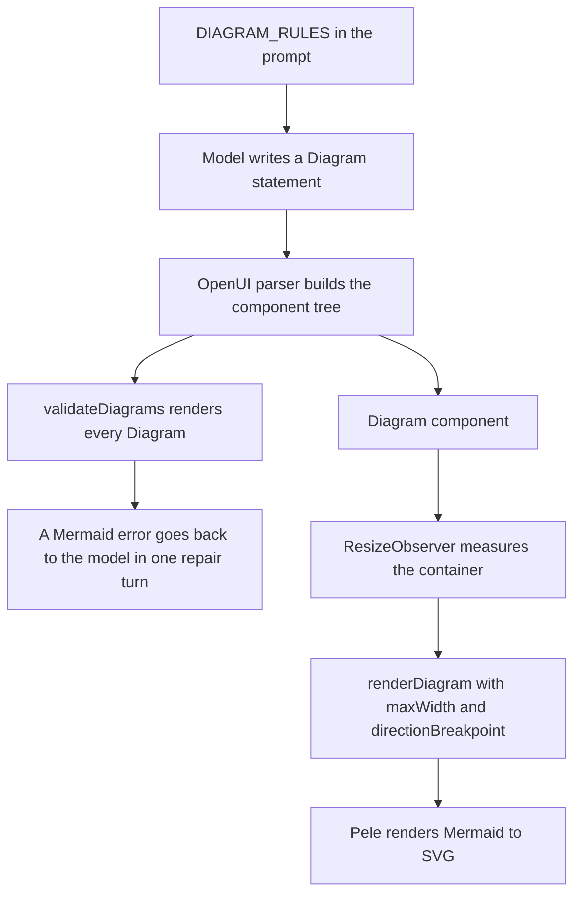
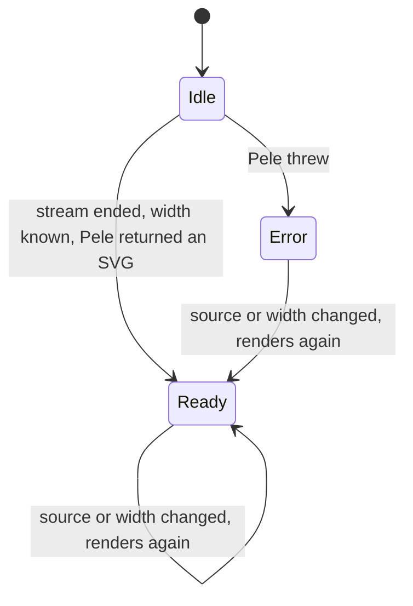

# Mermaid Diagrams via Pele

A summary may contain a `Diagram` block: Mermaid source written by the model, rendered to SVG in
the browser by [Pele](https://pele.run). Nothing about the diagram is fetched from the network and
no `eval` is involved — the model only writes text, Pele parses it and lays it out locally.

Five files own the pipeline:

| File | Responsibility |
| :--- | :--- |
| `lib/openui.ts` | The prompt rules that tell the model when and how to write Mermaid (`DIAGRAM_RULES`), and `validateDiagrams()`, which renders every diagram of a program so Mermaid errors reach the repair turn. |
| `lib/diagram.ts` | The Pele wrapper: `renderDiagram()` with the fixed render options, and `diagramError()` turning a Pele failure into a model-readable message. |
| `lib/library.tsx` | The `Diagram` component: it measures its container, calls the renderer, and shows the SVG, a placeholder or an error. |
| `lib/diagram-example.ts` | `DIAGRAM_SUMMARY_EXAMPLE`, the worked Mermaid example that is added to the prompt. |
| `assets/genui.css` | The `--pele-*` variables that give the SVG the app's colors, plus the card, caption, placeholder and error styles. |

## The pipeline



Caption: the model writes Mermaid text; one branch renders it for the reader once the width is
known, the other branch renders it again for the model so a Mermaid failure becomes a repair
request.

The two render passes are independent. The component renders for the reader; `validateDiagrams()`
renders for the model. The validation pass does not know the container width, so it only checks
whether the Mermaid parses and lays out at all.

## What the prompt demands of the model

`DIAGRAM_RULES` (`lib/openui.ts`) is injected into both the summary prompt and the Q&A prompt, so
the same constraints apply to a first summary, to a refinement turn and to a follow-up answer.

**When a diagram is allowed.** `Diagram(mermaid, caption)` is used only when the structure is
easier to see than to read: a process or workflow with four or more steps or branches, decision
logic, messages between two or more actors over time (`sequenceDiagram`), a lifecycle
(`stateDiagram-v2`), a concept map (`mindmap`), or a data model (`erDiagram`). At most one diagram
per summary, unless the source is mainly about processes. A plain list or a set of numbers must
not become a diagram — those go to `Takeaways` or to a chart — and the same steps must not appear
in both a `Diagram` and a `Timeline`.

The two prompts add their own placement rules. The summary prompt fixes the block order —
`SummaryHero → Verdict → KeyNumbers / charts / BarList / Diagram → Takeaways / ProsCons → People /
Timeline / TagBlock → Checklist → Glossary → SourceQuote → folded SectionBlock details →
FollowUpBlock` — so a diagram sits with the other visual blocks, in the metrics/charts group and
before the lists. The Q&A prompt adds a rule of its own: a question about how something works, a
process or a flow is answered with a Diagram plus one or two lines.

**How the Mermaid must look.** Four to twelve nodes, labels of one to five words, node ids without
spaces (`A`, `B`, `step1`), labels with punctuation wrapped in double quotes. No `style`,
`classDef`, `click` or `linkStyle`, no HTML, no icons and no images. `flowchart TD` is the default;
`flowchart LR` is reserved for linear flows of at most five nodes, because the app flips wide
flows to top-down on narrow screens.

**How the source is embedded.** The Mermaid lives inside an openui-lang string, so line breaks
are written as `\n` and inner double quotes are escaped as `\"`. The worked example in
`lib/diagram-example.ts` shows the whole shape — a small OAuth flowchart with a decision node,
short labels and no styling:

```ts
flow = Diagram("flowchart LR\\n  U([User]) --> A[App]\\n  A -->|redirect| P[Login provider]\\n  P --> C{Consent?}\\n  C -->|yes| T[Issue code]\\n  C -->|no| X([Cancelled])\\n  T --> A2[App swaps code for token]\\n  A2 --> D([Signed in])", "Password stays with the provider")
```

The caption is not decoration: the component description asks for "the takeaway in max 8 words",
and it is rendered as the `<figcaption>` above the SVG.

## Render options

`lib/diagram.ts` calls `renderAsync` from `pele/lazy`. The lazy entry point loads a diagram type
on first use, so a summary with only flowcharts never pays for the gantt, journey or sankey
parsers.

```ts
const BASE_OPTIONS: RenderOptions = {
  fontFamily: '"Bricolage Grotesque Variable", ui-sans-serif, system-ui, sans-serif',
  responsive: true,
  autoDirection: true,
  padding: 12,
  links: false,
  images: false,
  limit: 20_000,
};
```

- **`responsive: true`** makes Pele emit `max-width:100%; height:auto;` on the `<svg>`, so the
  diagram shrinks inside the card instead of overflowing it.
- **`autoDirection: true` plus `directionBreakpoint: 760`** is the narrow-screen flip. Pele lays
  the diagram out in its declared direction and, when the available width is below the
  breakpoint, lays it out again in the perpendicular direction and keeps the narrower result. The
  flip only applies to horizontal flowcharts (`LR`/`RL`) and only when the original layout did not
  fit. The breakpoint is set per render by the component, not by `BASE_OPTIONS`.
- **`limit: 20_000`** caps the length of the Mermaid source. A longer source is rejected by Pele
  with a `limit` error, which reaches the model like any other Mermaid error.
- **`links: false` and `images: false`** are a security decision: the model output is untrusted, so
  a diagram can contain neither a clickable link nor a remote image. Pele also escapes the text
  it paints.
- **`idPrefix`** is set per render to `dg${++counter}-`. Marker and gradient ids are therefore
  unique per render, so two diagrams on the same page cannot collide on an id and one of them
  disappear or inherit the other's gradient.

`renderDiagram(source, options)` merges `BASE_OPTIONS` with the caller's options, so the
component can add `maxWidth` and `directionBreakpoint` without restating the rest.

## The `Diagram` component lifecycle

The component lives in `lib/library.tsx` and is registered in the library with the same content
slots as the other blocks (`Card.children`, `SectionItem.content`, `TabItem.content`,
`AccordionItem.content`). Its props are `mermaid` (required string) and `caption` (optional
string); its description, shown to the model as part of the library schema, is where the
"takeaway in max 8 words" instruction for the caption comes from.



Caption: the component waits for a complete source and a known width before rendering, then
shows either the SVG or the error.

- **It waits for the stream to end.** Partial Mermaid is almost always invalid, so the render is
  skipped while `useIsStreaming()` is true. Until then the component shows the "Drawing diagram…"
  placeholder.
- **It measures itself.** A `ResizeObserver` watches the container and rounds the measured width
  down to 40px steps, so a small resize does not re-lay-out the diagram. The first non-zero
  measurement is what allows the render to start, which is why the component also renders correctly
  when it is mounted into a side panel that is still being laid out.
- **It renders with the measured width.** `renderDiagram(props.mermaid, { maxWidth: width,
  directionBreakpoint: 760 })` — the measured width is the space the diagram really has, and the
  breakpoint decides whether a horizontal flow flips to top-down.
- **It keeps three states.** The state type is `idle | ready | error`: `idle` shows the striped
  placeholder with `aria-busy="true"`, `ready` injects the SVG, and `error` shows a `<details>`
  block.
- **The SVG is the only raw HTML.** It is the one place in the block that uses
  `dangerouslySetInnerHTML`, and it comes from Pele with links and images disabled. Everything
  else — the caption, the placeholder and the failure message — is rendered as ordinary React
  elements.
- **The error is text, never markup.** The failure message can contain the diagram source, so it
  is rendered inside a `<pre>` under the "This diagram could not be drawn" summary.
- **A late result is discarded.** The effect sets a `cancelled` flag on cleanup, so a render that
  resolves after the source or the width changed does not overwrite the newer state.

## Mermaid errors reach the model

`diagramError(source)` in `lib/diagram.ts` renders the source and returns `null` when it works.
On a Pele failure it returns a message built for the model:

```ts
return `Mermaid ${e.code} error${where}: ${e.message}${snippet}`;
```

`where` is ` (line <line>, column <column>)` when Pele knows the position, and `snippet` is a
trimmed fragment of the offending source, cut to 80 characters, prefixed with ` near: `. The code
is one of Pele's own codes — `unsupported-diagram`, `syntax`, `semantic` or `limit` — so the
model can tell "I used a diagram type Pele does not know" from "the syntax is broken". A
non-Pele exception falls back to `Mermaid error: <message>`.

`validateDiagrams(program)` (`lib/openui.ts`) walks the parsed tree, collects every element of
type `Diagram` that has a string `mermaid` prop, renders each one and returns the failures. The
statement id is prepended, so the error points at the statement the model has to fix:

```
"flow": Diagram Mermaid syntax error (line 3, column 12): ...
```

The repair loop in `lib/generate.ts` merges this check with the parser check:

```ts
async function fullCheck(program: string) {
  const check = validateProgram(program);
  const diagrams = await validateDiagrams(program).catch(() => []);
  return { ok: check.ok && diagrams.length === 0, errors: [...check.errors, ...diagrams] };
}
```

A program with a broken diagram is therefore not accepted: the errors go back to the model in the
single repair turn, which is asked for the corrected statements only. The validation pass is
wrapped in `.catch(() => [])`, so a failure inside the diagram validation is treated as "no
diagram errors" rather than as a hard failure of the turn. If the repair does not make things
worse it is kept, and any remaining errors are surfaced to the user as a warning ("The model
produced N invalid UI statements; showing what rendered."). See
[OpenUI Lang Program Model and Library](../concepts/openui-lang.md) for the whole validation and
merge loop.

## Theming

Pele paints from CSS custom properties at render time, so a theme change restyles an existing
diagram without re-rendering the Mermaid. `assets/genui.css` maps the app tokens onto the Pele
variables on the `.g-diagram` element:

```css
.g-diagram {
  --pele-bg: transparent;
  --pele-fg: var(--ink);
  --pele-muted: var(--ink-2);
  --pele-surface: var(--surface);
  --pele-surface-alt: var(--accent-soft);
  --pele-border: var(--line-strong);
  --pele-line: var(--ink-3);
  --pele-accent: var(--accent);
  --pele-error: var(--down);
  --pele-critical: var(--down);
  --pele-font: var(--font-sans);
  --pele-radius: 10px;
}
```

The same rule styles the rest of the block: `.g-diagram` is a card with its own padding, border
and background; `.g-diagram__caption` is the bold reading-font line above the SVG;
`.g-diagram__pending` is the striped placeholder; `.g-diagram__error pre` prints the failure in
the `--down` color. The SVG container is centered and scrolls horizontally when the diagram is
wider than the card, and the side-panel layout reduces the card padding.

The series colors `--pele-series-1..6` are written on the app root by `appearanceVars()` in
`lib/appearance.ts` from the same chart hue array that feeds the OpenUI charts, so a diagram and a
chart in one summary share one palette. The details are in
[Inkmark Design System](../concepts/inkmark-design-system.md).

## Where to change what

| Change | File |
| :--- | :--- |
| When the model may draw a diagram, and how the Mermaid must look | `lib/openui.ts` (`DIAGRAM_RULES`) |
| The worked example that shows the model a valid diagram | `lib/diagram-example.ts` |
| Render options: security flags, size limit, fonts, direction behaviour | `lib/diagram.ts` (`BASE_OPTIONS`) |
| The message the model receives when Mermaid is invalid | `lib/diagram.ts` (`diagramError`) |
| When the diagram is rendered, how it is measured, and how failures are shown | `lib/library.tsx` (the `Diagram` component) |
| The colors of the rendered SVG | `assets/genui.css` (`.g-diagram`) and `lib/appearance.ts` |
