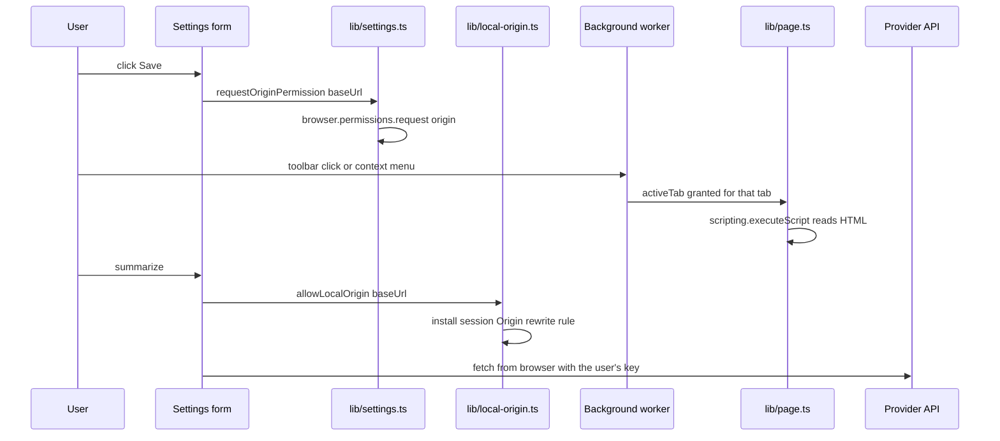

# Permissions, Privacy and Runtime Operations

This page covers the extension's *operational surface*: what the manifest declares, which code
needs each permission, the two runtime moments where host access and the local-server `Origin`
rewrite are set up, what data leaves the browser and where it is stored, and the commands used
to build, validate and package the extension.

Related reading: [Extension Surfaces and Routing](../architecture/extension-surfaces.md) for how a
trigger reaches a surface, [Storage and Session State](../architecture/storage-and-state.md) for
the persisted items, [Localization](../concepts/localization.md) for the two translation systems,
and [LLM Providers](../integrations/llm-providers.md) for the request path.

## What the manifest declares

**The browser never reads `wxt.config.ts`.** It reads the built artefact
`.output/chrome-mv3/manifest.json`, which WXT generates from the config *plus* the
`entrypoints/` folders and `public/`. The config file declares only the hand-written part of the
manifest, so reading it alone gives an incomplete picture of the extension's runtime surface.

```ts
// wxt.config.ts
manifest: {
  default_locale: 'en',
  name: '__MSG_extName__',
  description: '__MSG_extDescription__',
  permissions: [
    'storage',
    'sidePanel',
    'activeTab',
    'scripting',
    'contextMenus',
    'unlimitedStorage',
    'declarativeNetRequest',
    'favicon',
    'clipboardWrite',
  ],
  // Requested at runtime for the provider API domain (Settings → Save), so calls bypass CORS.
  optional_host_permissions: ['<all_urls>'],
  action: { default_title: '__MSG_actionTitle__' },
  commands: {
    _execute_action: { suggested_key: { default: 'Alt+Shift+S' }, description: '__MSG_commandOpen__' },
  },
}
```

### The built manifest adds the surface wiring

The built manifest at `.output/chrome-mv3/manifest.json` is a single-line JSON artefact. Beyond
what `wxt.config.ts` says, it also contains:

| Field | Value | Why it is there |
| --- | --- | --- |
| `action.default_popup` | `popup.html` | Derived from `entrypoints/popup/`, not from the config. |
| `side_panel.default_path` | `sidepanel.html` | Derived from `entrypoints/sidepanel/`. |
| `options_ui` | `{ open_in_tab: true, page: "options.html" }` | Derived from `entrypoints/options/`. |
| `background.service_worker` | `background.js` | Derived from `entrypoints/background.ts`. |
| `icons` | 16/32/48/96/128 px | Copied from `public/icon/`. |

Two consequences matter for anyone reading the config instead of the artefact:

- The **static** `default_popup` is the `tab`-mode fallback. The real behaviour is mode-dependent
  and produced at runtime: `entrypoints/background.ts` calls `browser.action.setPopup({ popup: '' })`
  in `sidepanel` mode, which clears the manifest default so the toolbar click falls through to
  `browser.action.onClicked`.
- The side-panel and options entries exist because the entrypoint folders exist. Deleting
  `entrypoints/sidepanel/` removes `side_panel` from the built manifest even though `wxt.config.ts`
  still lists the `sidePanel` permission.

### Permissions and the code that needs them

| Permission | What it is for | Where it is used |
| --- | --- | --- |
| `storage` | `chrome.storage.local` and `chrome.storage.session` | Every `storage.defineItem` in `lib/settings.ts`, `lib/history.ts`, `lib/models.ts`, `lib/pending.ts`. |
| `sidePanel` | The per-tab result panel | `browser.sidePanel.setOptions/open` in `lib/pending.ts`; `setPanelBehavior` in `entrypoints/background.ts`. |
| `activeTab` | Temporary access to the *one* tab the user acted on | Granted implicitly by the toolbar click and the context-menu click; consumed by `browser.scripting.executeScript` in `lib/page.ts`. |
| `scripting` | Injecting a function into the target tab | `extractTab()` and `highlightInTab()` in `lib/page.ts`. |
| `contextMenus` | "Summarize this page" / "Summarize selection" | `lib/context-menus.ts` (`syncContextMenus`, `parseMenuId`). |
| `unlimitedStorage` | Lifts the `chrome.storage.local` quota | Needed because history stores up to 20 sessions with full OpenUI programs in `local:history`. |
| `declarativeNetRequest` | Session rule that rewrites the `Origin` header for local servers | `allowLocalOrigin()` in `lib/local-origin.ts`. |
| `favicon` | Chrome's favicon cache for extension pages | `faviconUrl()` in `components/SessionView.tsx` (`chrome-extension://<id>/_favicon/?pageUrl=…`). |
| `clipboardWrite` | Copying a quote to the clipboard | The `CopyText` action handler in `components/SessionView.tsx` (`navigator.clipboard.writeText`). |

`optional_host_permissions: ['<all_urls>']` is **not** granted at install time. It is the pool
from which the provider's API origin is requested at runtime.

## Manifest V3 constraints the code must respect

**No remote code.** Manifest V3 forbids executing remotely hosted code in the extension. The
OpenUI React runtime ships a development-only Inspect widget that fetches its UI from
`cdn.jsdelivr.net` at runtime, which the extension's own CSP would block anyway. To keep the
bundle compliant and free of console errors, `lib/no-openui-devtools.ts` sets the library's
auto-mount flag *before* `@openuidev/react-lang` is evaluated:

```ts
(globalThis as Record<symbol, unknown>)[Symbol.for('openui.devtools.autoMount')] = true;
```

Because the flag is read when the module is first evaluated, this file has to be imported
**first** in every entrypoint — `entrypoints/app/main.tsx`, `entrypoints/popup/main.tsx`,
`entrypoints/options/main.tsx`, `entrypoints/sidepanel/main.tsx` (and the showcase harness) all
begin with `import '@/lib/no-openui-devtools';`. Reordering those imports re-enables the widget
and breaks the no-remote-code rule.

## The two runtime moments

The extension never asks for "access to everything". Host access is acquired in exactly two
places, at two different moments, each tied to a specific user action.

### Moment 1 — the provider API origin, on Save

`lib/settings.ts` turns a base URL into a Chrome match pattern and requests it:

```ts
/** Match pattern for chrome.permissions, e.g. "https://api.openai.com/*". */
export function originPattern(url: string): string | null { … }

/**
 * Asks for host permission on the provider's API origin, so the extension page can call it
 * without CORS restrictions. Call it directly inside a click handler (no await before it),
 * otherwise Chrome drops the user gesture. Resolves true right away if already granted.
 */
export function requestOriginPermission(url: string): Promise<boolean> {
  const pattern = originPattern(url);
  if (!pattern) return Promise.resolve(false);
  return browser.permissions.request({ origins: [pattern] });
}
```

`components/SettingsForm.tsx` calls it from two handlers, and in both the call is made
**synchronously** so that Chrome still sees the user gesture:

- **Save** (`onSave`) — requests the origin of the configured base URL, then writes the settings.
  If the user denies, the settings are still saved and the form shows `savedNoPermission`
  ("Saved, but permission for the API domain was denied. Requests may fail.").
- **Load models** (`onLoadClick`) — requests the origin before fetching `GET {base}/models`; on
  denial the form shows `permissionDenied`.

The `await` inside `requestOriginPermission` happens *after* `permissions.request()` has been
invoked, which is why the API resolves `true` immediately when the origin is already granted.
The invariant to preserve when editing this code: **do not insert an `await` before the
`permissions.request()` call**, or Chrome rejects the request because the user gesture has
expired.

The permission is scoped to one origin — `https://api.openai.com/*` for OpenAI — not to all
sites. It is what allows the extension page to call the provider without CORS.

### Moment 2 — the local server's `Origin` header, when a local provider is used

Local providers such as Ollama reject requests whose `Origin` is `chrome-extension://…` unless the
user sets `OLLAMA_ORIGINS`. Chrome omits `Origin` on simple GETs (so listing models works) but
always sends it on POST, which is where the summary request goes.

`lib/local-origin.ts` handles this with a *session* `declarativeNetRequest` rule that rewrites
`Origin` to the server's own origin:

```ts
condition: {
  urlFilter: `|${origin}/`,
  initiatorDomains: [browser.runtime.id],
  resourceTypes: ['xmlhttprequest', 'other'],
},
```

The rule is deliberately narrow and deliberately quiet:

- It only matches the local server's own origin (`urlFilter`), so no other destination is
  touched.
- `initiatorDomains` is restricted to this extension's own id, so a web page cannot use the rule
  to bypass the local server's origin protection.
- The rule id is a stable hash of the origin, and an in-memory `applied` set means it is
  installed **at most once per origin per browser session**; repeat calls return immediately.
- It is a *session* rule, not a persistent one, so it disappears when the browser closes.

The rule is installed lazily, right before the request that needs it: `allowLocalOrigin` is
called from `streamCompletion` in `lib/llm.ts` and from `fetchModels` in `lib/models.ts`. It only
applies to a loopback host (`localhost`, `127.0.0.1`, `0.0.0.0`, `[::1]`); for any other base URL
`isLocalUrl` returns false and the function does nothing. The host permission for the local
server itself still comes from Moment 1 (Save) — the rule only fixes the `Origin` header.

### Page access needs no prompt at all

Reading the page never uses a broad host permission. It uses `activeTab`, which Chrome grants
implicitly — without a prompt — to the tab the user interacted with:

- Clicking the toolbar icon (`browser.action.onClicked`) grants `activeTab` on the active tab.
- Clicking a context-menu item (`browser.contextMenus.onClicked`) grants `activeTab` on that tab.

The grant is what makes `lib/page.ts` able to run `browser.scripting.executeScript` against the
tab and read `document.documentElement.outerHTML`, and what lets the *result page* — a separate
tab or panel — read the original tab afterwards, because the grant outlives the popup.

`lib/page.ts` still refuses pages the browser itself blocks:

```ts
const RESTRICTED = /^(chrome|edge|about|chrome-extension|devtools|view-source):|^https:\/\/chromewebstore\.google\.com/;
```

and the popup disables its "Summarize this page" button for unreadable URLs
(`isReadableUrl`).



Caption: the two runtime setup moments — the API origin on Save and the local-server `Origin`
rewrite before the provider call — with the implicit `activeTab` grant on the trigger and the
direct browser-to-provider request that follows.

## The privacy model

**No backend.** The extension has no server of its own. `lib/llm.ts` builds an AI SDK model
pointed straight at the provider's base URL and calls it from the extension page:

```ts
export function createModel(settings: Settings) {
  const p = getActiveProvider(settings);
  const baseURL = p.resolvedBaseUrl;
  switch (p.preset.api) {
    case 'anthropic':
      return createAnthropic({ apiKey: p.apiKey, baseURL, headers: { 'anthropic-dangerous-direct-browser-access': 'true' } })(p.model);
    …
  }
}
```

The only traffic that leaves the browser is (a) the provider request, carrying the user's own key
and the extracted source text, and (b) the provider's model-list request. There is no analytics,
no telemetry and no first-party endpoint in the codebase.

**Keys stay local and are never synced.** The whole `Settings` object — including the per-provider
API keys — is stored under the `local:` prefix:

```ts
// "local:" (not "sync:") so API keys are never synced through the user's browser account.
export const settingsItem = storage.defineItem<Settings>('local:settings', {
  fallback: DEFAULT_SETTINGS,
});
```

The `local:` prefix maps to `chrome.storage.local`, which is not replicated through the user's
browser account. The Settings → Advanced tab states this to the user as well
(`locales/en/settings.json` → `advanced.privacy`: "Keys are stored only in this browser
(chrome.storage.local) and are never synced.").

**History stays local.** `lib/history.ts` keeps up to 20 sessions in `local:history`, again
`chrome.storage.local`. The **pending** request handoff is deliberately *not* durable:
`lib/pending.ts` puts queued requests in `session:requests`, `session:panelRequests` and
`session:panelUrls`, i.e. `chrome.storage.session`, which is memory-only and is cleared when the
browser closes. Large pasted or selected text therefore never travels in a URL, and it does not
outlive the browser session.

**What is sent to the model.** The source content is truncated to `settings.maxChars`
(default 60 000) before it is put into the prompt, and truncation is stated explicitly to the
model (`buildSourceMessage` adds "Note: the source was truncated to fit the context window.").

## Localization

Two separate localization systems exist, and they are easy to confuse.

### UI strings — `locales/<lang>/<namespace>.json`

| Path | Purpose |
| --- | --- |
| `locales/<lang>/common.json` | Shared actions, history, model picker. |
| `locales/<lang>/picker.json` | Start screen. |
| `locales/<lang>/popup.json` | Popup launcher. |
| `locales/<lang>/session.json` | Summary, refine, Q&A, generated-UI labels. |
| `locales/<lang>/settings.json` | Settings page. |
| `locales/<lang>/errors.json` | Error messages. |

Twelve languages ship today (`en`, `vi`, `ja`, `zh-CN`, `zh-TW`, `ko`, `es`, `fr`, `de`, `pt-BR`,
`ru`, `th`). `lib/i18n/index.ts` bundles them at **build time** with Vite's `import.meta.glob`:

```ts
const files = import.meta.glob<Record<string, unknown>>('../../locales/*/*.json', { eager: true, import: 'default' });
```

The glob is resolved by the bundler, so the JSON is inlined into the extension package and there
is no runtime fetch of a locale file. `lib/i18n/index.ts` also owns the language resolution:
`matchLanguage()` maps a BCP 47 tag to a supported language (`zh-HK`/`zh-MO`/`Hant` → `zh-TW`,
everything else `zh-*` → `zh-CN`, `pt*` → `pt-BR`), `browserLanguage()` prefers
`browser.i18n.getUILanguage()` and falls back to `navigator.languages`, and `resolveUiLanguage()`
turns the `"auto"` setting into a concrete language, falling back to English.

`lib/i18n/index.ts` deliberately has **no React dependency**, so `lib/` code and the background
worker can call `t` directly; React components get the same instance through
`<I18nextProvider>` in `components/Themed.tsx`.

### Chrome-level strings — `public/_locales/<lang>/messages.json`

This second tree holds the strings Chrome itself reads: the extension name and description
(`__MSG_extName__`, `__MSG_extDescription__`), the toolbar tooltip (`__MSG_actionTitle__`), the
keyboard-command description (`__MSG_commandOpen__`) and the context-menu titles
(`menuSummarizePage`, `menuSummarizeSelection`, read via `browser.i18n.getMessage` in
`lib/context-menus.ts`). The directory names use Chrome's underscore convention
(`pt_BR`, `zh_CN`, `zh_TW`), unlike `locales/` which uses BCP 47 hyphens.

### English is the source of truth, and its keys are type-checked

`lib/i18n/types.d.ts` augments the `i18next` module with the *English* JSON types:

```ts
declare module 'i18next' {
  interface CustomTypeOptions {
    defaultNS: 'common';
    resources: {
      common: typeof common;
      errors: typeof errors;
      picker: typeof picker;
      popup: typeof popup;
      session: typeof session;
      settings: typeof settings;
    };
  }
}
```

Because `typeof common` is the type of `locales/en/common.json`, a call such as
`t('settings:model.load')` fails to compile if the key is absent from English. So a missing
English key is a **compile error**, caught by `pnpm compile`, not a runtime surprise.

### What `pnpm check:i18n` verifies

`scripts/check-locales.mjs` compares every locale against English and fails (exit code 1) when
anything drifts. It checks:

- **Key parity** — every English key exists in the translation, and no translation contains a key
  English does not have ("unexpected key").
- **CLDR plural forms** — for a key that is pluralised in English (`_one`, `_other`, …), the
  translation must supply exactly the categories its own language needs, computed with
  `new Intl.PluralRules(lng).resolvedOptions().pluralCategories`. Russian, for example, must have
  `questions_one`, `questions_few`, `questions_many` and `questions_other`; English needs only
  `_one` and `_other`.
- **Placeholders** — the set of `{{placeholders}}` in a translation must equal the English set, so
  `{{count}}` or `{{provider}}` cannot be dropped or renamed.
- **No empty strings** — a translated value must not be blank.

A successful run prints `✓ <n> locales × <n> namespaces match English.`

## Commands and build outputs

| Command | What it does |
| --- | --- |
| `pnpm install` | Installs dependencies; the `postinstall` hook runs `wxt prepare`. |
| `pnpm dev` | Runs `wxt` — launches Chrome with the extension loaded and hot reload. |
| `pnpm compile` | `tsc --noEmit` — type-checks the whole project, including the type-checked i18n keys. |
| `pnpm build` | `wxt build` — production build. |
| `pnpm zip` | `wxt zip` — packages the build for the Chrome Web Store. |
| `pnpm check:i18n` | `node scripts/check-locales.mjs` — validates the locale folders against English. |
| `pnpm check:examples` | `tsx scripts/check-examples.ts` — validates the OpenUI Lang prompt examples and their Mermaid diagrams. |
| `pnpm check` | `pnpm compile && pnpm check:i18n && pnpm check:examples` — the full pre-commit gate. |

Firefox variants exist for the dev/build/zip trio (`pnpm dev:firefox`, `pnpm build:firefox`,
`pnpm zip:firefox`).

### What `pnpm check:examples` verifies

The summary prompt teaches the model OpenUI Lang by example, so a wrong example teaches wrong
syntax. `scripts/check-examples.ts` parses every example the prompt actually uses with the real
library and reports:

- **Parse errors** — the program is parsed with `createParser(library.toJSONSchema(), 'Card')`,
  and any `meta.errors` fails the check.
- **Unresolved and orphaned statements** — `meta.unresolved` (a reference to something that does
  not exist) and `meta.orphaned` (a statement nothing uses) are both reported.
- **Mermaid rendering** — every `Diagram` node's `mermaid` prop is extracted from the parsed tree
  and rendered with Pele; a Mermaid error fails the check.

The examples it covers are the ones embedded in the prompt: `VISUAL_SUMMARY_EXAMPLE`,
`CHART_SUMMARY_EXAMPLE`, `DIAGRAM_SUMMARY_EXAMPLE`, `REVIEW_SUMMARY_EXAMPLE`,
`NEWS_ACTORS_EXAMPLE` and the `CSV_TOOL_EXAMPLES` used for CSV sources — all referenced from
`lib/openui.ts` when the summary prompt is built. The script prints one `✓` line per example and
exits with code 1 if any example fails.

### Build outputs

`pnpm build` writes `.output/chrome-mv3/`:

```
.output/chrome-mv3/
  manifest.json      # the real manifest (see above)
  background.js      # the service worker bundle
  app.html  popup.html  options.html  sidepanel.html
  _locales/          # copied from public/_locales
  icon/              # copied from public/icon
  chunks/            # code-split JS (OpenUI renderer, pdf.js, Mermaid, icon set)
  assets/            # fonts, CSS, the pdf.js worker
```

`pnpm dev` writes the analogous `.output/chrome-mv3-dev/` tree. Both `.output/` and `.wxt/` are
git-ignored, so the built manifest is a local artefact, not a source file — which is exactly why
`wxt.config.ts` alone is an incomplete picture of the extension's permissions.

Note that the UI translations do **not** appear as loose JSON files in the output: they are
inlined into the JavaScript bundles by `import.meta.glob`. The only locale files copied verbatim
are the Chrome-level ones under `_locales/`.

## Operational checklist

- **After adding a manifest permission**: confirm it appears in `.output/chrome-mv3/manifest.json`
  after a rebuild, and that the code path that needs it is listed in the table above.
- **After adding an English UI string**: add the key to `locales/en/<namespace>.json` (the compile
  step will fail otherwise), then run `pnpm check:i18n` and fill in the new key in every other
  locale — including the plural variants that locale requires.
- **After changing a prompt example**: run `pnpm check:examples`; a broken example is a silent
  prompt regression otherwise.
- **After changing the provider flow**: remember that `requestOriginPermission` must stay inside
  a click handler, and that `activeTab` (not a host permission) is what authorises reading the
  page.
- **Before packaging**: `pnpm check && pnpm build && pnpm zip`.
