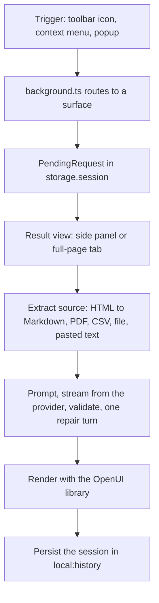

# Siftlume Code Wiki — Quickstart

This is the entry point to the code wiki for **Siftlume**, a Chrome (Manifest V3) extension that turns
a web page, a selection, pasted text or a file into a visual, interactive summary built with
[OpenUI](https://www.openui.com). The extension is branded **Siftlume** everywhere in the UI, in
`public/_locales/*/messages.json` and in the About panel — use that name, not "AI Summarizer".

Two invariants shape almost every design decision in the codebase:

- **No backend / bring your own key.** The extension calls the LLM provider the user configured,
  straight from the browser. API keys never leave `chrome.storage.local`, and nothing is sent
  anywhere except the chosen provider.
- **Appearance tokens drive everything visual.** Colors, radii, fonts and chart/diagram palettes
  are derived from the Inkmark design system, so a preset or a custom pen color changes the app
  chrome, the generated summary and the diagrams together.

Start with [Architecture Overview](architecture/overview.md) for the system-level map, then jump to
the page that owns the area you are about to change.

## Build and run it

Requirements: Node.js 20+ and [pnpm](https://pnpm.io).

```bash
pnpm install          # installs deps and runs `wxt prepare` (postinstall)
pnpm dev              # development build with hot reload, opens Chrome with the extension loaded
pnpm build            # production build → .output/chrome-mv3
```

To try the production build: open `chrome://extensions`, enable **Developer mode**, choose
**Load unpacked** and select `.output/chrome-mv3`. Then open the extension's Settings, pick a
provider, paste an API key and choose a model. Local providers (Ollama, LM Studio) work without a
key and are the cheapest way to develop.

The build is [WXT](https://wxt.dev) with the React module (`wxt.config.ts`,
`@wxt-dev/module-react`). `wxt.config.ts` also owns the manifest: permissions, the localized
`__MSG_extName__` / `__MSG_extDescription__` names, the `Alt+Shift+S` command and the optional
host permission used for the provider API domain.

| Command | What it does |
| --- | --- |
| `pnpm dev` / `pnpm dev:firefox` | Development build with hot reload |
| `pnpm build` / `pnpm build:firefox` | Production build in `.output/chrome-mv3` (`pnpm build:firefox` builds the Firefox target) |
| `pnpm zip` | Chrome Web Store package |
| `pnpm compile` | `tsc --noEmit` type-check (also type-checks i18n keys) |
| `pnpm check:i18n` | Every locale has the same keys, plural forms and placeholders as English |
| `pnpm check:examples` | The OpenUI Lang examples embedded in the prompts parse and their Mermaid renders |
| `pnpm check` | `compile` + `check:i18n` + `check:examples` — run before opening a PR |
| `pnpm screenshots` | Re-render `docs/screenshots/` from `scripts/showcase/` with headless Chrome |

## How a summary happens



Each step has its own page; the table below is the map from a task to the page that owns it.

## Repository map

```
entrypoints/          WXT surfaces — thin, they only wire the browser to the React app
  background.ts         service worker: context menus, toolbar behaviour, side-panel lifecycle
  popup/                launcher (only used in "new tab" display mode)
  app/                  result view, mounted full-page and inside the side panel
  sidepanel/            entry that mounts App with surface="panel"
  options/              settings page
components/            React UI: App view switch, SessionView, GenUI wrapper, SettingsForm
                       and its tabs, AppearancePanel, AboutPanel, ModelSwitcher, SourcePicker,
                       HistoryList, Themed, useSession / useSettings hooks
lib/                   domain modules with no React dependency
  library.tsx            OpenUI component library (chat library + Siftlume components and actions)
  openui.ts              system prompts, inline-mode parsing, validation, edit-mode merge
  generate.ts            streaming and the single bounded repair turn
  refine.ts              refine chips and standing summary styles
  extractors.ts, page.ts HTML / PDF / CSV / text extraction and reading a tab
  csv-tools.ts           in-browser Query tools over a parsed CSV
  diagram.ts             Mermaid to SVG with Pele
  llm.ts, models.ts      provider construction and live model lists
  settings.ts            provider catalogue, settings shape, config checks
  appearance.ts          Inkmark design tokens
  history.ts             sessions stored with the OpenUI Message Protocol
  pending.ts, context-menus.ts   request handoff and menu items
  local-origin.ts        Origin rewrite for local providers
  i18n/                  i18next instance, language matching, typed keys
locales/<lang>/        UI translations: one JSON file per namespace (common, picker, popup,
                       session, settings, errors); English is the source of truth
public/_locales/       Chrome-level strings: extension name, description, menu titles
assets/                app.css (app chrome), genui.css (generated summary, `g-` classes), fonts
scripts/               check-locales.mjs, check-examples.ts, screenshots.mjs, showcase/
types/                 ambient module declarations (e.g. turndown-plugin-gfm)
openwiki/              this generated code wiki
```

Two localization systems coexist on purpose: `locales/` is the i18next bundle used by the React
UI, while `public/_locales/` holds the Chrome-level strings (extension name, description, context
menu titles) that the browser itself reads.

## Task routing

Pick the row that matches what you are changing, then follow the link.

| I want to change… | Read |
| --- | --- |
| A component the model can use, the OpenUI library, the prompt rules, edit mode | [OpenUI Lang Program Model and Library](concepts/openui-lang.md) |
| A provider, its API flavour, the model list, the model cache, the Origin rewrite | [LLM Providers and Model Configuration](integrations/llm-providers.md) |
| A trigger, the popup vs toolbar behaviour, the side-panel lifecycle, URL routes | [Extension Surfaces and Routing](architecture/extension-surfaces.md) |
| The repair / validation loop, streaming, extraction, truncation, persistence | [Summary Generation](workflows/summary-generation.md) |
| Refine chips, standing styles, follow-up Q&A | [Refinement and Follow-up Questions](workflows/refinement.md) |
| Colors, tokens, presets, charts, diagram theming | [Inkmark Design System and Appearance Tokens](concepts/inkmark-design-system.md) |
| A UI string, a new language, the locale check | [Localization and Translation Workflow](concepts/localization.md) |
| A permission, the manifest, host/page access, key handling, build and packaging | [Permissions, Privacy, Checks and Runtime Operations](operations/permissions-and-privacy.md) |
| The CSV dataset, `csv_rows` / `csv_group`, browser-side filtering and grouping | [In-browser CSV Query Tools](concepts/csv-data-tools.md) |
| A Mermaid block, the Diagram component, the model-readable error format | [Mermaid Diagrams via Pele](integrations/mermaid-diagrams.md) |
| Where state is stored, what is dropped and when | [Storage and Session State](architecture/storage-and-state.md) |
| A React component or hook in `components/` | [React UI Components](architecture/ui-components.md) |
| The overall system, end-to-end flow, module ownership | [Architecture Overview](architecture/overview.md) |

## Conventions worth knowing before you edit

- **All user-facing strings go through i18next** (`t('…')`) with a key in `locales/en/*.json`.
  English keys are type-checked, so a missing English key fails `pnpm compile`. Instructions sent
  to the model stay in English; only what the user sees is translated.
- **Use the design tokens** (`--accent`, `--ink`, `--paper`, `--r-md`, `--font-reading`, …) instead
  of raw colors or radii, so presets, custom colors and dark mode keep working.
- **Manifest V3 constraints are easy to break**: no remote code (this is why OpenUI's dev widget is
  disabled in `lib/no-openui-devtools.ts`), no inline event handlers, and
  `chrome.sidePanel.open` / `chrome.permissions.request` must be called synchronously inside the
  click handler, before any `await`.
- **Model output and page HTML are untrusted**: never insert them as HTML outside a sanitizing
  renderer (the Pele diagram renderer runs with links and images disabled).
- **Prettier** with single quotes and 120 columns; one logical change per commit.

`AGENTS.md` states that `openwiki/` is optional just-in-time context rather than required startup
reading: use retrieval when a dependency's behaviour is unfamiliar, and treat the source code as
authoritative over these pages.
