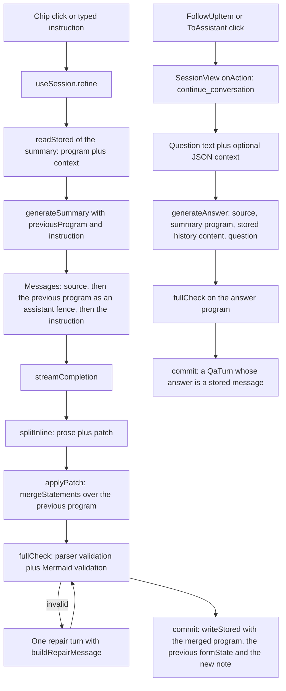

# Refinement and Follow-up Questions

Once a summary exists, the session supports two more kinds of turn:

1. **Refinement** — the user changes the summary, either with a one-click chip or with a typed
   instruction. The model runs in OpenUI **edit mode**: it sees the current program and returns
   only the changed statements, which are merged into the program that is already on screen.
2. **Follow-up Q&A** — the user asks a question about the source, either from the question box or
   by clicking a `FollowUpItem` / an `@ToAssistant` button inside the generated UI. The answer is
   an independent response (inline mode: prose, a program, or both).

Both turns are owned by `components/useSession.ts` (the controller), driven by
`components/SessionView.tsx` (the UI), and executed by `lib/generate.ts` (the turn loop). The
prompt rules live in `lib/openui.ts` and `lib/refine.ts`; the persistence contract lives in
`lib/history.ts`.

## The two turns at a glance



Caption: refinement edits the existing program in place; Q&A starts a new answer that is stored
as its own turn.

## Refinement: the edit-mode turn

### Entry points

`SessionView` offers two refinement paths, and both end in `ctrl.refine(instruction)`:

- **One-click chips.** The chip list is `REFINE_PRESETS` in `components/SessionView.tsx`:
  `['shorter', 'moreDetail', 'actionItems', 'timeline', 'simpler']`. Each chip id maps to an
  English instruction in `REFINE_PROMPTS` (`lib/refine.ts`) and to a translated label and tooltip
  (`session:refine.<id>` and `session:refineHint.<id>` in the locale files).
- **Free text.** The inline form next to the chips sends the typed text as-is; it is a
  model-facing instruction, not a UI command.

The chips only appear once a summary exists (`summary.content` is truthy), and they are disabled
while another turn is running (`busy`).

### Why the instruction stays English

`lib/refine.ts` documents the split explicitly: the prompts are *for the model*, so they stay in
English; only the labels and descriptions are translated. The chip button uses
`t(\`refine.${id}\`)` for its text and `t(\`refineHint.${id}\`)` for its tooltip, while the value
sent to the model is `REFINE_PROMPTS[id]` — an English sentence such as *"Add a checklist of
concrete action items or takeaways from the source."* A user who types a free-text instruction
gets it forwarded verbatim, in whatever language they typed it.

### What the model receives

`generateSummary` (`lib/generate.ts`) builds the message list for a refinement turn:

```ts
const messages: ModelMessage[] = [
  { role: 'user', content: `${buildSourceMessage(source, source.truncated)}\n\nSummarize this source.` },
];
if (previousProgram && instruction) {
  // Edit mode: the model sees the current merged program and returns only changed statements.
  messages.push({ role: 'assistant', content: fence(previousProgram) });
  messages.push({ role: 'user', content: instruction });
}
```

So the previous program is sent as the **last assistant message** (fenced with
`` ```openui-lang ``), and the instruction is the **last user message**. The source is still
included, so the model can check a fact before changing the summary. The summary prompt is built
with `editMode: true` and `inlineMode: true`, which is what tells the model to return only the
changed statements and at most one sentence of prose outside the fence.

### From patch to merged program

The response is split by `splitInline` into prose and code. The code is the patch, and it is
merged into the previous program with `applyPatch` (`lib/openui.ts`):

```ts
export function applyPatch(previous: string, patch: string) {
  if (!previous.trim()) return patch;
  if (!patch.trim()) return previous;
  return mergeStatements(previous, patch);
}
```

`mergeStatements` (from `@openuidev/react-lang`) merges by statement name: a statement with a
name that already exists is replaced, a new name is appended, a `null` statement deletes, and
statements that are no longer reachable from the root are garbage-collected. That is what makes
"make it shorter" or "remove the table" work without rewriting the whole program.

The merged program is then validated (`fullCheck`: parser validation plus Mermaid rendering of
every `Diagram`). If it is invalid, one repair turn is sent back to the model with
`buildRepairMessage(errors, true)`, which in edit mode asks for "only the corrected statements".
The repair is accepted only when it is **not worse** (`recheck.errors.length <= check.errors.length`);
otherwise the previous program is kept. Remaining errors become the user-visible warning
*"The model produced N invalid UI statements; showing what rendered."*

### What is stored afterwards

`useSession.refine` commits the merged program together with the **previous** `formState` and the
new prose note:

```ts
commit({
  ...current,
  summary: writeStored(res.program, { formState: context.formState, note: res.prose }),
  updatedAt: Date.now(),
});
```

`context.formState` comes from `readStored(current.summary)`, so the interactive state of the
summary (form values, `$state`) survives a refinement even though the program itself changed.
The note is the sentence the model wrote outside the fence on this turn; it replaces the previous
note.

Two UI details matter here:

- While `phase === 'refining'`, the **old program stays on screen** until the patch has been
  merged and committed, so a refinement never blanks the summary.
- If there is no program yet (an empty or prose-only summary), `refine` does not run an edit-mode
  turn at all: it falls back to `runSummary`, which regenerates the whole summary.

## Standing styles vs. refine chips

The two are easy to confuse because they overlap in name (`actionItems`, `timeline`, `simpler`
exist in both), but they work at different levels:

| | Standing styles | Refine chips |
| --- | --- | --- |
| Where | Settings → Summary → "Always include" | Buttons under the summary |
| Source of truth | `SUMMARY_STYLES` / `STYLE_RULES` in `lib/refine.ts` | `REFINE_PROMPTS` in `lib/refine.ts`, listed as `REFINE_PRESETS` in `components/SessionView.tsx` |
| Effect | Appended to the **summary prompt** as standing rules (`settings.styles.map((s) => STYLE_RULES[s])`) | Sent as a **one-off instruction** for the current summary |
| Scope | Every new summary produced with these settings | The summary that is open right now |
| Content | `actionItems`, `timeline`, `simpler` only — length has its own setting (`settings.length`) | also `shorter` and `moreDetail`, which are not available as standing styles |

The standing styles are therefore *rules the model always obeys* ("Always include a Timeline of
the key dates…"), while a chip is *a request for one change right now* ("Add a timeline…"). The
Settings hint says the same thing: *"Applied to every new summary. You can still add them later
with the buttons under a summary."*

Note that the styles reach the model through `buildSummaryPrompt`, so they apply to a refinement
turn as well (the same system prompt is used), but they are **not** part of the Q&A prompt:
`buildQaPrompt` does not include `STYLE_RULES` or the length rules.

## Follow-up Q&A

### From a click to a question

The generated UI can ask a question in three ways, all of which end up as a
`continue_conversation` action event:

- A **`FollowUpItem`** in a `FollowUpBlock` calls `triggerAction(text)` with no action plan; the
  Renderer turns that into a `continue_conversation` event whose `humanFriendlyMessage` is the
  item's text and whose `params` carry no context.
- A **button with `@ToAssistant("…")`** sends the message and, when the model supplied a
  `context` object, that context is forwarded in `params.context`.
- A **button without an action** sends its own label (equivalent to `@ToAssistant(label)`).

`SessionView`'s `onAction` handler turns the event into the question text:

```ts
case 'continue_conversation': {
  // FollowUpItem / @ToAssistant → ask as a follow-up question.
  const ctx = event.params?.context;
  const msg =
    ctx === undefined || ctx === null
      ? event.humanFriendlyMessage
      : `${event.humanFriendlyMessage}\n\nContext: ${JSON.stringify(ctx)}`;
  void ctrl.ask(msg);
  break;
}
```

So the context is **optional**: without it the question is just the human-readable message; with
it, a JSON blob is appended under a `Context:` line. The context is not sent as a separate
channel — it becomes part of the question text, which is why the model treats it as ordinary
input. (`event.formState` is also on the event, but the handler ignores it.)

The question box in the side column is the manual equivalent: it calls `ctrl.ask(question)` with
the typed text and no context.

### What the model receives

`generateAnswer` (`lib/generate.ts`) rebuilds the whole conversation from scratch on every
question:

```ts
const messages: ModelMessage[] = [
  { role: 'user', content: `${buildSourceMessage(source, source.truncated)}\n\nSummarize this source.` },
];
if (summaryProgram) messages.push({ role: 'assistant', content: fence(summaryProgram) });
for (const turn of history) {
  messages.push({ role: 'user', content: turn.question });
  // Message Protocol: the model sees only the content, never the ]]>openui: markers.
  messages.push({ role: 'assistant', content: readStored(turn.answer).content });
}
messages.push({ role: 'user', content: question });
```

Three things follow from this:

1. **The source is always re-sent.** The answer is grounded in the original source text, not
   only in the summary.
2. **The current summary is sent as an assistant message**, so the model knows what the user is
   looking at. Only the program's `content` is used — never the stored context.
3. **The stored answer history is rebuilt from content only.** `readStored(turn.answer).content`
   strips the Message Protocol markers and the stored form state, so the model never sees the
   `]]>openui:` envelope, the `formState` snapshot, or the app attribute. The protocol is a
   storage format for the renderer, not a wire format for the model.

The Q&A prompt (`buildQaPrompt`) enables `inlineMode` but not `editMode`: the answer may be
plain prose, a fenced program, or both, and it is never merged into the summary program.

### How the answer is stored and rendered

`useSession.ask` stores the raw answer of the turn as a Message Protocol message:

```ts
commit({
  ...latest,
  qa: [...latest.qa, { id: newId(), question, answer: writeStored(res.raw) }],
  updatedAt: Date.now(),
});
```

The stored answer is rendered back by the local `Answer` component in `SessionView`, which
splits it with `splitInline`: prose outside the fence goes to `MarkDownRenderer`, the fenced
program goes to `GenUI`. Each answer keeps its own renderer state, written back through
`ctrl.updateAnswerState(turn.id, …)` and persisted on a 500 ms debounce.

The stored answer is the model's raw text: prose and fenced program as they were written. The one
exception is the repair path, where `generateWithRepair` normalizes the raw answer into
`fence(program)` plus the prose before it is stored, so a repaired answer is always a well-formed
program.

## Failure and edge cases

| Situation | Behaviour |
| --- | --- |
| Provider not configured | `refine` and `ask` check `configProblem(settingsRef.current)` first and refuse to run; the message becomes the session error. |
| Another turn is running | `begin(phase)` aborts the previous request and installs a new one, so a chip click during a refinement cancels the refinement. The user can also press Stop. |
| The model answers with prose only during a refinement | `splitInline` finds no code, so the program is kept unchanged and only the note is replaced. |
| The summary comes back as prose only | The session stores an empty program with the prose as the note and warns *"The model answered with text instead of a UI."* |
| The model answers with prose only during Q&A | The turn is stored as a text answer and rendered as Markdown; no UI is produced. |
| The merged program is invalid | One repair turn; the fix is kept only if it is not worse; the remaining errors become a warning and the last valid program is kept. |
| The user asks while the summary is missing | The question is still asked: `ask` reads `readStored(current.summary).content`, which is empty, and the answer is grounded in the source alone. |

## Where to change what

| Change | File |
| :--- | :--- |
| A new refinement chip or a new standing style | `lib/refine.ts` (prompt and rule text), `components/SessionView.tsx` (`REFINE_PRESETS` for chips), and the locale files for the labels |
| The wording of the model-facing instruction | `lib/refine.ts` (`REFINE_PROMPTS`, `STYLE_RULES`) — keep them in English |
| How a click becomes a question | `components/SessionView.tsx` (`onAction`, the `continue_conversation` case) |
| What the model sees in a Q&A turn | `lib/generate.ts` (`generateAnswer`) |
| How a patch is merged into the program | `lib/openui.ts` (`applyPatch`) and the OpenUI runtime's `mergeStatements` |
| How a stored answer is turned back into a prompt | `lib/history.ts` (`readStored`) and `lib/generate.ts` |

## Related pages

<!-- openwiki: broken internal link [../architecture/storage-and-state.md] file "../architecture/storage-and-state.md" does not exist. Fix the href or restore the target, then delete this comment. -->
- [Storage and Session State](../architecture/storage-and-state.md)
- [OpenUI Lang Program Model and Library](../concepts/openui-lang.md)
- [Summary Generation](summary-generation.md)
<!-- openwiki: broken internal link [../architecture/ui-components.md] file "../architecture/ui-components.md" does not exist. Fix the href or restore the target, then delete this comment. -->
- [React UI Components](../architecture/ui-components.md)
