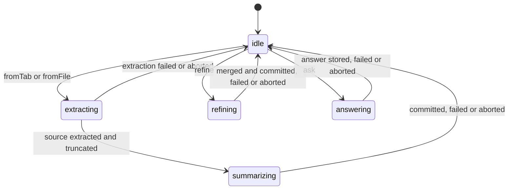
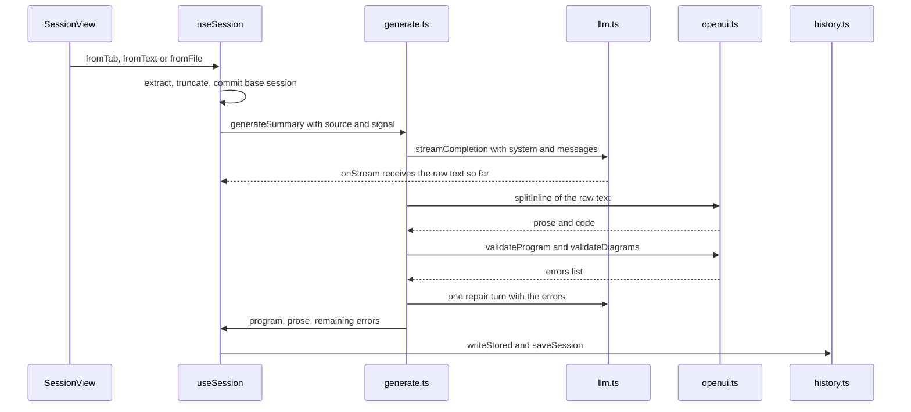

# Summary Generation

This page documents the **first** turn of a session: taking one source (a web page, a pasted
selection, a file), turning it into a prompt, streaming the model's answer, validating the
OpenUI Lang program it produced, repairing it at most once, and storing the result.

Post-summary turns — refinement (edit mode) and follow-up Q&A — are documented separately in
[Refinement and Follow-up Questions](refinement.md). The shared machinery of the program model
is in [OpenUI Lang Program Model and Library](../concepts/openui-lang.md), provider calls in
[LLM Providers and Model Configuration](../integrations/llm-providers.md), and persistence in
<!-- openwiki: broken internal link [../architecture/storage-and-state.md] file "../architecture/storage-and-state.md" does not exist. Fix the href or restore the target, then delete this comment. -->
[Storage and Session State](../architecture/storage-and-state.md).

## Who owns what

| Module | Responsibility |
| --- | --- |
| `components/useSession.ts` | The session controller: the phase state machine, the single `AbortController`, the commit of the session, and the mapping from model results to stored state. |
| `lib/extractors.ts` | Turning a page, a PDF, a CSV or a text file into an `ExtractedSource`, plus `truncate`. |
| `lib/page.ts` | Reading a browser tab (HTML injection, PDF download) and highlighting a quote back in the page. |
| `lib/openui.ts` | Prompt construction (`buildSummaryPrompt`, `buildSourceMessage`), `splitInline`, `validateProgram`, `validateDiagrams`, `buildRepairMessage`, `applyPatch`. |
| `lib/generate.ts` | The turn loop: stream → split → validate → one repair → result. |
| `lib/llm.ts` | `createModel`, `streamCompletion`, `describeError`. |
| `lib/history.ts` | The Message Protocol storage contract (`writeStored` / `readStored`) and `saveSession`. |

## From a user gesture to a pending request

A summary never starts inside the popup: the popup closes on blur, so it only *queues* the
request. The flow is:

1. The popup, the context menu ("Summarize this page" / "Summarize selection") or the side
   panel creates a `PendingRequest` (`{ type: 'tab', tabId }` or `{ type: 'text', text, … }`).
2. `queueRequest` stores it in `storage.session` under `session:requests` and returns an id;
   the result view is opened as `app.html?request=<id>` (or, in panel mode, the request is
   addressed to that tab's panel).
3. `App` consumes the route **once**, after the settings have loaded (the request needs the
   provider configuration), and calls `ctrl.fromTab(tabId)` or `ctrl.fromText(...)`.

If the id is unknown — the request was already taken, or `storage.session` was cleared when the
browser closed — `takeRequest` returns `null` and `App` shows the *request expired* error instead
of running anything. See [Extension Surfaces](../architecture/extension-surfaces.md) for the
route and panel mechanics.

## Phase state machine

`useSession` exposes a single `phase` value: `idle`, `extracting`, `summarizing`, `refining`,
`answering`. Everything the UI shows is derived from it (`busy = phase !== 'idle'` disables the
source picker, the refine chips and the question box).



Caption: the phase is a single value; every transition goes through `begin()`/`finish()` in
`components/useSession.ts`.

### The single-`AbortController` rule

`begin(phase)` aborts the controller of the previous operation, creates a new one, and returns
it. Every operation then keeps **its own** controller and only touches the UI state if that
controller is still the current one:

```ts
const begin = (p: Phase) => {
  abortRef.current?.abort();
  const ctrl = new AbortController();
  abortRef.current = ctrl;
  setError(null);
  setWarning(null);
  setStreamRaw('');
  setPhase(p);
  return ctrl;
};
```

Two guards depend on this:

- In the `finally` block, `if (abortRef.current === ctrl) finish();` — a superseded operation
  must not reset the phase of the operation that replaced it.
- In the `catch` block, `if (!ctrl.signal.aborted) setError(describeError(e, settingsRef.current))`
  — an abort is a user action, not an error, so it is not reported.

`stop()` aborts the current controller and returns the UI to `idle`; the component unmount also
aborts (`useEffect(() => () => abortRef.current?.abort(), [])`).

## Extraction per source kind

Extraction happens in `phase === 'extracting'` and produces an `ExtractedSource`
(`kind`, `title`, `origin`, `content`, and for CSV also the parsed `dataset`).

| Kind | Path | What is extracted |
| --- | --- | --- |
| `webpage` | `htmlToMarkdown` (`lib/extractors.ts`) | The tab HTML is parsed with `DOMParser`; a `<base href>` is prepended so Readability resolves relative links. `Readability(doc).parse()` yields the article; it is converted with Turndown (`headingStyle: 'atx'`, `codeBlockStyle: 'fenced'`) plus the **GFM plugin**, which keeps `<table>` elements as Markdown tables — the main source of numbers for charts. `script`, `style`, `noscript`, `iframe`, `form`, `nav` and `footer` are removed. If Readability finds no article, the body text is used as a fallback. |
| `pdf` | `extractPdf` | `pdfjs-dist` is imported dynamically (so the library is only loaded when needed); every page's text items are concatenated with `--- Page N ---` separators, so the model can cite page numbers. A PDF tab is fetched and parsed; an uploaded PDF is read from the `File`. |
| `csv` | `extractCsv` | Papa Parse with `header: true`. The **whole file is not sent**: the prompt receives the row count, the column list, the detected numeric columns, per-column statistics (min/max/mean for numeric columns, distinct count and the most common values for text columns) and a Markdown table of the first 30 rows. The parsed rows (at most `MAX_CSV_ROWS = 5000`) are kept separately in `source.csv` so the in-browser `Query` tools can run against them later. |
| `markdown` | `extractFile` | The file text is passed through unchanged. |
| `text` | `extractFile` | The file text is passed through unchanged (`.txt`, `.json`, `.log`, `.xml`, `.yaml`, `.yml`, anything with a `text/` MIME type). Pasted text and context-menu selections also arrive as `text`. |
| `webpage` from a file | `extractFile` | An uploaded `.html`/`.htm` file goes through the same Readability + Turndown path with the URL `about:blank`. |

A file type that matches nothing throws `errors:file.unsupported`. A tab whose URL the browser
does not let extensions read (`chrome://`, the Web Store, …) is rejected by `isReadableUrl`
before any injection; a tab without text fails with `errors:page.noText`.

## Truncation and the `maxChars` flag

The source content is cut to the configured budget before it ever reaches the prompt:

```ts
export function truncate(content: string, maxChars: number): { content: string; truncated: boolean } {
  if (content.length <= maxChars) return { content, truncated: false };
  return { content: content.slice(0, maxChars), truncated: true };
}
```

`settings.maxChars` (default `60_000`) is applied in `start()`. The `truncated` flag travels with
the source in the session and is **sent to the model** as part of `buildSourceMessage`:

```
Source type: webpage
Title: …
Origin: …
Note: the source was truncated to fit the context window.

<source>
…
</source>
```

The user also sees a hint in the session header ("Long content: only the beginning was sent
(the limit is in Settings)"). Truncation is a plain head cut — no word or page boundary is
respected.

## The session is committed before the first model call

`start()` builds the base session and commits it **before** the first call to the model:

```ts
const { content, truncated } = truncate(src.content, settingsRef.current.maxChars);
const source = { ...src, content, truncated };
const base: Session = { id: newId(), createdAt: now, updatedAt: now, source, summary: null, qa: [] };
commit(base);
await runSummary(source, base);
```

`commit` writes to the in-memory ref, to React state and to `local:history`. The consequence is
an intentional invariant: **an interrupted or failed summary still leaves a history entry**
(with `summary: null`), so the user never loses the extracted source. When such a session is
reopened, `open()` finishes it:

```ts
// A session saved before its summary finished (e.g. the tab was closed): finish it now.
if (!s.summary && !configProblem(settingsRef.current)) void runSummary(s.source, s);
```

## Prompt composition

`buildSummaryPrompt(settings, source)` (`lib/openui.ts`) has two parts.

**The cached library base.** `library.prompt(...)` renders the component library, its examples
and the shared rules. It is cached per `summary:<kind>:<hasCsv>` in a module-level
`Map`, so the expensive part is built once per source kind. The CSV tools are only enabled when
there is data to query (`toolOptions`): `tools`, `toolExamples`, `toolCalls` and `bindings` are
added only for a CSV source with a parsed dataset, which keeps the prompt lean otherwise. The
prompt is built with `editMode: true` and `inlineMode: true`, and the examples include the
visual, chart and diagram summaries.

**The per-turn rules.** The rule list is assembled from the settings and the source kind:

- `VISUAL_RULES` — the visual-first contract (SummaryHero first, KeyNumbers, Takeaways, …).
- `CHART_RULES` — how to pick a chart from the data shape, and the "data must come from the
  source, never estimated" constraint.
- `DIAGRAM_RULES` — when a Mermaid `Diagram` is allowed, and the Mermaid syntax limits.
- `LENGTH_RULES[settings.length]` — `short`, `medium` or `detailed`.
- `settings.styles.map(s => STYLE_RULES[s])` — the standing styles from Settings.
- `layoutRule(settings)` — `tab` (~800px) or `sidepanel` (~400px) constraints.
- `KIND_RULES[source.kind]` — per-kind instructions, e.g. "the source is a CSV dataset, use
  `Query("csv_group", …)` instead of hard-coding numbers".
- The output order, the "first turn returns the complete program in one fence" instruction, and
  the user rules (output language, `settings.customInstructions`).

The Q&A prompt (`buildQaPrompt`) is a separate, smaller rule set — see
[Refinement and Follow-up Questions](refinement.md).

## The generation turn



Caption: the turn streams once, validates, and may spend exactly one extra call on a repair.

### Streaming

`streamCompletion` (`lib/llm.ts`) builds the AI SDK model for the active provider, asks for the
host permission to be allowed (`allowLocalOrigin` rewrites the `Origin` header for local
servers such as Ollama), and streams with `streamText`. Every delta is appended to the
accumulated text and passed to `onStream`, which the controller stores in `streamRaw`.

`streamRaw` is not decoration: `SessionView` runs `splitInline(ctrl.streamRaw)` on it while
`phase === 'summarizing'` and renders the code part, so the summary appears while it is still
being written. Errors raised inside the stream are captured by `onError` and re-thrown after the
loop, so a mid-stream failure is still an error.

### `splitInline`

Inline mode means the answer can be prose, a program, or both. `splitInline` splits the raw text
into `prose` (rendered as Markdown) and `code` (the OpenUI Lang program). It works while
streaming, with an unclosed fence. Two fallbacks keep a sloppy model usable:

- No fence at all but the first non-empty line looks like a statement (`name = …`) → the whole
  text is treated as code.
- A fence that contains no statement at all → the text is given back to the prose.

Fences with another tag (e.g. ` ```ts `) stay in the prose.

### Validation

`fullCheck` combines two checks:

- `validateProgram` parses the program with the OpenUI parser. It reports the parser errors,
  adds *"No root component. The program must define `root = Card([...])`"* when there is no
  root, and lists unresolved references. The messages are written so they can be sent back to
  the model unchanged.
- `validateDiagrams` walks the parsed tree, finds every `Diagram` node and renders its Mermaid
  source with Pele (`lib/diagram.ts`). A Mermaid syntax error becomes an LLM-readable string
  with the error code, the line and column and a short snippet.

### The bounded repair loop

If the program is invalid, **exactly one** repair turn is sent: the original assistant message,
followed by a user message built by `buildRepairMessage(errors, editMode)` that lists the errors
and asks for the corrected statements. The repair is not streamed to the UI (`onText: () => {}`),
so the user keeps seeing the first attempt while it runs.

The fix is kept only if it does **not** make things worse:

```ts
const recheck = await fullCheck(candidate);
// Keep the fix only if it is not worse.
if (recheck.errors.length <= check.errors.length) {
  program = candidate;
  check = recheck;
}
```

If the repair is rejected, the last valid program is kept and the remaining errors are surfaced
as a warning (*"The model produced N invalid UI statements; showing what rendered."*). There is
no second repair turn: the loop is bounded by design, so a model that keeps producing broken
programs cannot loop the extension.

### Prose-only answers

If the model answered with plain text and no program, `res.program` is empty and `res.prose`
holds the text. The controller stores the note and shows the warning *"The model answered with
text instead of a UI."* Nothing is validated in this case — there is no program to validate.

### Persistence of the result

The program and the note are stored with the OpenUI Message Protocol:

```ts
commit({
  ...base,
  summary: writeStored(res.program, { note: res.prose }),
  updatedAt: Date.now(),
});
```

`writeStored` (`lib/history.ts`) calls `buildMessage` with the content and a context object
(`note`, `formState`), and `readStored` parses it back with `parseMessage`. The stored message
can be handed to the Renderer directly; only its `content` is ever sent back to the model.
`saveSession` puts the session at the front of `local:history` and keeps at most 20 sessions.

## Failure modes

| Situation | Detected by | What the user sees | Session state |
| --- | --- | --- | --- |
| Missing or invalid provider configuration (base URL, API key, model) | `configProblem(settings)` before every model turn (`start`, `refine`, `resummarize`, `ask`) | An error banner with a link to Settings. | For a **new** summary the session is not created at all (`start` returns before `commit`). For an existing session the session is kept untouched. |
| Provider or network failure (401, 403, 404, 429, unreachable host) | `describeError(err, settings)` maps the status code to a short message | A specific error banner: key rejected, access denied, model not found, rate limited, network/CORS/permission problem, or the local-server hint for a 403 on `localhost`. | The session stays in history with `summary: null`; reopening it retries the summary. |
| The user pressed Stop (or a new operation superseded this one) | `ctrl.signal.aborted` | Nothing — an abort is not an error. | The phase returns to `idle`; the partial program is **not** committed, so the session keeps `summary: null`. |
| The model answered with prose instead of a program | `!res.program && res.prose` | The warning *"The model answered with text instead of a UI."* | The note is stored; the program is empty. |
| The program is still invalid after the single repair turn | `res.errors.length > 0` | The warning *"The model produced N invalid UI statements; showing what rendered."* | The last valid program (before or after the repair) is stored; the Renderer shows what it can render. |
| The pending request is gone (already taken, or `storage.session` was cleared) | `takeRequest` / `takePanelRequest` return `null` | The error *"This request has expired. Start again from the extension icon."* | No session is created. |

## Operational notes

- **Re-running a summary.** `resummarize()` (the "Summarize again" button) starts the same source
  from scratch — useful after switching model. The previous summary stays on screen until the
  new statements arrive, and the questions and answers are kept.
- **Streaming vs. stored.** While `phase === 'summarizing'` the UI renders the streamed code;
  after the commit it renders the stored message, so the `$state` and form values of the
  summary survive a refresh.
- **The `note`.** The sentence the model wrote outside the fence is stored as the message
  context and shown under the summary when no operation is running.

## Related pages

- [Refinement and Follow-up Questions](refinement.md) — the two post-summary turns.
- [OpenUI Lang Program Model and Library](../concepts/openui-lang.md) — the program model,
  the prompt and the parser.
- [LLM Providers and Model Configuration](../integrations/llm-providers.md) — provider calls,
  keys, permissions and error mapping.
<!-- openwiki: broken internal link [../architecture/storage-and-state.md] file "../architecture/storage-and-state.md" does not exist. Fix the href or restore the target, then delete this comment. -->
- [Storage and Session State](../architecture/storage-and-state.md) — where sessions live and
  how the Message Protocol is persisted.
- [Extension Surfaces](../architecture/extension-surfaces.md) — how a request reaches the
  result view.
